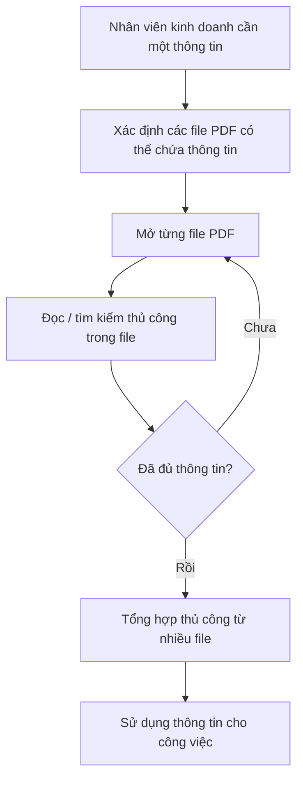
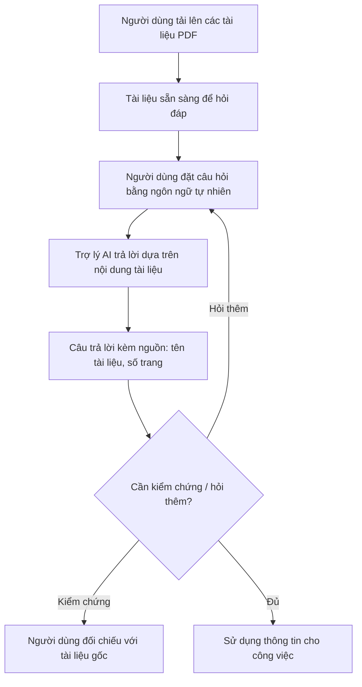

# Tài liệu Yêu cầu Nghiệp vụ (BRD) — Công cụ "Chat với tài liệu" (MVP)

> **Chuẩn áp dụng:** IEEE 29148-2018
> **Giai đoạn SDLC:** Phase 2 — Requirements (Agentic SDLC)
> **Prompt nguồn:** [BRD_Elicitation_Prompt_IEEE_standard.md](../prompts/BRD_Elicitation_Prompt_IEEE_standard.md), [BRD_Prompt_IEEE_standard.md](../prompts/BRD_Prompt_IEEE_standard.md)
> **Đầu vào Phase 1:** [intent.md](../01-intake/intent.md), [stakeholders.md](../01-intake/stakeholders.md), [glossary.md](../01-intake/glossary.md)
> **Kết quả audit:** [BRD_checklist_audit.md](BRD_checklist_audit.md)

---

## 0. Tóm tắt kiểm tra đầu vào (Validation summary)

### 0.1 Đầu vào đã nhận

| Source ID | Nguồn | Loại | Chủ sở hữu | Ngày / Phiên bản | Nội dung chứng minh |
|---|---|---|---|---|---|
| SRC-001 | Yêu cầu của quản lý (mục 2.1 của prompt BRD) | Sponsor brief (mô tả ngắn) | Quản lý dự án (chưa nêu tên) | 2026-10-27 / v1.0 | Vấn đề nghiệp vụ (khó nắm bắt nhiều PDF, tốn thời gian tổng hợp), mục tiêu MVP (web app, upload PDF, chat với AI), cho phép BA đề xuất thêm tính năng |
| SRC-002 | Đề xuất của đội BA trong quá trình soạn BRD | Phân tích BA | Đội BA | 2026-10-27 | Các tính năng bổ sung (trích dẫn nguồn, lịch sử hội thoại, tóm tắt, phản hồi chất lượng câu trả lời) — **chưa được quản lý phê duyệt** |
| SRC-003 | IEEE 29148-2018 | Tiêu chuẩn | IEEE | 2018 | Quy tắc chất lượng yêu cầu |

### 0.2 Thông tin còn thiếu

- Tên tổ chức, tên executive sponsor, business owner (khối Fill-In ở mục 8 của prompt còn trống).
- Số liệu nền (baseline): số lượng tài liệu PDF, số người dùng, thời gian trung bình hiện nay để tìm một thông tin.
- Mục tiêu định lượng (target) và mốc thời gian MVP, ngân sách.
- Chính sách bảo mật / phân loại dữ liệu của tài liệu kinh doanh; việc có được phép gửi nội dung tài liệu tới dịch vụ AI bên ngoài hay không.
- Không có phỏng vấn người dùng cuối (đội phát triển kinh doanh) hay mô tả quy trình hiện tại.

### 0.3 Ba rủi ro lớn nhất đối với chất lượng yêu cầu

1. **Thiếu baseline và target định lượng** → các mục tiêu BO-001..BO-003 chưa thể kiểm chứng (OQ-003, OQ-004, OQ-005).
2. **Chưa rõ ràng buộc bảo mật dữ liệu** → có thể làm thay đổi phạm vi giải pháp (OQ-006, OQ-007, RSK-002).
3. **Chỉ có một nguồn bằng chứng (SRC-001) dạng ngắn gọn** → nhu cầu của người dùng cuối mới là suy luận, cần xác nhận qua phỏng vấn (OQ-002).

---

## 1. Kiểm soát tài liệu (Document control)

| Mục | Giá trị |
|---|---|
| Tiêu đề | BRD — Công cụ "Chat với tài liệu" (MVP) |
| Mã tài liệu | BRD-CWD-001 |
| Phiên bản | 0.2 |
| Trạng thái | Draft — đề nghị baseline có điều kiện (chờ PO ký) |
| Tác giả | Đội BA (minhtrungle) |
| Người đóng góp | [TBD: OQ-001] |
| Người review | Quản lý dự án; Đại diện đội phát triển kinh doanh; Trưởng nhóm kỹ thuật [TBD: OQ-001] |
| Người phê duyệt | Executive sponsor [TBD: OQ-001] |
| Phân loại bảo mật | Nội bộ (Internal) |

### Lịch sử phiên bản

| Phiên bản | Ngày | Tác giả | Tóm tắt thay đổi |
|---|---|---|---|
| 0.1 | 2026-10-27 | Đội BA | Bản nháp đầu tiên dựa trên SRC-001 |
| 0.2 | 2026-10-28 | Agent (Claude) | Thêm tuyên bố tầm nhìn (§2.1), yêu cầu phi chức năng mức nghiệp vụ BR-024..BR-028 (§7.6), giá trị mặc định đề xuất cho câu hỏi mở (§12.1), tham chiếu persona PRD; xử lý các mục "Chưa đạt" trong checklist IEEE 29148 |

### Danh sách phân phối

| Người nhận | Mục đích |
|---|---|
| Quản lý dự án (sponsor) | Review & phê duyệt |
| Đội phát triển kinh doanh | Xác nhận nhu cầu |
| Đội kỹ thuật / phát triển | Đánh giá tính khả thi, làm đầu vào cho PRD/SRS |
| Bộ phận IT / Bảo mật | Review ràng buộc dữ liệu |

---

## 2. Tóm tắt điều hành (Executive summary)

### 2.1 Tuyên bố tầm nhìn

> *Mọi thành viên đội phát triển kinh doanh có thể hỏi bộ tài liệu dự án như hỏi một đồng nghiệp nắm rõ hồ sơ, và nhận câu trả lời có nguồn để kiểm chứng trong vài giây thay vì vài chục phút.*

Tầm nhìn này gắn với mục tiêu tổ chức là tăng năng suất đội kinh doanh và giảm rủi ro quyết định dựa trên thông tin thiếu (BO-001, BO-002).

### 2.2 Tóm tắt

**Vấn đề:** Đội phát triển kinh doanh phải làm việc với nhiều tài liệu PDF của dự án và khó nắm bắt đầy đủ nội dung. Mỗi lần cần một thông tin, họ phải mở và tổng hợp thủ công từ nhiều file, gây tốn thời gian (SRC-001). Mức độ tác động định lượng hiện chưa được đo [TBD: OQ-003].

**Thay đổi đề xuất:** Xây dựng một MVP dạng ứng dụng web cho phép người dùng tải lên các tài liệu PDF và đặt câu hỏi bằng ngôn ngữ tự nhiên; trợ lý AI trả lời dựa trên nội dung của các tài liệu đã tải lên, kèm chỉ dẫn nguồn để người dùng kiểm chứng (SRC-001, SRC-002).

**Lợi ích kỳ vọng:**
- Giảm thời gian tìm kiếm và tổng hợp thông tin từ tài liệu (MET-001).
- Tăng tỷ lệ câu hỏi được trả lời chính xác, có nguồn kiểm chứng (MET-002).
- Người dùng mục tiêu sử dụng công cụ thường xuyên (MET-003).

**Đầu tư, tiến độ, rủi ro chính:** Ngân sách và tiến độ chưa xác định [TBD: OQ-008, OQ-009]. Rủi ro chính: AI trả lời sai/bịa thông tin (RSK-001), lộ dữ liệu kinh doanh (RSK-002), chất lượng trích xuất PDF scan/bảng biểu kém (RSK-004).

**Quyết định cần phê duyệt:** Phê duyệt phạm vi MVP tại mục 5 và các yêu cầu mức **Must** tại mục 7, đồng thời chỉ định người chịu trách nhiệm trả lời các câu hỏi mở tại mục 12.

---

## 3. Bối cảnh nghiệp vụ và phát biểu vấn đề

### 3.1 Quy trình hiện tại (As-is)

Nguồn: suy ra từ SRC-001 — chi tiết các bước **[Unverified]**, cần xác nhận qua phỏng vấn người dùng (OQ-002).

### 3.2 Quy trình đề xuất (To-be, mức nghiệp vụ)

### 3.3 Ai bị ảnh hưởng và như thế nào

| Đối tượng | Ảnh hưởng | Bằng chứng |
|---|---|---|
| Đội phát triển kinh doanh | Tốn thời gian tìm và tổng hợp thông tin; có nguy cơ bỏ sót thông tin do không nắm hết tài liệu | SRC-001 |
| Quản lý dự án | Năng suất của đội giảm; quyết định có thể dựa trên thông tin chưa đầy đủ | SRC-001 (suy luận) **[Unverified]** |

### 3.4 Chi phí nếu không hành động

- **Chi phí thời gian:** số giờ/tuần dành cho việc tìm kiếm thủ công [TBD: OQ-003].
- **Rủi ro chất lượng:** bỏ sót hoặc dùng sai thông tin trong tài liệu kinh doanh **[Unverified]**.
- Chưa có số liệu doanh thu/chi phí liên quan [TBD: OQ-003].

### 3.5 Nguyên nhân gốc và triệu chứng

| Triệu chứng | Nguyên nhân gốc |
|---|---|
| Tìm một thông tin mất nhiều thời gian | Thông tin phân tán trong nhiều file PDF, không có điểm truy cập tập trung theo nội dung |
| Không nắm bắt đầy đủ tài liệu | Khối lượng tài liệu lớn so với thời gian đọc của người dùng [Unverified — OQ-004] |
| Phải tổng hợp thủ công | Không có công cụ trả lời câu hỏi xuyên suốt nhiều tài liệu |

### 3.6 Vì sao làm bây giờ

Quản lý đã đưa ra yêu cầu phát triển MVP (SRC-001). Tác nhân thúc đẩy cụ thể và mức độ khẩn cấp (deadline, sự kiện kinh doanh) chưa được nêu [TBD: OQ-009].

---

## 4. Động lực nghiệp vụ và mục tiêu

| ID | Động lực nghiệp vụ | Mục tiêu (kết quả) | Metric ID | Baseline | Target | Thời hạn | Nguồn |
|---|---|---|---|---|---|---|---|
| BO-001 | Tốn thời gian tìm thông tin trong nhiều PDF | Giảm thời gian để người dùng có được một thông tin cần thiết từ tài liệu dự án | MET-001 | [TBD: OQ-003] | [TBD: OQ-005] | [TBD: OQ-009] | SRC-001 |
| BO-002 | Khó nắm bắt đầy đủ nội dung tài liệu | Người dùng nhận được câu trả lời đúng với nội dung tài liệu và có thể kiểm chứng nguồn | MET-002 | Không áp dụng (chưa có công cụ) | [TBD: OQ-005] | [TBD: OQ-009] | SRC-001, SRC-002 |
| BO-003 | Chứng minh giá trị của MVP | Người dùng mục tiêu chấp nhận và sử dụng công cụ trong công việc | MET-003 | 0 (chưa có công cụ) | [TBD: OQ-005] | [TBD: OQ-009] | SRC-001 |

### Định nghĩa chỉ số

| ID | Định nghĩa | Công thức | Nguồn dữ liệu | Chủ sở hữu | Tần suất | Ngày baseline |
|---|---|---|---|---|---|---|
| MET-001 | Thời gian trung bình để tìm được câu trả lời cho một câu hỏi nghiệp vụ từ bộ tài liệu dự án | Tổng thời gian tìm kiếm / số câu hỏi trong bộ câu hỏi chuẩn | Bài đo bấm giờ với bộ câu hỏi chuẩn, trước và sau MVP | Quản lý dự án | Một lần trước MVP, một lần khi nghiệm thu | [TBD: OQ-003] |
| MET-002 | Tỷ lệ câu trả lời đúng và trích dẫn đúng nguồn | Số câu trả lời được người kiểm định đánh giá "đúng" / tổng số câu hỏi trong bộ câu hỏi chuẩn × 100% | Bộ câu hỏi chuẩn có đáp án do đội kinh doanh soạn (DEP-002) | Đội BA + Đội kinh doanh | Mỗi lần nghiệm thu | Không áp dụng |
| MET-003 | Số người dùng hoạt động hàng tuần | Số người dùng khác nhau đặt ít nhất 1 câu hỏi trong tuần | Thống kê sử dụng của công cụ | Quản lý dự án | Hàng tuần | Ngày go-live |

---

## 5. Phạm vi

### 5.1 Trong phạm vi (MVP)

- Tải lên tài liệu định dạng PDF và quản lý danh sách tài liệu đã tải lên (SRC-001).
- Hỏi đáp bằng ngôn ngữ tự nhiên trên nội dung **tất cả** tài liệu đã tải lên (SRC-001).
- Câu trả lời có chỉ dẫn nguồn (tên tài liệu, số trang) (SRC-002).
- Hội thoại nhiều lượt có ngữ cảnh trong một phiên (SRC-002).
- Hỗ trợ câu hỏi và câu trả lời bằng tiếng Việt (SRC-002) [ngôn ngữ khác: OQ-010].
- Kênh: ứng dụng web (SRC-001).
- Người dùng: đội phát triển kinh doanh của dự án (SRC-001).

### 5.2 Ngoài phạm vi

| Hạng mục | Lý do |
|---|---|
| Định dạng khác PDF (Word, Excel, PowerPoint, ảnh) | SRC-001 chỉ yêu cầu PDF |
| Chỉnh sửa nội dung tài liệu PDF | Không thuộc mục tiêu hỏi đáp |
| Ứng dụng di động native | SRC-001 chỉ định ứng dụng web |
| Tích hợp với hệ thống lưu trữ tài liệu khác (Drive, SharePoint…) | Vượt phạm vi MVP |
| Sinh tài liệu mới (báo cáo, email) từ câu trả lời | Vượt phạm vi MVP |

### 5.3 Hoãn sang giai đoạn sau

| Hạng mục | Lý do hoãn |
|---|---|
| Phân quyền chi tiết theo nhóm / tài liệu | Phụ thuộc chính sách bảo mật chưa rõ (OQ-007) |
| Hỗ trợ PDF dạng ảnh scan (OCR) | Phụ thuộc kết quả xác nhận ASM-001 |
| Lưu lịch sử hội thoại lâu dài giữa các phiên | Mức Could; đánh giá sau MVP |

### 5.4 Ranh giới

Sáng kiến bắt đầu từ khi người dùng có file PDF trong tay và kết thúc khi người dùng nhận được câu trả lời có nguồn. Việc thu thập, tạo lập, phê duyệt tài liệu PDF nằm ngoài sáng kiến.

---

## 6. Các bên liên quan và nhu cầu

| ID | Bên liên quan | Vai trò | Mối quan tâm | Ảnh hưởng | Nhu cầu | Nguồn |
|---|---|---|---|---|---|---|
| STK-001 | Quản lý dự án | Người yêu cầu / sponsor của MVP | MVP chứng minh được giá trị, đúng tiến độ | Cao | SN-001, SN-002 | SRC-001 |
| STK-002 | Đội phát triển kinh doanh | Người dùng cuối | Tìm thông tin nhanh, chính xác, tin cậy được | Cao | SN-003, SN-004, SN-005, SN-006 | SRC-001 |
| STK-003 | Đội BA | Đề xuất tính năng, quản lý yêu cầu | Yêu cầu rõ ràng, truy vết được | Trung bình | SN-007 | SRC-001 |
| STK-004 | Đội phát triển (kỹ thuật) | Xây dựng MVP | Phạm vi khả thi, ràng buộc rõ | Trung bình | SN-008 | SRC-001 (suy luận) |
| STK-005 | Bộ phận IT / Bảo mật | Bảo vệ dữ liệu doanh nghiệp — **có thể chặn triển khai** | Tài liệu kinh doanh không bị lộ | Cao | SN-009 | **[Unverified]** — OQ-006 |
| STK-006 | QA | Kiểm thử và nghiệm thu | Test plan, bộ câu hỏi chuẩn, launch gate | Trung bình | SN-008 | [stakeholders.md](../01-intake/stakeholders.md) |

> Hồ sơ người dùng chi tiết (persona Linh, Hùng, Mai) nằm ở [PRD §2.1](../03-analysis/PRD.md#21-persona).

### Nhu cầu chi tiết

| ID | Bên liên quan | Phát biểu nhu cầu | Vấn đề hiện tại | Bằng chứng | Ưu tiên |
|---|---|---|---|---|---|
| SN-001 | STK-001 | Có một MVP chạy được để đánh giá giá trị của việc hỏi đáp trên tài liệu | Chưa có công cụ | SRC-001 | Must |
| SN-002 | STK-001 | Đo được hiệu quả của công cụ so với cách làm hiện tại | Không có số liệu | SRC-001 (suy luận) | Should |
| SN-003 | STK-002 | Đưa các tài liệu PDF của dự án vào một nơi để hỏi đáp | Tài liệu phân tán | SRC-001 | Must |
| SN-004 | STK-002 | Hỏi một câu và nhận câu trả lời tổng hợp từ nhiều tài liệu | Tổng hợp thủ công tốn thời gian | SRC-001 | Must |
| SN-005 | STK-002 | Tin cậy được câu trả lời — biết thông tin lấy từ đâu | AI có thể trả lời sai **[Unverified]** | SRC-002 | Must |
| SN-006 | STK-002 | Hỏi tiếp, làm rõ mà không phải lặp lại ngữ cảnh | — | SRC-002 | Should |
| SN-007 | STK-003 | Có thể bổ sung tính năng gia tăng giá trị (tóm tắt, phản hồi chất lượng) | — | SRC-001 | Could |
| SN-008 | STK-004 | Phạm vi và tiêu chí nghiệm thu rõ ràng để ước lượng | Thông tin đầu vào còn thiếu | SRC-001 (suy luận) | Must |
| SN-009 | STK-005 | Chỉ người được phép mới truy cập được tài liệu và câu trả lời | — | **[Unverified]** — OQ-006 | Must |

---

## 7. Yêu cầu nghiệp vụ

**Quy ước động từ:** **phải** = *shall* (bắt buộc); **nên** = *should* (mong muốn); **có thể** = *may* (cho phép).
**Ưu tiên:** Must / Should / Could / Won't (MoSCoW).

### 7.1 Quản lý tài liệu

| ID | Yêu cầu | Lý do | Nguồn | Ưu tiên | AC | Phương pháp kiểm chứng | Trạng thái |
|---|---|---|---|---|---|---|---|
| BR-001 | Người dùng **phải** có khả năng tải lên một hoặc nhiều tài liệu PDF, mỗi tài liệu có dung lượng tối đa [TBD: OQ-011] MB. | Đưa tài liệu vào phạm vi hỏi đáp | BO-001 / SN-003 | Must | AC-001 | Test | Draft |
| BR-002 | Khi tải lên một tệp không phải PDF hoặc vượt giới hạn dung lượng, người dùng **phải** nhận được thông báo nêu rõ lý do tệp bị từ chối. | Tránh người dùng nhầm tưởng tài liệu đã sẵn sàng | SN-003 | Must | AC-002 | Test | Draft |
| BR-003 | Người dùng **phải** biết được khi nào một tài liệu đã tải lên sẵn sàng để hỏi đáp. | Tránh hỏi khi tài liệu chưa được xử lý xong | SN-003, SN-005 | Must | AC-003 | Demonstration | Draft |
| BR-004 | Người dùng **phải** xem được danh sách tài liệu đã tải lên, gồm tên tài liệu và thời điểm tải lên. | Biết được phạm vi tri thức mà AI đang dùng | SN-003 | Must | AC-004 | Demonstration | Draft |
| BR-005 | Người dùng **phải** có khả năng xóa một tài liệu đã tải lên. | Loại bỏ tài liệu sai, lỗi thời | SN-003 | Should | AC-005 | Test | Draft |
| BR-006 | Sau khi một tài liệu bị xóa, câu trả lời cho các câu hỏi mới **phải** không sử dụng nội dung của tài liệu đó. | Đảm bảo tính đúng đắn của phạm vi tri thức | SN-005 | Should | AC-006 | Test | Draft |

### 7.2 Hỏi đáp trên tài liệu

| ID | Yêu cầu | Lý do | Nguồn | Ưu tiên | AC | Phương pháp kiểm chứng | Trạng thái |
|---|---|---|---|---|---|---|---|
| BR-007 | Người dùng **phải** có khả năng đặt câu hỏi bằng ngôn ngữ tự nhiên về nội dung các tài liệu đã tải lên. | Chức năng cốt lõi của MVP | BO-001 / SN-004 | Must | AC-007 | Demonstration | Draft |
| BR-008 | Khi thông tin trả lời nằm rải rác trong nhiều tài liệu, câu trả lời **phải** tổng hợp thông tin từ tất cả các tài liệu liên quan. | Giải quyết việc tổng hợp thủ công | BO-001 / SN-004 | Must | AC-008 | Test | Draft |
| BR-009 | Câu trả lời **phải** chỉ dựa trên nội dung của các tài liệu đã tải lên. | Giảm rủi ro thông tin sai/bịa | BO-002 / SN-005 | Must | AC-009 | Test | Draft |
| BR-010 | Khi các tài liệu đã tải lên không chứa thông tin để trả lời, câu trả lời **phải** nêu rõ là không tìm thấy thông tin trong tài liệu. | Người dùng không bị dẫn dắt sai | BO-002 / SN-005 | Must | AC-010 | Test | Draft |
| BR-011 | Mỗi câu trả lời **phải** chỉ dẫn nguồn gồm tên tài liệu và số trang chứa thông tin được sử dụng. | Người dùng kiểm chứng được câu trả lời | BO-002 / SN-005 | Must | AC-011 | Test | Draft |
| BR-012 | Tỷ lệ câu trả lời đúng trên bộ câu hỏi chuẩn **phải** đạt tối thiểu [TBD: OQ-005] %. | Định lượng chất lượng câu trả lời | BO-002 / MET-002 | Must | AC-012 | Analysis | Draft |
| BR-013 | Người dùng **phải** nhận được câu trả lời trong vòng [TBD: OQ-012] giây kể từ khi gửi câu hỏi, đối với tối thiểu 90% số câu hỏi. | Mục tiêu giảm thời gian tìm thông tin | BO-001 / MET-001 | Must | AC-013 | Test | Draft |
| BR-014 | Người dùng **phải** có khả năng đặt câu hỏi và nhận câu trả lời bằng tiếng Việt. | Ngôn ngữ làm việc của người dùng [Unverified — OQ-010] | SN-004 | Must | AC-014 | Test | Draft |
| BR-015 | Trong một phiên hội thoại, người dùng **nên** có khả năng đặt câu hỏi tiếp theo tham chiếu đến câu hỏi/câu trả lời trước đó mà không cần nhắc lại ngữ cảnh. | Hỏi đáp tự nhiên, giảm thao tác | SN-006 | Should | AC-015 | Demonstration | Draft |
| BR-016 | Người dùng **nên** có khả năng giới hạn phạm vi câu hỏi vào một hoặc một số tài liệu được chọn. | Tăng độ chính xác khi tài liệu có nội dung trùng lặp | SN-004, SN-005 | Should | AC-016 | Test | Draft |

### 7.3 Lịch sử hội thoại

| ID | Yêu cầu | Lý do | Nguồn | Ưu tiên | AC | Phương pháp kiểm chứng | Trạng thái |
|---|---|---|---|---|---|---|---|
| BR-017 | Người dùng **nên** xem lại được toàn bộ câu hỏi và câu trả lời của phiên hội thoại hiện tại. | Tra cứu lại thông tin đã hỏi | SN-006 | Should | AC-017 | Demonstration | Draft |
| BR-018 | Người dùng **có thể** xem lại lịch sử hội thoại của các phiên trước. | Tái sử dụng kết quả | SN-007 | Could | AC-018 | Demonstration | Draft |

### 7.4 Truy cập và bảo mật

| ID | Yêu cầu | Lý do | Nguồn | Ưu tiên | AC | Phương pháp kiểm chứng | Trạng thái |
|---|---|---|---|---|---|---|---|
| BR-019 | Chỉ người dùng được cấp quyền **phải** truy cập được công cụ, tài liệu đã tải lên và câu trả lời. | Bảo vệ tài liệu kinh doanh | SN-009 | Must | AC-019 | Test | Draft |
| BR-020 | Việc xử lý nội dung tài liệu **phải** tuân thủ chính sách dữ liệu của tổ chức về việc chia sẻ dữ liệu với bên thứ ba [TBD: OQ-006]. | Tránh vi phạm chính sách / lộ dữ liệu | SN-009 | Must | AC-020 | Review | Draft |

### 7.5 Đo lường và tính năng gia tăng (đề xuất của BA)

| ID | Yêu cầu | Lý do | Nguồn | Ưu tiên | AC | Phương pháp kiểm chứng | Trạng thái |
|---|---|---|---|---|---|---|---|
| BR-021 | Người dùng **nên** có khả năng đánh giá từng câu trả lời là hữu ích hoặc không hữu ích. | Thu thập dữ liệu chất lượng cho MET-002 | BO-002, BO-003 / SN-002 | Should | AC-021 | Demonstration | Draft |
| BR-022 | Quản lý dự án **nên** xem được số người dùng hoạt động và số câu hỏi theo tuần. | Đo MET-003 | BO-003 / SN-002 | Should | AC-022 | Demonstration | Draft |
| BR-023 | Người dùng **có thể** yêu cầu bản tóm tắt nội dung của một tài liệu đã tải lên. | Nắm nhanh nội dung tài liệu | BO-002 / SN-007 | Could | AC-023 | Demonstration | Draft |

### 7.6 Yêu cầu phi chức năng mức nghiệp vụ (bổ sung v0.2)

| ID | Yêu cầu | Lý do | Nguồn | Ưu tiên | AC | Phương pháp kiểm chứng | Trạng thái |
|---|---|---|---|---|---|---|---|
| BR-024 | Công cụ **phải** sẵn sàng phục vụ trong giờ làm việc (08:00–18:00, thứ Hai–thứ Sáu) với tỷ lệ sẵn sàng tối thiểu 99% mỗi tháng. | Người dùng phụ thuộc công cụ trong giờ làm việc | SN-004 | Should | AC-024 | Analysis (log giám sát) | Draft |
| BR-025 | Khi xảy ra sự cố, công cụ **phải** được khôi phục trong vòng 4 giờ làm việc và không mất quá 24 giờ dữ liệu (tài liệu, hội thoại). | Giới hạn tác động gián đoạn | SN-004, SN-009 | Should | AC-025 | Demonstration (diễn tập khôi phục) | Draft |
| BR-026 | Mọi thao tác tải lên, xóa tài liệu, đăng nhập thành công và thất bại **phải** được ghi nhận kèm người thực hiện và thời điểm, và lưu tối thiểu 90 ngày. | Kiểm toán và điều tra sự cố | SN-009 | Must | AC-026 | Test | Draft |
| BR-027 | Nội dung tài liệu và câu hỏi **phải không** xuất hiện trong nhật ký vận hành và số liệu phân tích. | Giảm bề mặt rò rỉ dữ liệu kinh doanh | SN-009 | Must | AC-027 | Inspection | Draft |
| BR-028 | Một người dùng **phải không** xem được tài liệu, hội thoại hay câu trả lời của người dùng khác (theo quyết định mặc định OQ-007: workspace riêng). | Bảo vệ dữ liệu giữa người dùng | SN-009 | Must | AC-028 | Test | Draft |

### 7.7 Tiêu chí nghiệm thu

| ID | Yêu cầu | Tiêu chí nghiệm thu |
|---|---|---|
| AC-001 | BR-001 | Tải lên đồng thời 3 file PDF hợp lệ (mỗi file dưới giới hạn) → cả 3 file xuất hiện trong danh sách tài liệu. |
| AC-002 | BR-002 | Tải lên 1 file .docx và 1 file PDF vượt giới hạn → mỗi file bị từ chối với thông báo lần lượt nêu "sai định dạng" và "vượt dung lượng". |
| AC-003 | BR-003 | Sau khi tải lên, mỗi tài liệu hiển thị trạng thái; câu hỏi về nội dung tài liệu chỉ được trả lời đúng sau khi trạng thái là "sẵn sàng". |
| AC-004 | BR-004 | Danh sách hiển thị đúng tên file và thời điểm tải lên của 100% tài liệu đã tải lên trong bài kiểm thử. |
| AC-005 | BR-005 | Xóa 1 tài liệu → tài liệu không còn trong danh sách. |
| AC-006 | BR-006 | Với câu hỏi chỉ có đáp án trong tài liệu đã xóa → câu trả lời nêu không tìm thấy thông tin và không trích dẫn tài liệu đã xóa. |
| AC-007 | BR-007 | Người kiểm thử gửi 10 câu hỏi bằng ngôn ngữ tự nhiên → nhận được câu trả lời cho cả 10 câu. |
| AC-008 | BR-008 | Với bộ câu hỏi có đáp án nằm ở ≥ 2 tài liệu khác nhau → câu trả lời chứa thông tin và trích dẫn từ tất cả các tài liệu chứa đáp án, trong ≥ [TBD: OQ-005] % số câu. |
| AC-009 | BR-009 | Với 10 câu hỏi kiến thức chung không liên quan đến tài liệu → không câu trả lời nào đưa ra thông tin ngoài tài liệu. |
| AC-010 | BR-010 | Với 10 câu hỏi không có đáp án trong tài liệu → ≥ 9/10 câu trả lời nêu rõ không tìm thấy thông tin. [Ngưỡng cần xác nhận — OQ-005] |
| AC-011 | BR-011 | Với bộ câu hỏi chuẩn → 100% câu trả lời có trích dẫn; ≥ [TBD: OQ-005] % trích dẫn trỏ đúng tài liệu và trang chứa thông tin. |
| AC-012 | BR-012 | Chạy bộ câu hỏi chuẩn (DEP-002), người kiểm định đánh giá → tỷ lệ đúng ≥ target tại OQ-005. |
| AC-013 | BR-013 | Đo thời gian phản hồi cho bộ câu hỏi chuẩn → ≥ 90% câu trả lời trong ngưỡng tại OQ-012. |
| AC-014 | BR-014 | Bộ câu hỏi chuẩn bằng tiếng Việt → 100% câu trả lời bằng tiếng Việt. |
| AC-015 | BR-015 | Hỏi "Giá trị hợp đồng X là bao nhiêu?" rồi "Thời hạn của nó?" → câu trả lời thứ hai đề cập đúng hợp đồng X. |
| AC-016 | BR-016 | Chọn 1 tài liệu và hỏi câu có đáp án ở tài liệu khác → câu trả lời không trích dẫn tài liệu ngoài phạm vi đã chọn. |
| AC-017 | BR-017 | Sau 5 lượt hỏi đáp → cả 5 cặp câu hỏi/câu trả lời hiển thị đúng thứ tự. |
| AC-018 | BR-018 | Đóng phiên và mở lại → hội thoại của phiên trước xem lại được. |
| AC-019 | BR-019 | Người chưa được cấp quyền truy cập → không xem được tài liệu, câu hỏi hay câu trả lời. |
| AC-020 | BR-020 | Bộ phận IT/Bảo mật review cách xử lý dữ liệu và ký xác nhận tuân thủ. |
| AC-021 | BR-021 | Đánh giá 1 câu trả lời → đánh giá được ghi nhận và thống kê được theo tổng số. |
| AC-022 | BR-022 | Sau 1 tuần sử dụng thử → số liệu hiển thị khớp với số người dùng và số câu hỏi thực tế đã ghi nhận. |
| AC-023 | BR-023 | Yêu cầu tóm tắt 1 tài liệu → bản tóm tắt được người dùng nghiệp vụ đánh giá là phản ánh đúng các ý chính (review thủ công). |
| AC-024 | BR-024 | Báo cáo giám sát 1 tháng → thời gian sẵn sàng trong giờ làm việc ≥ 99%. |
| AC-025 | BR-025 | Diễn tập: xóa dữ liệu môi trường, khôi phục từ bản sao lưu gần nhất → hoàn tất trong ≤ 4 giờ, dữ liệu mất ≤ 24 giờ. |
| AC-026 | BR-026 | Thực hiện tải lên, xóa, đăng nhập đúng và sai → mỗi thao tác có 1 bản ghi kiểm toán với người dùng và thời điểm. |
| AC-027 | BR-027 | Rà soát log và sự kiện phân tích sau bộ test hỏi đáp → không chứa văn bản câu hỏi hay nội dung tài liệu. |
| AC-028 | BR-028 | Người dùng B dùng mã tài liệu/hội thoại của người dùng A → bị từ chối như không tồn tại. |

---

## 8. Quy tắc nghiệp vụ

| ID | Quy tắc | Loại | Phạm vi | Người chịu trách nhiệm | Nguồn |
|---|---|---|---|---|---|
| BRU-001 | Chỉ chấp nhận tài liệu định dạng PDF. | Policy | Quản lý tài liệu | Product owner | SRC-001 |
| BRU-002 | Dung lượng tối đa mỗi tài liệu và tổng số tài liệu được phép là [TBD: OQ-011]. | Policy | Quản lý tài liệu | Product owner | OQ-011 |
| BRU-003 | Câu trả lời không có nguồn trích dẫn từ tài liệu thì không được trình bày như một khẳng định thực tế. | Decision | Hỏi đáp | Product owner | SRC-002 |
| BRU-004 | Tài liệu đã xóa không còn được dùng làm nguồn cho câu trả lời mới. | Decision | Quản lý tài liệu / Hỏi đáp | Product owner | SRC-002 |
| BRU-005 | Phạm vi chia sẻ tài liệu giữa người dùng (riêng từng người hay chung cả đội) theo quyết định tại OQ-007. | Policy | Truy cập | Quản lý dự án | OQ-007 |

---

## 9. Ràng buộc

| ID | Ràng buộc | Loại | Bên áp đặt | Ảnh hưởng | Nguồn |
|---|---|---|---|---|---|
| CON-001 | Giải pháp được cung cấp dưới dạng ứng dụng web. | Technical | Quản lý dự án | Không xây dựng ứng dụng desktop/mobile native | SRC-001 |
| CON-002 | Giải pháp sử dụng AI để trả lời câu hỏi. | Technical | Quản lý dự án | Phải quản lý rủi ro độ chính xác (RSK-001) và chi phí sử dụng AI (RSK-005) | SRC-001 |
| CON-003 | Phạm vi giao hàng là MVP. | Organizational | Quản lý dự án | Ưu tiên Must; Should/Could chỉ thực hiện khi còn năng lực | SRC-001 |
| CON-004 | Đầu vào là tài liệu PDF. | Business | Quản lý dự án | Không hỗ trợ định dạng khác trong MVP | SRC-001 |
| CON-005 | Ngân sách và thời hạn MVP. | Budget / Time | Sponsor | [TBD: OQ-008, OQ-009] | — |

---

## 10. Giả định, phụ thuộc và rủi ro

| ID | Hạng mục | Loại | Mô tả | Tác động nếu sai | Chủ sở hữu | Xác nhận / giảm thiểu | Hạn |
|---|---|---|---|---|---|---|---|
| ASM-001 | PDF có lớp văn bản | Assumption | Phần lớn tài liệu PDF là PDF có văn bản (không phải ảnh scan) | Câu trả lời thiếu/sai với tài liệu scan; cần OCR (tăng phạm vi) | Đội BA | Lấy mẫu bộ tài liệu thực tế để kiểm tra | 2026-11-06 |
| ASM-002 | Ngôn ngữ tài liệu | Assumption | Tài liệu chủ yếu bằng tiếng Việt và/hoặc tiếng Anh | Cần hỗ trợ thêm ngôn ngữ | Đội BA | Xác nhận với đội kinh doanh (OQ-010) | 2026-11-06 |
| ASM-003 | Quy mô sử dụng | Assumption | Số người dùng và số tài liệu ở mức quy mô một đội dự án | Yêu cầu hiệu năng/chi phí thay đổi | Quản lý dự án | Xác nhận số liệu (OQ-004) | 2026-11-06 |
| ASM-004 | Truy cập trình duyệt | Assumption | Người dùng có máy tính có trình duyệt web và kết nối mạng nội bộ/Internet | Không truy cập được công cụ | Đội kỹ thuật | Xác nhận với IT | 2026-11-06 |
| DEP-001 | Dịch vụ AI | Dependency | Có quyền sử dụng một dịch vụ/mô hình AI được tổ chức phê duyệt | Không thể triển khai chức năng cốt lõi | Đội kỹ thuật | Chốt lựa chọn sau OQ-006 | 2026-11-10 |
| DEP-002 | Bộ tài liệu & câu hỏi chuẩn | Dependency | Đội kinh doanh cung cấp bộ tài liệu mẫu và bộ câu hỏi có đáp án để nghiệm thu | Không đo được MET-001, MET-002 | Đội kinh doanh | Lên lịch workshop soạn bộ câu hỏi | 2026-11-10 |
| DEP-003 | Hạ tầng triển khai | Dependency | Có môi trường để triển khai ứng dụng web | Chậm go-live | IT | Đăng ký môi trường | [TBD: OQ-009] |
| RSK-001 | AI trả lời sai / bịa thông tin | Risk | Mô hình AI sinh nội dung không có trong tài liệu → người dùng dùng thông tin sai → quyết định kinh doanh sai | Cao | Product owner | BR-009, BR-010, BR-011; nghiệm thu bằng bộ câu hỏi chuẩn; hướng dẫn người dùng kiểm chứng nguồn | 2026-11-10 |
| RSK-002 | Lộ dữ liệu kinh doanh | Risk | Tài liệu được gửi tới dịch vụ bên ngoài hoặc truy cập trái phép → lộ thông tin nhạy cảm → vi phạm chính sách/hợp đồng | Cao | IT / Bảo mật | BR-019, BR-020; review bảo mật trước go-live | 2026-11-10 |
| RSK-003 | Mức độ sử dụng thấp | Risk | Người dùng không tin tưởng câu trả lời → quay lại cách làm cũ → MVP không chứng minh được giá trị | Trung bình | Quản lý dự án | Trích dẫn nguồn (BR-011), thu phản hồi (BR-021), đào tạo ngắn | Go-live + 4 tuần |
| RSK-004 | Trích xuất PDF kém | Risk | PDF scan, bảng biểu, nhiều cột → nội dung trích xuất sai → câu trả lời sai | Trung bình | Đội kỹ thuật | Kiểm tra ASM-001 sớm; nêu giới hạn trong hướng dẫn sử dụng | 2026-11-06 |
| RSK-005 | Chi phí AI vượt dự kiến | Risk | Số câu hỏi/tài liệu lớn → chi phí dịch vụ AI tăng → vượt ngân sách | Trung bình | Quản lý dự án | Đặt giới hạn sử dụng (BRU-002), theo dõi chi phí hàng tuần | [TBD: OQ-008] |
| RSK-006 | Phình phạm vi | Risk | Thêm nhiều tính năng đề xuất → trễ tiến độ MVP | Trung bình | Product owner | Giữ MoSCoW, chỉ cam kết Must | Liên tục |

---

## 11. Truy vết (Traceability)

| Mục tiêu | Nhu cầu | Yêu cầu nghiệp vụ | Tiêu chí nghiệm thu | ID PRD/SRS |
|---|---|---|---|---|
| BO-001 | SN-003 | BR-001 | AC-001 | [TBD] |
| BO-001 | SN-003 | BR-002 | AC-002 | [TBD] |
| BO-001 | SN-003, SN-005 | BR-003 | AC-003 | [TBD] |
| BO-001 | SN-003 | BR-004 | AC-004 | [TBD] |
| BO-001 | SN-003 | BR-005 | AC-005 | [TBD] |
| BO-002 | SN-005 | BR-006 | AC-006 | [TBD] |
| BO-001 | SN-004 | BR-007 | AC-007 | [TBD] |
| BO-001 | SN-004 | BR-008 | AC-008 | [TBD] |
| BO-002 | SN-005 | BR-009 | AC-009 | [TBD] |
| BO-002 | SN-005 | BR-010 | AC-010 | [TBD] |
| BO-002 | SN-005 | BR-011 | AC-011 | [TBD] |
| BO-002 | SN-005 | BR-012 | AC-012 | [TBD] |
| BO-001 | SN-004 | BR-013 | AC-013 | [TBD] |
| BO-001 | SN-004 | BR-014 | AC-014 | [TBD] |
| BO-001 | SN-006 | BR-015 | AC-015 | [TBD] |
| BO-002 | SN-004, SN-005 | BR-016 | AC-016 | [TBD] |
| BO-001 | SN-006 | BR-017 | AC-017 | [TBD] |
| BO-003 | SN-007 | BR-018 | AC-018 | [TBD] |
| BO-003 | SN-009 | BR-019 | AC-019 | [TBD] |
| BO-003 | SN-009 | BR-020 | AC-020 | [TBD] |
| BO-002, BO-003 | SN-002 | BR-021 | AC-021 | [TBD] |
| BO-003 | SN-002 | BR-022 | AC-022 | [TBD] |
| BO-002 | SN-007 | BR-023 | AC-023 | [TBD] |
| BO-001 | SN-004 | BR-024 | AC-024 | NFR-005 |
| BO-001 | SN-004, SN-009 | BR-025 | AC-025 | NFR-006 |
| BO-003 | SN-009 | BR-026 | AC-026 | NFR-007 |
| BO-003 | SN-009 | BR-027 | AC-027 | NFR-008 |
| BO-003 | SN-009 | BR-028 | AC-028 | NFR-004 |

### Báo cáo độ phủ

| Kiểm tra | Kết quả |
|---|---|
| Mục tiêu không có yêu cầu | Không có |
| Yêu cầu mồ côi (không có mục tiêu/nhu cầu) | Không có |
| Nhu cầu không có yêu cầu | **SN-001** (có MVP để đánh giá) và **SN-008** (phạm vi rõ cho đội kỹ thuật) được đáp ứng bởi chính tài liệu BRD và tập yêu cầu, không phải bởi một BR riêng — ghi nhận, không phải lỗi |
| Yêu cầu không có AC hoặc phương pháp kiểm chứng | Không có. Tuy nhiên AC-008, AC-011, AC-012, AC-013 phụ thuộc ngưỡng chưa xác định (OQ-005, OQ-012) |

---

## 12. Câu hỏi mở và quyết định

| ID | Câu hỏi / quyết định cần có | Vì sao quan trọng | Người chịu trách nhiệm | Hạn | Trạng thái | Kết luận |
|---|---|---|---|---|---|---|
| OQ-001 | Ai là executive sponsor, business owner, người review và người phê duyệt BRD? | Không thể phê duyệt BRD | Quản lý dự án | 2026-11-03 | Open | — |
| OQ-002 | Quy trình tìm thông tin hiện tại của đội kinh doanh cụ thể ra sao? Các loại câu hỏi thường gặp là gì? | Xác nhận mục 3.1 và nhu cầu SN-003..SN-006 | Đội BA | 2026-11-06 | Open | — |
| OQ-003 | Thời gian trung bình hiện tại để tìm một thông tin là bao nhiêu (baseline MET-001)? | BO-001 không kiểm chứng được | Quản lý dự án + Đội kinh doanh | 2026-11-06 | Open | — |
| OQ-004 | Số lượng tài liệu PDF, tổng số trang, số người dùng dự kiến? | Ảnh hưởng ASM-003, BRU-002, chi phí | Quản lý dự án | 2026-11-06 | Open | — |
| OQ-005 | Target cho MET-001, MET-002, MET-003 và các ngưỡng độ chính xác trong AC-008, AC-010, AC-011, AC-012? | BR-012 và nhiều AC chưa có ngưỡng | Quản lý dự án | 2026-11-06 | Open | — |
| OQ-006 | Chính sách bảo mật có cho phép gửi nội dung tài liệu tới dịch vụ AI bên ngoài không? Mức phân loại của tài liệu? | Có thể thay đổi phạm vi giải pháp (BR-020, DEP-001) | IT / Bảo mật | 2026-11-06 | Open | — |
| OQ-007 | Tài liệu tải lên là riêng của từng người dùng hay dùng chung cho cả đội? | Ảnh hưởng BR-019, BRU-005 | Quản lý dự án | 2026-11-06 | Open | — |
| OQ-008 | Ngân sách MVP (bao gồm chi phí dịch vụ AI)? | CON-005, RSK-005 | Sponsor | 2026-11-10 | Open | — |
| OQ-009 | Thời hạn go-live MVP và tác nhân thúc đẩy (vì sao bây giờ)? | Lập kế hoạch, ưu tiên | Sponsor | 2026-11-03 | Open | — |
| OQ-010 | Ngoài tiếng Việt, có cần hỗ trợ hỏi đáp bằng tiếng Anh (hoặc hỏi tiếng Việt trên tài liệu tiếng Anh) không? | BR-014, ASM-002 | Đội kinh doanh | 2026-11-06 | Open | — |
| OQ-011 | Dung lượng tối đa mỗi file PDF và tổng số tài liệu cho phép? | BR-001, BRU-002 | Product owner | 2026-11-06 | Open | — |
| OQ-012 | Thời gian phản hồi tối đa chấp nhận được cho một câu trả lời? | BR-013 | Đội kinh doanh | 2026-11-06 | Open | — |
| OQ-013 | Quản lý có chấp thuận các tính năng đề xuất của BA (BR-016, BR-018, BR-021, BR-022, BR-023) không? | Chốt phạm vi MVP | Quản lý dự án | 2026-11-06 | Open | — |

### 12.1 Giá trị mặc định đề xuất (để không chặn tiến độ)

Agent đề xuất các giá trị dưới đây để đội có thể thiết kế và xây dựng. **Đây không phải quyết định đã phê duyệt.** Mỗi giá trị là tham số cấu hình trong hệ thống, nên khi PO chốt giá trị khác thì chỉ cần đổi cấu hình, không phải đổi thiết kế.

| OQ | Giá trị mặc định đề xuất | Tham số cấu hình | Người phải xác nhận |
|---|---|---|---|
| OQ-005 | Đúng ≥ 85%; trích dẫn đúng ≥ 90%; từ chối đúng ≥ 9/10 | (dùng trong launch gate) | Quản lý dự án |
| OQ-006 | **Không** gửi nội dung ra dịch vụ AI bên ngoài. Mặc định dùng bộ sinh câu trả lời cục bộ; chỉ bật mô hình bên ngoài khi IT/Bảo mật cho phép | `CWD_ALLOW_EXTERNAL_AI=false` | IT / Bảo mật |
| OQ-007 | Workspace **riêng** cho từng người dùng (an toàn hơn; chuyển sang dùng chung sau nếu cần) | — (thiết kế) | Quản lý dự án |
| OQ-010 | Hỏi đáp tiếng Việt là bắt buộc; tiếng Anh được hỗ trợ ở mức trả lời theo ngôn ngữ câu hỏi | — | Đội kinh doanh |
| OQ-011 | Tối đa 20 MB mỗi file; tối đa 50 tài liệu mỗi workspace | `CWD_MAX_FILE_MB=20`, `CWD_MAX_DOCS=50` | Product owner |
| OQ-012 | P90 ≤ 15 giây | `CWD_ANSWER_TIMEOUT_S=15` | Đội kinh doanh |
| OQ-013 | Làm BR-016, BR-021, BR-022 (P1) trong MVP; hoãn BR-018, BR-023 (P2) | — | Quản lý dự án |

---

## 13. Thuật ngữ và tài liệu tham khảo

### 13.1 Thuật ngữ

| Thuật ngữ | Định nghĩa |
|---|---|
| BRD | Business Requirements Document — tài liệu yêu cầu nghiệp vụ |
| MVP | Minimum Viable Product — sản phẩm khả dụng tối thiểu để kiểm chứng giá trị |
| PDF | Định dạng tài liệu Portable Document Format |
| PDF có lớp văn bản | PDF mà văn bản có thể chọn/sao chép được, khác với PDF chỉ chứa ảnh scan |
| Tài liệu sẵn sàng | Tài liệu đã tải lên thành công và có thể được sử dụng làm nguồn trả lời |
| Trích dẫn nguồn | Thông tin chỉ ra tên tài liệu và số trang mà câu trả lời dựa vào |
| Bộ câu hỏi chuẩn | Tập câu hỏi kèm đáp án đúng và vị trí nguồn, do đội kinh doanh soạn, dùng để nghiệm thu (DEP-002) |
| Câu trả lời đúng | Câu trả lời mà người kiểm định đánh giá là khớp nội dung với đáp án trong bộ câu hỏi chuẩn |
| Phiên hội thoại | Chuỗi câu hỏi/câu trả lời liên tiếp của một người dùng từ khi bắt đầu đến khi kết thúc hoặc bắt đầu cuộc hội thoại mới |
| Người dùng hoạt động | Người dùng đặt ít nhất 1 câu hỏi trong kỳ đo |
| phải / nên / có thể | Tương ứng *shall* / *should* / *may* theo IEEE 29148 |
| Must / Should / Could / Won't | Thang ưu tiên MoSCoW |

### 13.2 Tài liệu tham khảo

| Tên | Phiên bản | Vị trí | Ngày truy cập |
|---|---|---|---|
| IEEE 29148-2018 Systems and software engineering — Requirements engineering | 2018 | IEEE Xplore | 2026-10-27 |
| Prompt BRD theo IEEE | 1.0 | [docs/BRD_Prompt_IEEE_standard.md](../BRD_Prompt_IEEE_standard.md) | 2026-10-27 |

---

## 14. Phê duyệt

| Vai trò | Tên | Quyết định | Chữ ký / ngày |
|---|---|---|---|
| Executive sponsor | [TBD: OQ-001] | [Approve / Approve with conditions / Reject] | |
| Business owner | [TBD: OQ-001] | [Approve / Reject] | |
| Product manager / Product owner | [TBD: OQ-001] | [Approve / Reject] | |
| IT / Bảo mật | [TBD: OQ-006] | [Approve / Reject] | |

**Phiên bản đề nghị phê duyệt:** 0.2 (Draft). Mã PRD tương ứng cho BR-001..BR-023 xem [traceability.md](../03-analysis/traceability.md).
**Điều kiện phê duyệt:** OQ-001, OQ-005, OQ-006, OQ-012 phải được giải quyết và các ngưỡng [TBD] trong BR-001, BR-012, BR-013 phải được điền trước khi baseline.

---

## 15. Phụ lục

### 15.1 Kết quả rà soát theo checklist (mục 5 của prompt)

**Chất lượng yêu cầu**

| Kiểm tra | Kết quả | Ghi chú |
|---|---|---|
| Mỗi yêu cầu dùng cú pháp phải/nên/có thể và một nghĩa vụ | Đạt | |
| Không chứa ngôn ngữ giải pháp/thiết kế | Đạt | Công nghệ chỉ xuất hiện dưới dạng ràng buộc (CON-001, CON-002) |
| Định lượng khi số lượng ảnh hưởng nghiệm thu | **Chưa đạt** | BR-001, BR-012, BR-013 còn [TBD] — OQ-005, OQ-011, OQ-012 |
| Không còn từ mơ hồ (nhanh, dễ, ổn định…) | Đạt | |
| Thuật ngữ chuyên biệt có trong glossary | Đạt | |
| Không trùng lặp/mâu thuẫn | Đạt | |
| ID duy nhất, cố định | Đạt | |

**Tính đầy đủ và truy vết**

| Kiểm tra | Kết quả | Ghi chú |
|---|---|---|
| Mỗi mục tiêu có ít nhất một yêu cầu | Đạt | |
| Mỗi yêu cầu truy vết về mục tiêu/nhu cầu | Đạt | |
| Mỗi yêu cầu có AC | Đạt | |
| Mỗi yêu cầu có phương pháp kiểm chứng | Đạt | |
| Mỗi nhóm stakeholder có nhu cầu | Đạt | STK-005 chưa được xác nhận |
| Phạm vi, loại trừ, giả định, phụ thuộc, rủi ro đầy đủ | Đạt | |
| Mỗi câu hỏi mở có người chịu trách nhiệm và hạn | Đạt | Người chịu trách nhiệm ghi theo vai trò, chưa có tên |

**Xác nhận nghiệp vụ**

| Kiểm tra | Kết quả | Ghi chú |
|---|---|---|
| Vấn đề có bằng chứng | **Một phần** | Chỉ có SRC-001, chưa định lượng — OQ-002, OQ-003 |
| Baseline/target có nguồn và đo được | **Chưa đạt** | OQ-003, OQ-005 |
| Lợi ích và chi phí nêu theo ngôn ngữ nghiệp vụ | **Một phần** | Chi phí chưa có — OQ-008 |
| Sponsor xác nhận vấn đề và kết quả mong muốn | **Chưa đạt** | Chờ review |
| Người đọc nghiệp vụ hiểu được không cần dịch kỹ thuật | Đạt | |

### 15.2 Ghi chú cho PRD/SAD (không phải yêu cầu nghiệp vụ)

- Các yêu cầu BR-008 đến BR-011 gợi ý một cách tiếp cận "truy xuất nội dung liên quan rồi sinh câu trả lời" có trích dẫn; lựa chọn kỹ thuật cụ thể thuộc phạm vi PRD/SAD.
- Lựa chọn dịch vụ AI phụ thuộc kết quả OQ-006.

---

## Tuyên bố mức độ sẵn sàng

**Ready with conditions** — Sẵn sàng để review với các bên liên quan; **chưa sẵn sàng để phê duyệt/baseline**.

Các hạng mục đang chặn phê duyệt:
- **OQ-001** — chưa xác định người phê duyệt.
- **OQ-003, OQ-005** — thiếu baseline và target; ảnh hưởng BO-001..BO-003 và yêu cầu Must BR-012.
- **OQ-006** — chưa rõ chính sách dữ liệu; ảnh hưởng yêu cầu Must BR-020.
- **OQ-011, OQ-012** — thiếu ngưỡng định lượng cho yêu cầu Must BR-001, BR-013.
