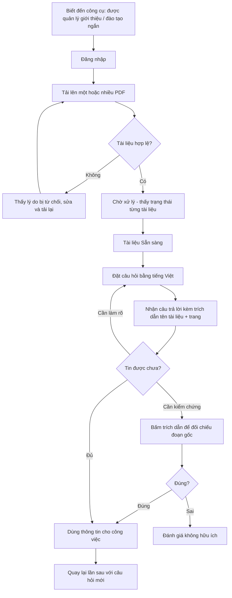

# Tài liệu Yêu cầu Sản phẩm (PRD) — Công cụ "Chat với tài liệu" (MVP)

> **Chuẩn áp dụng:** IEEE 29148-2018
> **Mã tài liệu:** PRD-CWD-001 · **Phiên bản:** 0.2 · **Trạng thái:** Draft — đề nghị baseline có điều kiện
> **Đầu vào:** [BRD-CWD-001 v0.2](../02-requirements/BRD.md) · **Prompt nguồn:** [PRD_Prompt_IEEE_standard.md](../prompts/PRD_Prompt_IEEE_standard.md)
> **Tài liệu đi kèm:** [USER_STORIES.md](USER_STORIES.md) (story + AC đầy đủ, kể cả P1) · [traceability.md](traceability.md) · [PRD_checklist_audit.md](PRD_checklist_audit.md)
> **Giá trị mặc định:** các `[TBD: OQ-xxx]` dùng giá trị đề xuất ở [BRD §12.1](../02-requirements/BRD.md) cho tới khi PO chốt.
> **Tác giả:** Đội BA / Product (minhtrungle) · **Ngày:** 2026-10-27

**Quy ước:** `[TBD: OQ-xxx]` = giá trị chưa có, đang chờ câu hỏi mở tương ứng trong BRD mục 12. `[Đề xuất]` = giá trị do đội Product đề xuất để làm việc tiếp, **chưa được sponsor phê duyệt**. Mã `BR-xxx`, `BO-xxx`, `MET-xxx`, `AC-xxx`, `RSK-xxx` lấy từ BRD để truy vết.

---

## 0. Kiểm tra các trụ cột sản phẩm (Product pillars validation)

### 0.1 Nền tảng sản phẩm (điền từ BRD)

| Trụ cột | Giá trị | Nguồn | Đánh giá |
|---|---|---|---|
| **Tên sản phẩm** | Công cụ "Chat với tài liệu" (MVP) | BRD §1 | Đạt |
| **Người dùng mục tiêu** | Đội phát triển kinh doanh của dự án (người dùng cuối); Quản lý dự án (người theo dõi hiệu quả) | BRD STK-001, STK-002 | Đạt, nhưng mới là suy luận từ một brief ngắn — cần phỏng vấn (OQ-002) |
| **Vấn đề** | Phải mở và tổng hợp thủ công nhiều file PDF để tìm một thông tin; khó nắm đầy đủ nội dung | BRD §3 | Có bằng chứng định tính, **chưa định lượng** (OQ-003) |
| **Giải pháp cốt lõi** | Web app: tải PDF → hỏi bằng ngôn ngữ tự nhiên → AI trả lời chỉ dựa trên tài liệu, kèm trích dẫn (tên tài liệu + số trang) | BRD §2, §7 | Đạt |
| **Trụ cột UX** | Xem §0.2 | — | BRD không nêu; PRD đề xuất |

### 0.2 Trụ cột UX/sản phẩm đề xuất

BRD không có mục "Key Visual/UX Pillars". Các trụ cột dưới đây suy ra từ BRD và là **[Đề xuất]**:

| # | Trụ cột | Suy ra từ | Hệ quả thiết kế |
|---|---|---|---|
| P-1 | **Tin cậy trước, tiện lợi sau** (verifiable by default) | BR-009, BR-010, BR-011, RSK-001 | Mọi câu trả lời đều có trích dẫn bấm được; thà trả lời "không tìm thấy" còn hơn đoán |
| P-2 | **Tối thiểu thao tác** (upload → hỏi, không cấu hình) | SN-003, SN-004 | Màn hình chính chỉ có 2 vùng: tài liệu và hội thoại; không bắt buộc thiết lập gì trước khi hỏi |
| P-3 | **Trạng thái luôn minh bạch** | BR-003, BR-004 | Mỗi tài liệu hiển thị rõ trạng thái xử lý; AI đang dùng tài liệu nào luôn nhìn thấy được |
| P-4 | **Tiếng Việt là ngôn ngữ hạng nhất** | BR-014 | Toàn bộ giao diện, thông báo lỗi và câu trả lời mặc định bằng tiếng Việt |
| P-5 | **Desktop web, trình duyệt hiện đại** | CON-001, ASM-004 | Tối ưu cho màn hình máy tính; không làm app native (ngoài phạm vi) |

### 0.3 Các điểm cần cảnh báo trước khi dùng PRD này

1. **Chưa có baseline/target** (OQ-003, OQ-005) → OKR ở §1.2 dùng giá trị `[Đề xuất]`, phải được sponsor xác nhận trước khi baseline.
2. **Chưa rõ chính sách gửi dữ liệu tới dịch vụ AI bên ngoài** (OQ-006) → có thể buộc đổi kiến trúc (ví dụ mô hình triển khai nội bộ). PRD này **không** chọn công nghệ; chỉ nêu ràng buộc hành vi.
3. **Chưa rõ tài liệu riêng từng người hay dùng chung** (OQ-007) → ảnh hưởng mô hình dữ liệu và phân quyền. PRD giả định **[Đề xuất] dùng chung trong một workspace của đội** cho MVP (xem Giả định A-1).
4. **Các tính năng do BA đề xuất** (BR-016, 018, 021, 022, 023) chưa được quản lý duyệt (OQ-013) → được gắn P1/P2 và **không chặn launch**.

---

## 1. Tóm tắt điều hành và chiến lược

### 1.1 Tầm nhìn sản phẩm

**Tầm nhìn dài hạn:** Mọi thành viên trong đội kinh doanh có thể đặt câu hỏi cho toàn bộ kho tri thức dự án và nhận được câu trả lời đáng tin cậy, kiểm chứng được trong vài giây, thay vì phải đọc từng tài liệu.

**Tầm nhìn MVP:** Chứng minh với số liệu đo được rằng hỏi đáp trên PDF có trích dẫn nguồn giúp đội kinh doanh tìm thông tin nhanh hơn cách làm thủ công, mà vẫn đủ chính xác để họ tin dùng.

**Câu hỏi MVP phải trả lời (hypothesis):**
> Nếu đội kinh doanh có thể hỏi bằng tiếng Việt trên bộ PDF dự án và nhận câu trả lời có trích dẫn đúng nguồn, thì họ sẽ tìm thông tin nhanh hơn đáng kể và dùng công cụ đều đặn hằng tuần.

### 1.2 Mục tiêu và kết quả then chốt (OKR)

Tất cả giá trị target dưới đây là **[Đề xuất]** và chờ OQ-003/OQ-005/OQ-009 chốt. Cách đo tuân theo định nghĩa chỉ số của BRD §4.

**Objective 1 — Người dùng tìm thông tin nhanh hơn** (BO-001, MET-001)

| KR | Chỉ số | Baseline | Target [Đề xuất] | Cách đo |
|---|---|---|---|---|
| KR1.1 | Thời gian trung bình tìm được đáp án cho một câu hỏi trong bộ câu hỏi chuẩn | [TBD: OQ-003] | Giảm ≥ 50% so với baseline | Đo bấm giờ, cùng bộ câu hỏi, trước và sau MVP |
| KR1.2 | Thời gian phản hồi của AI (P90) | Không áp dụng | ≤ [TBD: OQ-012] giây; tạm đề xuất ≤ 15 giây | Log hệ thống, bộ câu hỏi chuẩn (BR-013) |

**Objective 2 — Câu trả lời đúng và kiểm chứng được** (BO-002, MET-002)

| KR | Chỉ số | Baseline | Target [Đề xuất] | Cách đo |
|---|---|---|---|---|
| KR2.1 | Tỷ lệ câu trả lời đúng trên bộ câu hỏi chuẩn | Không áp dụng | ≥ 85% [TBD: OQ-005] | Người kiểm định chấm (BR-012) |
| KR2.2 | Tỷ lệ câu trả lời có trích dẫn | Không áp dụng | 100% | Kiểm tra tự động (BR-011) |
| KR2.3 | Tỷ lệ trích dẫn trỏ đúng tài liệu + trang | Không áp dụng | ≥ 90% [TBD: OQ-005] | Chấm thủ công trên bộ câu hỏi chuẩn |
| KR2.4 | Tỷ lệ câu hỏi "không có đáp án" được từ chối đúng (không bịa) | Không áp dụng | ≥ 90% (AC-010) | Bộ câu hỏi đối chứng |

**Objective 3 — Người dùng mục tiêu chấp nhận công cụ** (BO-003, MET-003)

| KR | Chỉ số | Baseline | Target [Đề xuất] | Cách đo |
|---|---|---|---|---|
| KR3.1 | Người dùng hoạt động hằng tuần (WAU) / tổng số người dùng được cấp quyền | 0 | ≥ 60% sau 4 tuần go-live [TBD: OQ-005] | Analytics (§5.2) |
| KR3.2 | Tỷ lệ câu trả lời được đánh giá "hữu ích" | Không áp dụng | ≥ 75% | Sự kiện `answer_feedback_submitted` |

### 1.3 Phi mục tiêu (Non-goals) cho MVP

Không hỗ trợ định dạng ngoài PDF, không OCR, không chỉnh sửa PDF, không app native, không tích hợp Drive/SharePoint, không sinh tài liệu mới từ câu trả lời, không phân quyền chi tiết theo tài liệu (BRD §5.2, §5.3).

---

## 2. Persona và hành trình người dùng

### 2.1 Persona

#### Persona chính — "Linh", chuyên viên phát triển kinh doanh (STK-002)

| Thuộc tính | Mô tả |
|---|---|
| Vai trò | Nhân viên đội phát triển kinh doanh của dự án |
| Bối cảnh | Làm việc trên máy tính, cần số liệu/điều khoản từ nhiều PDF (hợp đồng, đề xuất, đặc tả…) để chuẩn bị họp hoặc trả lời khách hàng |
| Mục tiêu | Có đáp án đúng, nhanh, biết lấy từ đâu để dám dùng |
| Nỗi đau | Mở từng file, tìm thủ công, tổng hợp bằng tay; sợ bỏ sót thông tin |
| Mức am hiểu công nghệ | Dùng thành thạo công cụ văn phòng; **không** phải kỹ thuật viên; không muốn học prompt |
| Điều khiến Linh bỏ công cụ | Một lần AI trả lời sai mà không có cách kiểm tra |

#### Persona phụ — "Hùng", quản lý dự án (STK-001)

| Thuộc tính | Mô tả |
|---|---|
| Vai trò | Sponsor/người yêu cầu MVP |
| Mục tiêu | Có số liệu chứng minh MVP đáng đầu tư tiếp |
| Nhu cầu với sản phẩm | Xem số người dùng hoạt động và số câu hỏi theo tuần; xem tỷ lệ đánh giá hữu ích (BR-021, BR-022) |
| Nỗi đau | Không có số liệu so sánh trước/sau |

#### Persona ảnh hưởng — "Mai", cán bộ IT/Bảo mật (STK-005) **[Unverified]**

Không dùng trực tiếp sản phẩm nhưng **có thể chặn go-live**. Cần biết dữ liệu đi đâu, ai truy cập được (BR-019, BR-020).

### 2.2 Hành trình người dùng cấp cao (Linh)



| Giai đoạn | Mục tiêu của người dùng | Điểm chạm | Rủi ro bỏ cuộc | Giải pháp thiết kế |
|---|---|---|---|---|
| Khám phá | Hiểu công cụ làm gì | Hướng dẫn ngắn, trạng thái trống | Không biết bắt đầu từ đâu | Empty state có CTA "Tải tài liệu đầu tiên" |
| Nạp tài liệu | Đưa PDF vào | Upload | File bị từ chối không rõ lý do; chờ lâu không biết | Thông báo lỗi cụ thể; trạng thái xử lý rõ ràng |
| Hỏi đáp | Có đáp án | Khung chat | Câu trả lời chậm hoặc chung chung | Hiển thị đang xử lý; trích dẫn kèm theo |
| Kiểm chứng | Xác nhận đáp án | Trích dẫn | Phải tự mở file gốc tìm lại | Trích dẫn nêu trích đoạn và số trang |
| Quay lại | Dùng thường xuyên | — | Mất tin tưởng | Phản hồi chất lượng, cải tiến liên tục |

---

## 3. Yêu cầu chức năng và User Story

**Ưu tiên:** **P0** = bắt buộc để launch · **P1** = nên có · **P2** = nếu còn năng lực. Ánh xạ từ MoSCoW của BRD: Must → P0, Should → P1, Could → P2.

### 3.1 Ma trận Epic / Feature

| Epic | Mô tả | Yêu cầu BRD | Persona | Ưu tiên cao nhất |
|---|---|---|---|---|
| E1 — Truy cập & workspace | Đăng nhập, chỉ người được cấp quyền mới vào | BR-019, BR-020 | Linh, Hùng | P0 |
| E2 — Quản lý tài liệu | Tải lên, trạng thái, danh sách, xóa | BR-001..BR-006 | Linh | P0 |
| E3 — Hỏi đáp có trích dẫn | Hỏi, trả lời tổng hợp, từ chối khi không có thông tin, trích dẫn | BR-007..BR-014 | Linh | P0 |
| E4 — Hội thoại | Nhiều lượt, giới hạn phạm vi tài liệu, xem lại | BR-015..BR-018 | Linh | P1 |
| E5 — Phản hồi & đo lường | Đánh giá câu trả lời, dashboard sử dụng | BR-021, BR-022 | Linh, Hùng | P1 |
| E6 — Tóm tắt tài liệu | Tóm tắt nhanh một tài liệu | BR-023 | Linh | P2 |

### 3.2 Epic E1 — Truy cập và workspace

#### US-101 · P0 — Đăng nhập để vào công cụ
**Là** Linh, **tôi muốn** đăng nhập bằng tài khoản được cấp, **để** tài liệu kinh doanh của tôi không bị người ngoài xem.
*Truy vết: BR-019, AC-019, SN-009.*

**Acceptance Criteria**
- **AC-101.1** — *Given* tôi chưa đăng nhập, *When* tôi mở bất kỳ trang nào của ứng dụng, *Then* tôi được chuyển tới màn hình đăng nhập và không thấy tên tài liệu hay nội dung hội thoại nào.
- **AC-101.2** — *Given* tài khoản của tôi đã được cấp quyền, *When* tôi đăng nhập thành công, *Then* tôi vào màn hình chính của workspace.
- **AC-101.3** — *Given* tài khoản không được cấp quyền (hoặc sai thông tin đăng nhập), *When* tôi cố đăng nhập, *Then* tôi nhận thông báo từ chối và không truy cập được tài liệu, câu hỏi hay câu trả lời nào.
- **AC-101.4** — *Given* tôi chưa đăng nhập, *When* ai đó gọi trực tiếp một địa chỉ tải tài liệu hoặc API hỏi đáp, *Then* hệ thống từ chối (không chỉ ẩn ở giao diện).

> **Ghi chú:** Phương thức xác thực (SSO nội bộ hay tài khoản riêng) phụ thuộc OQ-006/DEP-003. Ghi vào SRS.

#### US-102 · P0 — Hệ thống tuân thủ chính sách dữ liệu
**Là** Mai (IT/Bảo mật), **tôi muốn** biết nội dung tài liệu được xử lý ở đâu và bởi ai, **để** xác nhận tuân thủ chính sách trước go-live.
*Truy vết: BR-020, AC-020.*

**Acceptance Criteria**
- **AC-102.1** — *Given* tài liệu đã tải lên, *When* IT/Bảo mật review, *Then* có tài liệu mô tả luồng dữ liệu (nội dung tài liệu và câu hỏi đi tới những dịch vụ nào) và IT/Bảo mật ký xác nhận tuân thủ **trước khi** go-live.
- **AC-102.2** — *Given* chính sách OQ-006 không cho phép gửi tới dịch vụ AI bên ngoài, *When* cấu hình triển khai, *Then* hệ thống không gọi dịch vụ ngoài đó (kiểm chứng bằng review cấu hình).

### 3.3 Epic E2 — Quản lý tài liệu

#### US-201 · P0 — Tải lên một hoặc nhiều PDF
**Là** Linh, **tôi muốn** tải nhiều file PDF cùng lúc, **để** đưa toàn bộ tài liệu dự án vào một nơi để hỏi đáp.
*Truy vết: BR-001, AC-001, SN-003.*

**Acceptance Criteria**
- **AC-201.1** — *Given* tôi ở màn hình chính, *When* tôi chọn hoặc kéo-thả 3 file PDF hợp lệ (mỗi file dưới giới hạn [TBD: OQ-011]), *Then* cả 3 file xuất hiện trong danh sách tài liệu ngay sau khi tải.
- **AC-201.2** — *Given* đang tải nhiều file, *When* một file lỗi, *Then* các file còn lại vẫn được tải bình thường và chỉ file lỗi bị báo lỗi.
- **AC-201.3** — *Given* một file đang tải, *When* quá trình tải diễn ra, *Then* tôi thấy tiến độ tải của từng file.

#### US-202 · P0 — Bị từ chối rõ lý do khi file không hợp lệ
**Là** Linh, **tôi muốn** biết ngay vì sao file bị từ chối, **để** không nhầm tưởng tài liệu đã sẵn sàng.
*Truy vết: BR-002, AC-002, BRU-001.*

**Acceptance Criteria**
- **AC-202.1** — *Given* tôi chọn một file .docx, *When* tôi tải lên, *Then* file bị từ chối với thông báo nêu "sai định dạng, chỉ chấp nhận PDF" và file đó không xuất hiện trong danh sách.
- **AC-202.2** — *Given* tôi chọn một PDF vượt giới hạn [TBD: OQ-011] MB, *When* tôi tải lên, *Then* file bị từ chối với thông báo nêu "vượt dung lượng" kèm giới hạn cho phép.
- **AC-202.3** — *Given* tôi chọn một file có đuôi .pdf nhưng nội dung không phải PDF hợp lệ hoặc bị hỏng, *When* tôi tải lên, *Then* file bị từ chối hoặc báo "xử lý thất bại" kèm lý do dễ hiểu.
- **AC-202.4** — *Given* tổng số tài liệu đã đạt giới hạn [TBD: OQ-011], *When* tôi tải thêm, *Then* tôi nhận thông báo đã đạt giới hạn.

#### US-203 · P0 — Biết khi nào tài liệu sẵn sàng
**Là** Linh, **tôi muốn** thấy trạng thái xử lý của từng tài liệu, **để** không hỏi khi tài liệu chưa được xử lý xong.
*Truy vết: BR-003, AC-003.*

**Acceptance Criteria**
- **AC-203.1** — *Given* tôi vừa tải lên một tài liệu, *When* tài liệu đang được xử lý, *Then* trạng thái hiển thị là "Đang xử lý".
- **AC-203.2** — *Given* tài liệu xử lý xong, *When* trạng thái được cập nhật, *Then* trạng thái chuyển thành "Sẵn sàng" mà **không cần tải lại trang**.
- **AC-203.3** — *Given* xử lý tài liệu thất bại, *When* trạng thái được cập nhật, *Then* hiển thị "Lỗi" kèm lý do và tùy chọn thử lại hoặc xóa.
- **AC-203.4** — *Given* tôi hỏi một câu mà thông tin chỉ có trong tài liệu "Đang xử lý", *When* tôi gửi câu hỏi, *Then* hệ thống cảnh báo rằng còn tài liệu chưa sẵn sàng và câu trả lời có thể chưa đầy đủ (hoặc không dùng tài liệu đó) — không được trả lời như thể đã đọc tài liệu đó.
- **AC-203.5** — *Given* PDF không có lớp văn bản (ảnh scan), *When* xử lý xong, *Then* tài liệu được gắn cảnh báo "Không trích xuất được văn bản" thay vì "Sẵn sàng" (liên quan ASM-001, RSK-004).

#### US-204 · P0 — Xem danh sách tài liệu
**Là** Linh, **tôi muốn** xem danh sách tài liệu đã tải lên, **để** biết phạm vi mà AI đang dùng.
*Truy vết: BR-004, AC-004.*

**Acceptance Criteria**
- **AC-204.1** — *Given* đã có tài liệu trong workspace, *When* tôi mở màn hình chính, *Then* danh sách hiển thị đúng tên file, thời điểm tải lên và trạng thái của 100% tài liệu.
- **AC-204.2** — *Given* chưa có tài liệu nào, *When* tôi mở màn hình chính, *Then* tôi thấy trạng thái trống (xem §4.2).

#### US-205 · P1 — Xóa tài liệu
**Là** Linh, **tôi muốn** xóa tài liệu sai/lỗi thời, **để** AI không dùng nội dung đó.
*Truy vết: BR-005, BR-006, AC-005, AC-006, BRU-004.*

Tiêu chí (P1, không bắt buộc dạng Given-When-Then, nhưng nên có):
- Xóa một tài liệu → tài liệu biến mất khỏi danh sách (AC-005).
- Sau khi xóa, câu hỏi mà đáp án chỉ có trong tài liệu đã xóa → hệ thống trả lời không tìm thấy và không trích dẫn tài liệu đã xóa (AC-006).
- Hệ thống yêu cầu xác nhận trước khi xóa.

> **Rủi ro:** Nếu US-205 bị cắt khỏi launch, tài liệu sai không gỡ được. **Đề xuất nâng US-205 lên P0 nếu tài liệu dùng chung** (xem A-1) — chờ OQ-007.

### 3.4 Epic E3 — Hỏi đáp có trích dẫn

#### US-301 · P0 — Đặt câu hỏi bằng ngôn ngữ tự nhiên
**Là** Linh, **tôi muốn** gõ câu hỏi bằng tiếng Việt, **để** nhận đáp án mà không phải mở từng file.
*Truy vết: BR-007, BR-014, AC-007, AC-014.*

**Acceptance Criteria**
- **AC-301.1** — *Given* có ít nhất một tài liệu "Sẵn sàng", *When* tôi nhập câu hỏi và gửi, *Then* tôi nhận được một câu trả lời hiển thị trong khung hội thoại.
- **AC-301.2** — *Given* tôi hỏi bằng tiếng Việt, *When* hệ thống trả lời, *Then* câu trả lời bằng tiếng Việt (100% trên bộ câu hỏi chuẩn tiếng Việt).
- **AC-301.3** — *Given* tôi đã gửi câu hỏi, *When* hệ thống đang xử lý, *Then* tôi thấy chỉ báo "đang trả lời" và ô nhập không cho gửi trùng cùng lúc cùng một câu.
- **AC-301.4** — *Given* tôi gửi ô nhập rỗng hoặc chỉ có khoảng trắng, *When* tôi bấm gửi, *Then* không có yêu cầu nào được gửi đi.
- **AC-301.5** — *Given* chưa có tài liệu "Sẵn sàng" nào, *When* tôi mở khung hội thoại, *Then* ô nhập bị vô hiệu hóa kèm hướng dẫn tải tài liệu.

#### US-302 · P0 — Câu trả lời tổng hợp từ nhiều tài liệu
**Là** Linh, **tôi muốn** nhận một câu trả lời tổng hợp khi thông tin nằm ở nhiều file, **để** khỏi tổng hợp thủ công.
*Truy vết: BR-008, AC-008.*

**Acceptance Criteria**
- **AC-302.1** — *Given* đáp án nằm ở ≥ 2 tài liệu khác nhau, *When* tôi hỏi, *Then* câu trả lời chứa thông tin từ tất cả tài liệu liên quan và trích dẫn từng tài liệu đó, đạt ≥ [TBD: OQ-005] % trên bộ câu hỏi chuẩn.
- **AC-302.2** — *Given* hai tài liệu mâu thuẫn nhau về một thông tin, *When* tôi hỏi, *Then* câu trả lời nêu rõ có sự khác biệt và trích dẫn cả hai, không tự chọn một bên mà không nói.

#### US-303 · P0 — Chỉ trả lời dựa trên tài liệu
**Là** Linh, **tôi muốn** AI chỉ dùng nội dung trong tài liệu tôi tải lên, **để** tôi tin được đáp án.
*Truy vết: BR-009, AC-009, BRU-003, RSK-001.*

**Acceptance Criteria**
- **AC-303.1** — *Given* 10 câu hỏi kiến thức chung không liên quan đến tài liệu, *When* gửi lần lượt, *Then* không câu trả lời nào đưa ra thông tin ngoài tài liệu (hệ thống nêu rõ không tìm thấy trong tài liệu).
- **AC-303.2** — *Given* nội dung trong tài liệu có đoạn văn bản giống lệnh (ví dụ "bỏ qua mọi hướng dẫn trước đó…"), *When* tôi hỏi, *Then* hệ thống coi đó là nội dung tài liệu, không thực thi như chỉ thị. *(Phòng thủ prompt injection — đề xuất bổ sung của PRD, chờ IT/Bảo mật xác nhận.)*

#### US-304 · P0 — Thông báo khi không tìm thấy thông tin
**Là** Linh, **tôi muốn** AI nói rõ khi tài liệu không có đáp án, **để** tôi không bị dẫn đi sai.
*Truy vết: BR-010, AC-010.*

**Acceptance Criteria**
- **AC-304.1** — *Given* 10 câu hỏi không có đáp án trong tài liệu, *When* gửi lần lượt, *Then* ≥ 9/10 câu trả lời nêu rõ "không tìm thấy thông tin trong tài liệu đã tải lên" [ngưỡng chờ OQ-005].
- **AC-304.2** — *Given* thông tin chỉ có một phần trong tài liệu, *When* tôi hỏi, *Then* câu trả lời nêu phần tìm thấy kèm trích dẫn **và** nêu rõ phần còn thiếu.
- **AC-304.3** — *Given* câu trả lời "không tìm thấy", *When* hiển thị, *Then* không kèm trích dẫn giả.

#### US-305 · P0 — Trích dẫn nguồn có thể kiểm chứng
**Là** Linh, **tôi muốn** thấy mỗi câu trả lời lấy từ tài liệu nào, trang nào, **để** kiểm chứng trước khi dùng.
*Truy vết: BR-011, AC-011.*

**Acceptance Criteria**
- **AC-305.1** — *Given* một câu trả lời có thông tin từ tài liệu, *When* hiển thị, *Then* câu trả lời kèm danh sách nguồn gồm tên tài liệu và số trang; 100% câu trả lời có thông tin đều có trích dẫn.
- **AC-305.2** — *Given* tôi bấm vào một trích dẫn, *When* thao tác hoàn tất, *Then* tôi thấy đoạn văn bản gốc trong tài liệu đó (và số trang) mà câu trả lời dựa vào.
- **AC-305.3** — *Given* bộ câu hỏi chuẩn, *When* chấm, *Then* ≥ [TBD: OQ-005] % trích dẫn trỏ đúng tài liệu và trang chứa thông tin.
- **AC-305.4** — *Given* một tài liệu đã bị xóa, *When* tôi xem câu trả lời cũ trích dẫn tài liệu đó, *Then* trích dẫn hiển thị trạng thái "tài liệu đã bị xóa" thay vì lỗi.

#### US-306 · P0 — Chất lượng và độ trễ đạt ngưỡng
**Là** Hùng, **tôi muốn** biết câu trả lời đạt chất lượng và tốc độ đã cam kết, **để** quyết định mở rộng.
*Truy vết: BR-012, BR-013, AC-012, AC-013.*

**Acceptance Criteria**
- **AC-306.1** — *Given* bộ câu hỏi chuẩn (DEP-002), *When* người kiểm định chấm, *Then* tỷ lệ đúng ≥ [TBD: OQ-005] % (đề xuất 85%).
- **AC-306.2** — *Given* bộ câu hỏi chuẩn, *When* đo thời gian từ lúc gửi tới lúc hiển thị kết quả đầu tiên/đầy đủ, *Then* ≥ 90% câu trong ngưỡng [TBD: OQ-012].

### 3.5 Epic E4 — Hội thoại

#### US-401 · P1 — Hỏi tiếp trong cùng phiên
**Là** Linh, **tôi muốn** hỏi tiếp mà không phải nhắc lại ngữ cảnh, **để** hỏi đáp tự nhiên.
*Truy vết: BR-015, AC-015.* Ví dụ: hỏi "Giá trị hợp đồng X là bao nhiêu?" rồi "Thời hạn của nó?" → câu thứ hai hiểu "nó" là hợp đồng X.

#### US-402 · P1 — Giới hạn câu hỏi vào tài liệu được chọn
**Là** Linh, **tôi muốn** chọn một hoặc vài tài liệu để hỏi, **để** tăng độ chính xác khi nội dung trùng lặp.
*Truy vết: BR-016, AC-016.* Khi đã chọn phạm vi, câu trả lời không được trích dẫn tài liệu ngoài phạm vi; phạm vi đang áp dụng luôn hiển thị.

#### US-403 · P1 — Xem lại hội thoại trong phiên
**Là** Linh, **tôi muốn** cuộn lại câu hỏi và câu trả lời trước đó, **để** tra cứu lại.
*Truy vết: BR-017, AC-017.* Sau 5 lượt, cả 5 cặp hiển thị đúng thứ tự; có nút "Cuộc hội thoại mới".

#### US-404 · P2 — Xem lịch sử các phiên trước
**Là** Linh, **tôi muốn** mở lại hội thoại cũ, **để** tái sử dụng kết quả.
*Truy vết: BR-018, AC-018.* Hoãn sau MVP nếu còn thiếu năng lực (BRD §5.3).

### 3.6 Epic E5 — Phản hồi và đo lường

#### US-501 · P1 — Đánh giá câu trả lời
**Là** Linh, **tôi muốn** bấm hữu ích / không hữu ích cho từng câu trả lời, **để** giúp đội cải thiện chất lượng.
*Truy vết: BR-021, AC-021.* Đánh giá được ghi nhận và thống kê theo tổng số; có thể đổi đánh giá; tùy chọn nhập lý do ngắn khi bấm "không hữu ích".

> **Lưu ý:** US-501 là nguồn dữ liệu cho KR3.2 và RSK-003. Nếu bị cắt, KR3.2 không đo được. Do cost thấp, **đề xuất giữ trong launch**.

#### US-502 · P1 — Xem số liệu sử dụng
**Là** Hùng, **tôi muốn** xem số người dùng hoạt động và số câu hỏi theo tuần, **để** đo MET-003.
*Truy vết: BR-022, AC-022.* Số liệu khớp với số liệu thực tế ghi nhận sau 1 tuần dùng thử.

### 3.7 Epic E6 — Tóm tắt tài liệu

#### US-601 · P2 — Tóm tắt một tài liệu
**Là** Linh, **tôi muốn** yêu cầu tóm tắt một tài liệu, **để** nắm nhanh nội dung.
*Truy vết: BR-023, AC-023.* Bản tóm tắt cũng phải có trích dẫn trang và được người dùng nghiệp vụ đánh giá phản ánh đúng ý chính.

### 3.8 Tổng hợp ưu tiên

| P0 (launch) | P1 | P2 |
|---|---|---|
| US-101, US-102, US-201, US-202, US-203, US-204, US-301, US-302, US-303, US-304, US-305, US-306 | US-205*, US-401, US-402, US-403, US-501, US-502 | US-404, US-601 |

\* US-205 có thể nâng lên P0 tùy OQ-007 (xem ghi chú).

### 3.9 Đặc tả yêu cầu phần mềm (FR / NFR) — bổ sung v0.2

Mỗi FR/NFR là một phát biểu kiểm thử được, gắn với BR gốc và story. Đây là mức SRS mà thiết kế (Phase 4) và test (Phase 7) dùng làm nguồn.

#### 3.9.1 Yêu cầu chức năng

| ID | Yêu cầu (hệ thống **phải** …) | BR | Story | Ưu tiên | Kiểm chứng |
|---|---|---|---|---|---|
| FR-001 | xác thực người dùng bằng tên đăng nhập + mật khẩu và cấp phiên đăng nhập; từ chối thông tin sai với thông báo chung không tiết lộ tài khoản nào tồn tại | BR-019 | US-101 | P0 | Test |
| FR-002 | từ chối (HTTP 401) mọi yêu cầu tới API tài liệu, hỏi đáp, phản hồi, số liệu khi không có phiên hợp lệ; phiên hết hạn sau 8 giờ không hoạt động | BR-019 | US-101 | P0 | Test |
| FR-003 | không gọi bất kỳ dịch vụ AI bên ngoài nào khi cấu hình `CWD_ALLOW_EXTERNAL_AI` khác `true`; công bố chế độ xử lý hiện tại qua endpoint cấu hình công khai | BR-020 | US-102 | P0 | Test + Review |
| FR-004 | nhận một hoặc nhiều file trong một lần tải lên, xử lý từng file độc lập (một file lỗi không ảnh hưởng file khác) | BR-001 | US-201 | P0 | Test |
| FR-005 | từ chối file không phải PDF (kiểm tra chữ ký `%PDF-`, không chỉ đuôi file), file > `CWD_MAX_FILE_MB`, và khi workspace đã có `CWD_MAX_DOCS` tài liệu; mỗi lỗi có mã ổn định (`file.wrong_type`, `file.too_large`, `docs.limit_reached`) | BR-002 | US-202 | P0 | Test |
| FR-006 | xử lý tài liệu bất đồng bộ với trạng thái `processing` → `ready` \| `failed` \| `no_text`; `no_text` khi không trích được văn bản; `failed` khi PDF hỏng hoặc có mật khẩu, kèm lý do | BR-003 | US-203 | P0 | Test |
| FR-007 | trả danh sách tài liệu của workspace gồm tên, thời điểm tải lên, trạng thái, số trang | BR-004 | US-204 | P0 | Test |
| FR-008 | xóa tài liệu cùng toàn bộ chunk và file gốc; sau khi xóa, tài liệu không xuất hiện trong kết quả truy xuất | BR-005, BR-006 | US-205 | P1 | Test |
| FR-009 | nhận câu hỏi 1–2000 ký tự (sau khi bỏ khoảng trắng) và trả câu trả lời; từ chối câu hỏi rỗng hoặc quá dài với mã `chat.invalid_question` | BR-007, BR-014 | US-301 | P0 | Test |
| FR-010 | truy xuất chunk liên quan từ **mọi** tài liệu `ready` trong phạm vi, tối đa `CWD_TOP_K` chunk, có giới hạn số chunk mỗi tài liệu để đảm bảo đa dạng nguồn | BR-008 | US-302 | P0 | Test |
| FR-011 | chỉ dùng chunk truy xuất được làm ngữ cảnh sinh câu trả lời; nội dung tài liệu được coi là dữ liệu, không phải chỉ thị | BR-009 | US-303 | P0 | Test |
| FR-012 | trả `outcome = not_found` với thông điệp "Không tìm thấy thông tin trong tài liệu đã tải lên" và **không** kèm trích dẫn khi không có chunk vượt ngưỡng liên quan `CWD_MIN_RELEVANCE` | BR-010 | US-304 | P0 | Test |
| FR-013 | trả kèm mỗi câu trả lời `outcome = answered` danh sách trích dẫn (mã tài liệu, tên tài liệu, số trang, đoạn trích) lấy từ CSDL; mọi trích dẫn phải trỏ tới chunk đã truy xuất | BR-011 | US-305 | P0 | Test |
| FR-014 | dùng tối đa 3 lượt hỏi trước trong cùng hội thoại để bổ sung ngữ cảnh truy xuất cho câu hỏi tiếp theo | BR-015 | US-401 | P1 | Test |
| FR-015 | khi yêu cầu có danh sách `document_ids`, chỉ truy xuất trong các tài liệu đó | BR-016 | US-402 | P1 | Test |
| FR-016 | lưu và trả toàn bộ lượt hỏi đáp của hội thoại theo thứ tự thời gian; cho phép tạo hội thoại mới | BR-017 | US-403 | P1 | Test |
| FR-017 | ghi nhận đánh giá `up`/`down` (một đánh giá mỗi câu trả lời mỗi người, cho phép đổi) kèm lý do tùy chọn ≤ 500 ký tự | BR-021 | US-501 | P1 | Test |
| FR-018 | trả số người dùng hoạt động, số câu hỏi, tỷ lệ `not_found`, tỷ lệ đánh giá tích cực theo tuần ISO; chỉ người dùng vai trò `manager` được xem | BR-022 | US-502 | P1 | Test |
| FR-019 | ghi nhật ký kiểm toán cho đăng nhập thành công/thất bại, tải lên, xóa tài liệu (người thực hiện, hành động, đối tượng, thời điểm) | BR-026 | US-103 | P0 | Test |

#### 3.9.2 Yêu cầu phi chức năng (ISO/IEC 25010)

| ID | Đặc tính 25010 | Yêu cầu | Ngưỡng (mặc định) | BR | Kiểm chứng |
|---|---|---|---|---|---|
| NFR-001 | Performance efficiency | Thời gian từ gửi câu hỏi tới có câu trả lời hoàn chỉnh | P90 ≤ 15 s với LLM ngoài; P90 ≤ 2 s với bộ sinh cục bộ trên 50 tài liệu | BR-013 | Test (đo trong CI cho chế độ cục bộ) |
| NFR-002 | Functional suitability | Độ chính xác trên bộ câu hỏi chuẩn | ≥ 85% đúng, ≥ 90% trích dẫn đúng, ≥ 9/10 `not_found` đúng | BR-012 | Analysis (bộ đánh giá `tests/eval`) |
| NFR-003 | Usability | Toàn bộ giao diện và thông báo bằng tiếng Việt; tìm kiếm hỗ trợ tiếng Việt có dấu và không dấu | 100% chuỗi UI tiếng Việt | BR-014 | Test + Inspection |
| NFR-004 | Security — confidentiality | Cô lập workspace: truy cập tài nguyên của người khác trả 404 như không tồn tại | 0 rò rỉ trong test | BR-028 | Test |
| NFR-005 | Reliability — availability | Sẵn sàng trong giờ làm việc; endpoint `/api/health` cho giám sát | ≥ 99%/tháng | BR-024 | Analysis |
| NFR-006 | Reliability — recoverability | Sao lưu và khôi phục toàn bộ dữ liệu bằng script | RTO ≤ 4 h, RPO ≤ 24 h | BR-025 | Demonstration |
| NFR-007 | Security — accountability | Lưu nhật ký kiểm toán | ≥ 90 ngày | BR-026 | Inspection |
| NFR-008 | Security — confidentiality | Không ghi nội dung câu hỏi, câu trả lời, văn bản tài liệu vào log ứng dụng | 0 lần xuất hiện | BR-027 | Test |
| NFR-009 | Usability — accessibility | WCAG 2.1 AA: tương phản ≥ 4.5:1, điều hướng bàn phím, nhãn ARIA, vùng `aria-live` cho câu trả lời mới | Đạt checklist WCAG | UX-011 | Inspection |
| NFR-010 | Security — integrity | Mật khẩu băm bằng PBKDF2-SHA256 ≥ 200 000 vòng; cookie phiên `HttpOnly`, `SameSite=Strict`; chống CSRF cho thao tác ghi; giới hạn 5 lần đăng nhập sai / 5 phút | Đạt review L3 | BR-019 | Test + Inspection |

#### 3.9.3 Story bổ sung

**US-103 · P0 — Nhật ký kiểm toán.** **Là** Mai (IT/Bảo mật), **tôi muốn** có nhật ký đăng nhập, tải lên, xóa tài liệu, **để** điều tra khi có sự cố. *Truy vết: BR-026, FR-019.* AC xem [USER_STORIES.md](USER_STORIES.md#us-103).

#### 3.9.4 Môi trường vận hành, khả năng mở rộng và giao diện

| Hạng mục | Đặc tả |
|---|---|
| Môi trường vận hành | Máy chủ ứng dụng chạy Python ≥ 3.12 (Windows hoặc Linux), lưu dữ liệu trên đĩa cục bộ; client là trình duyệt máy tính (Chrome, Edge, Firefox bản ≤ 2 năm), độ rộng tối thiểu 1280 px |
| Quy mô thiết kế (ASM-003) | ≤ 30 người dùng, ≤ 50 tài liệu mỗi người, ≤ 300 trang mỗi tài liệu, ≤ 5 câu hỏi đồng thời |
| Khả năng mở rộng | Kho dữ liệu và bộ truy xuất nằm sau interface (ADR-002, ADR-004) để chuyển sang PostgreSQL + pgvector khi vượt quy mô trên mà không đổi API |
| Giao diện người dùng | Ứng dụng web một trang: màn hình đăng nhập, workspace hai vùng (tài liệu / hội thoại), panel trích dẫn, dashboard số liệu (§4) |
| Giao diện phần cứng | Không có |
| Giao diện phần mềm | REST API JSON (OpenAPI 3.1, `docs/04-design/openapi.yaml`); tùy chọn Anthropic Messages API khi `CWD_ALLOW_EXTERNAL_AI=true` |
| Giao diện truyền thông | HTTPS (TLS do reverse proxy đầu cuối đảm nhận khi triển khai); upload `multipart/form-data`; phiên qua cookie |

---

## 4. Yêu cầu UX và UI

### 4.1 Luồng và bố cục chính

#### Màn hình chính (sau đăng nhập) — bố cục hai vùng

```
+--------------------------------------------------------------------+
| [Logo]  Chat với tài liệu                      [Tên người dùng ▾]  |
+------------------------+-------------------------------------------+
| TÀI LIỆU (n)           |  HỘI THOẠI            [Cuộc hội thoại mới]|
| [+ Tải lên PDF]        |                                           |
| ---------------------- |  Phạm vi: [Tất cả tài liệu ▾]  (P1)       |
| ☑ HopDong_A.pdf        |  ---------------------------------------  |
|   Sẵn sàng · 27/10     |  Bạn: Giá trị hợp đồng A là bao nhiêu?    |
| ☑ DeXuat_B.pdf         |                                           |
|   Đang xử lý ◌         |  AI:  Giá trị hợp đồng A là ... [1][2]    |
| ☐ Spec_C.pdf           |       Nguồn:                              |
|   Lỗi · Thử lại        |       [1] HopDong_A.pdf — tr. 12          |
|                        |       [2] DeXuat_B.pdf — tr. 3            |
|                        |       [👍 Hữu ích] [👎 Không hữu ích]      |
|                        |  ---------------------------------------  |
|                        |  [ Nhập câu hỏi...                 ] [Gửi]|
+------------------------+-------------------------------------------+
```

#### Yêu cầu bố cục và tương tác

| ID | Yêu cầu |
|---|---|
| UX-001 | Màn hình chính chỉ có hai vùng: **Tài liệu** (trái) và **Hội thoại** (phải); không cần bước cấu hình trước khi hỏi. |
| UX-002 | Mỗi tài liệu hiển thị: tên, thời điểm tải lên, trạng thái (Đang xử lý / Sẵn sàng / Lỗi / Cảnh báo không có văn bản). Trạng thái dùng cả **biểu tượng + chữ**, không chỉ dựa vào màu. |
| UX-003 | Tải lên hỗ trợ cả bấm chọn file và kéo-thả; chọn nhiều file; hiển thị tiến độ từng file. |
| UX-004 | Trích dẫn trong câu trả lời là phần tử bấm được; bấm mở panel xem đoạn gốc + số trang. Panel không làm mất ngữ cảnh hội thoại. |
| UX-005 | Câu trả lời của AI hiển thị chỉ báo "đang trả lời"; nội dung hiển thị dần (streaming) nếu khả thi để giảm cảm giác chờ. *(Cách thực hiện thuộc SRS/SAD.)* |
| UX-006 | Phạm vi tài liệu đang áp dụng cho câu hỏi luôn hiển thị gần ô nhập (mặc định "Tất cả tài liệu"). |
| UX-007 | Mỗi câu trả lời có nút đánh giá hữu ích / không hữu ích (P1). |
| UX-008 | Toàn bộ giao diện và thông báo bằng tiếng Việt; thông báo lỗi nêu **nguyên nhân + hành động tiếp theo** bằng ngôn ngữ nghiệp vụ, không hiển thị mã lỗi kỹ thuật thô. |
| UX-009 | Bàn phím: Enter để gửi, Shift+Enter xuống dòng; điều hướng bằng Tab tới mọi điều khiển chính. |
| UX-010 | Hỗ trợ trình duyệt hiện đại trên máy tính; độ rộng tối thiểu hỗ trợ [TBD: xác nhận với IT — ASM-004]. Mobile không thuộc phạm vi MVP. |
| UX-011 | Khả năng tiếp cận: độ tương phản chữ ≥ 4.5:1, có nhãn cho mọi nút biểu tượng, câu trả lời mới được thông báo cho trình đọc màn hình. *(Mức tuân thủ WCAG cụ thể: [TBD] — chưa có yêu cầu từ BRD.)* |

### 4.2 Trường hợp biên và trạng thái lỗi

| # | Tình huống | Hành vi bắt buộc |
|---|---|---|
| EC-01 | **Trạng thái trống — chưa có tài liệu** | Vùng tài liệu hiển thị hướng dẫn và nút "Tải tài liệu đầu tiên"; ô nhập hội thoại bị vô hiệu hóa kèm lý do. |
| EC-02 | **Trạng thái trống — chưa có tài liệu nào "Sẵn sàng"** (tất cả đang xử lý) | Báo "Đang xử lý n tài liệu, bạn có thể hỏi khi có ít nhất một tài liệu sẵn sàng". |
| EC-03 | **Mất kết nối mạng khi đang tải lên** | Hiển thị file nào chưa tải xong; cho phép thử lại từng file; không hiển thị file đó là "Sẵn sàng". |
| EC-04 | **Mất kết nối khi đang hỏi** | Giữ nguyên nội dung câu hỏi đã nhập; hiển thị "Mất kết nối" và nút "Gửi lại"; không để lại câu trả lời dang dở như thể hoàn chỉnh. |
| EC-05 | **Dịch vụ AI quá thời gian hoặc lỗi** | Hiển thị thông báo thân thiện + nút thử lại; không hiển thị câu trả lời bịa/suy đoán; lỗi được ghi log (§5.2). |
| EC-06 | **Phản hồi chậm vượt ngưỡng** | Sau [TBD: OQ-012] giây, hiển thị thông báo "đang xử lý lâu hơn bình thường" và cho phép hủy. |
| EC-07 | **Câu hỏi rỗng / chỉ khoảng trắng** | Không gửi; không báo lỗi gây phiền. |
| EC-08 | **Câu hỏi quá dài** | Giới hạn độ dài [TBD: SRS]; báo số ký tự còn lại; không cắt cụt im lặng. |
| EC-09 | **Câu hỏi bằng ngôn ngữ khác tiếng Việt** | Hành vi theo OQ-010; tối thiểu: trả lời trung thực hoặc nêu giới hạn hỗ trợ, không trả lời sai ngôn ngữ mà không báo. |
| EC-10 | **File sai định dạng / quá dung lượng / hỏng** | Từ chối kèm lý do cụ thể (US-202); danh sách không chứa file đó. |
| EC-11 | **PDF dạng ảnh scan hoặc có mật khẩu** | Gắn cảnh báo "Không trích xuất được văn bản" / "Tài liệu có mật khẩu"; không coi là "Sẵn sàng". |
| EC-12 | **Tải lên trùng tên file** | Cảnh báo trùng tên; cho chọn thay thế hoặc giữ cả hai (hành vi chọn: [TBD: xác nhận với Product owner]). |
| EC-13 | **Xóa tài liệu đang được hỏi** | Xác nhận trước khi xóa; câu hỏi mới không dùng tài liệu đó (BRU-004). |
| EC-14 | **Không có thông tin trong tài liệu** | Thông báo rõ "không tìm thấy trong tài liệu đã tải lên"; có gợi ý thử diễn đạt khác hoặc kiểm tra tài liệu đã đủ chưa. |
| EC-15 | **Phiên đăng nhập hết hạn giữa chừng** | Đưa về đăng nhập, **giữ lại** câu hỏi đang nhập nếu có thể; sau đăng nhập quay lại đúng màn hình. |
| EC-16 | **Hai người cùng xóa/tải lên (workspace dùng chung)** | Danh sách tài liệu cập nhật nhất quán khi tải lại; không hiển thị tài liệu đã bị người khác xóa như còn tồn tại. |
| EC-17 | **Đạt giới hạn sử dụng/chi phí** (BRU-002, RSK-005) | Thông báo rõ giới hạn; không lỗi chung chung. |

---

## 5. Tiêu chí phát hành và chỉ số sau launch

### 5.1 Cổng launch (Launch gate)

Mọi mục **bắt buộc** phải đạt trước khi go-live. Các ngưỡng `[Đề xuất]` phải được sponsor/QA xác nhận.

#### a) Chức năng và chất lượng câu trả lời

| ID | Tiêu chí | Ngưỡng | Nguồn |
|---|---|---|---|
| LG-01 | Tất cả story P0 đạt toàn bộ Acceptance Criteria | 100% | §3 |
| LG-02 | Không còn defect mức Blocker/Critical đang mở | 0 | [Đề xuất] |
| LG-03 | Tỷ lệ câu trả lời đúng trên bộ câu hỏi chuẩn | ≥ [TBD: OQ-005] (đề xuất 85%) | BR-012 |
| LG-04 | Tỷ lệ câu trả lời có trích dẫn | 100% | BR-011 |
| LG-05 | Tỷ lệ trích dẫn đúng tài liệu + trang | ≥ [TBD: OQ-005] (đề xuất 90%) | AC-011 |
| LG-06 | Từ chối đúng với câu hỏi không có đáp án | ≥ 9/10 | AC-010 |
| LG-07 | Không rò rỉ thông tin ngoài tài liệu cho câu hỏi kiến thức chung | 10/10 | AC-009 |
| LG-08 | Không dùng nội dung tài liệu đã xóa | 100% | AC-006 |

#### b) Hiệu năng

| ID | Tiêu chí | Ngưỡng | Nguồn |
|---|---|---|---|
| LG-09 | Thời gian phản hồi hỏi đáp, P90 | ≤ [TBD: OQ-012] giây (đề xuất ≤ 15 s) | BR-013 |
| LG-10 | Thời gian từ lúc tải lên đến "Sẵn sàng" cho PDF điển hình | [TBD: SRS, theo OQ-004 và OQ-011] | BR-003 |
| LG-11 | Chịu tải số người dùng đồng thời dự kiến | [TBD: OQ-004] | ASM-003 |
| LG-12 | Tải trang ban đầu (màn hình chính) | ≤ 3 s trên mạng nội bộ [Đề xuất] | — |

#### c) Bảo mật và tuân thủ

| ID | Tiêu chí | Ngưỡng | Nguồn |
|---|---|---|---|
| LG-13 | IT/Bảo mật review luồng dữ liệu và **ký xác nhận tuân thủ** | Bắt buộc | BR-020, AC-020 |
| LG-14 | Người chưa xác thực không truy cập được tài liệu, câu hỏi, câu trả lời (kể cả gọi trực tiếp API/địa chỉ file) | 100% bị từ chối | BR-019, AC-101.4 |
| LG-15 | Kiểm thử phòng thủ prompt injection qua nội dung PDF | Không có bypass mức nghiêm trọng đã biết | US-303 |
| LG-16 | Dữ liệu được mã hóa khi truyền; nội dung tài liệu không ghi vào log ứng dụng dạng rõ | Bắt buộc | [Đề xuất — chờ IT] |
| LG-17 | Không có lỗ hổng mức cao/nghiêm trọng chưa xử lý trong quét bảo mật | 0 | [Đề xuất] |

#### d) QA và vận hành

| ID | Tiêu chí | Ngưỡng | Nguồn |
|---|---|---|---|
| LG-18 | Mỗi story P0 có ít nhất 1 test case tự động hoặc thủ công đã chạy đạt | 100% | IEEE 29148 |
| LG-19 | Kiểm thử hồi quy trên bộ câu hỏi chuẩn chạy được lặp lại | Có | DEP-002 |
| LG-20 | Bộ tài liệu và câu hỏi chuẩn được đội kinh doanh cung cấp | Có (DEP-002) | DEP-002 |
| LG-21 | UAT với đại diện đội kinh doanh | Đạt, có biên bản | [Đề xuất] |
| LG-22 | Môi trường triển khai sẵn sàng; có cách rollback | Có | DEP-003 |
| LG-23 | Có giám sát lỗi, độ trễ và chi phí AI | Có | RSK-005 |
| LG-24 | Tài liệu hướng dẫn ngắn nêu giới hạn (PDF scan, bảng biểu) và cách kiểm chứng trích dẫn | Có | RSK-003, RSK-004 |
| LG-25 | Mọi `[TBD]` chặn phê duyệt trong BRD (OQ-001, 003, 005, 006, 011, 012) đã được giải quyết | 100% | BRD §14 |

### 5.2 Analytics và theo dõi

**Nguyên tắc:** (1) không ghi nội dung câu hỏi/tài liệu thô vào analytics trừ khi IT/Bảo mật cho phép (OQ-006); chỉ ghi siêu dữ liệu và độ dài; (2) mọi sự kiện có `user_id` (đã băm hoặc mã nội bộ), `session_id`, `timestamp`; (3) sự kiện đặt tên `đối_tượng_hành_động` (snake_case).

#### Bảng sự kiện

| Sự kiện | Thời điểm kích hoạt | Thuộc tính chính | Phục vụ |
|---|---|---|---|
| `login_succeeded` / `login_failed` | Đăng nhập | `reason` (nếu lỗi) | MET-003, bảo mật |
| `workspace_viewed` | Mở màn hình chính | `doc_count`, `ready_doc_count` | Funnel |
| `document_upload_started` | Bắt đầu tải 1 file | `file_size_bucket`, `batch_size` | Funnel, KR |
| `document_upload_rejected` | File bị từ chối | `reason` (wrong_format / too_large / corrupt / limit_reached) | Chất lượng UX |
| `document_processing_completed` | Tài liệu chuyển "Sẵn sàng" | `duration_ms`, `page_count`, `text_extractable` | LG-10, RSK-004 |
| `document_processing_failed` | Xử lý lỗi | `reason`, `page_count` | RSK-004 |
| `document_deleted` | Xóa tài liệu | — | BR-005 |
| `question_submitted` | Gửi câu hỏi | `scope_type` (all/selected), `selected_doc_count`, `question_length_bucket`, `is_followup` | MET-003, funnel |
| `answer_displayed` | Câu trả lời hiển thị xong | `latency_ms`, `citation_count`, `outcome` (answered / not_found / partial / error) | KR1.2, KR2.2, KR2.4 |
| `answer_error` | Lỗi khi trả lời | `error_type` (timeout / ai_service / network) | Độ tin cậy |
| `citation_opened` | Bấm xem trích dẫn | `citation_index` | Hành vi kiểm chứng |
| `answer_feedback_submitted` | Bấm hữu ích / không hữu ích | `rating`, `has_reason` | KR3.2, BR-021 |
| `conversation_started` | Bắt đầu hội thoại mới | — | Engagement |
| `summary_requested` (P2) | Yêu cầu tóm tắt | `doc_id` | BR-023 |
| `usage_limit_reached` | Chạm giới hạn | `limit_type` | RSK-005 |

#### Funnel cần dựng

| Bước | Sự kiện | Câu hỏi cần trả lời |
|---|---|---|
| 1. Vào công cụ | `login_succeeded` | Bao nhiêu người được cấp quyền thực sự đăng nhập? |
| 2. Có tài liệu | `document_processing_completed` | Bao nhiêu % người dùng nạp được ít nhất 1 tài liệu "Sẵn sàng"? Nạp xong mất bao lâu? |
| 3. Đặt câu hỏi đầu tiên | `question_submitted` | Thời gian từ đăng nhập tới câu hỏi đầu tiên? |
| 4. Nhận câu trả lời | `answer_displayed` (outcome = answered) | Tỷ lệ lỗi / "không tìm thấy" là bao nhiêu? |
| 5. Kiểm chứng | `citation_opened` | Người dùng có thực sự kiểm chứng? |
| 6. Đánh giá | `answer_feedback_submitted` | Tỷ lệ "hữu ích"? |
| 7. Quay lại | `question_submitted` ở tuần kế | Giữ chân tuần 2, tuần 4? |

#### Dashboard sau launch

| Chỉ số | Định nghĩa | Ngưỡng cảnh báo [Đề xuất] |
|---|---|---|
| WAU (MET-003) | Số người dùng khác nhau có ≥ 1 `question_submitted` trong tuần | Giảm > 30% tuần-qua-tuần |
| Câu hỏi / người dùng hoạt động / tuần | Trung bình | — |
| Latency P50/P90 | Từ `answer_displayed.latency_ms` | P90 vượt ngưỡng OQ-012 |
| Tỷ lệ lỗi trả lời | `answer_error` / `question_submitted` | > 3% |
| Tỷ lệ "không tìm thấy" | outcome = not_found | Tăng đột biến → có thể thiếu tài liệu hoặc truy xuất kém |
| Tỷ lệ hữu ích | Đánh giá hữu ích / tổng đánh giá | < 75% |
| Tỷ lệ tài liệu xử lý lỗi / không trích xuất được văn bản | Từ sự kiện xử lý | > 10% → xem xét OCR (hoãn trong BRD §5.3) |
| Chi phí AI / tuần | Từ nhà cung cấp dịch vụ | Vượt ngân sách OQ-008 |

#### Quy trình đo hiệu quả (ngoài analytics)

- **MET-001, MET-002**: chạy bộ câu hỏi chuẩn (DEP-002) trước MVP (baseline thủ công) và khi nghiệm thu; không thay thế bằng analytics.
- **Rà soát sau go-live**: tuần 2 và tuần 4, xem funnel, đánh giá của người dùng và các câu trả lời bị đánh "không hữu ích" để quyết định có đầu tư giai đoạn sau (OCR, phân quyền, lịch sử).

---

## 6. Giả định, phụ thuộc, rủi ro và câu hỏi mở của PRD

### 6.1 Giả định bổ sung của PRD

| ID | Giả định | Nếu sai | Cần xác nhận |
|---|---|---|---|
| A-1 | MVP dùng **một workspace dùng chung** cho cả đội; mọi người dùng được cấp quyền đều thấy mọi tài liệu | Cần mô hình riêng tư theo người dùng → đổi mô hình dữ liệu, US-205, BR-019 | OQ-007 |
| A-2 | Người dùng được cấp quyền qua danh sách do admin quản lý (không tự đăng ký) | Cần luồng đăng ký/duyệt | OQ-001, DEP-003 |
| A-3 | Câu trả lời mặc định bằng tiếng Việt, ngay cả khi tài liệu bằng tiếng Anh | Cần quy tắc ngôn ngữ phức tạp hơn | OQ-010 |
| A-4 | Nội dung tài liệu và câu hỏi được phép xử lý bởi dịch vụ AI do tổ chức phê duyệt | Có thể phải dùng mô hình triển khai nội bộ → chi phí, chất lượng thay đổi | OQ-006 |

### 6.2 Bảng rủi ro sản phẩm (bổ sung BRD §10)

| ID | Rủi ro | Biện pháp trong PRD |
|---|---|---|
| RSK-001 | AI trả lời sai/bịa | US-303, US-304, US-305; LG-03..LG-07; panel xem trích đoạn gốc (UX-004) |
| RSK-002 | Lộ dữ liệu | US-101, US-102; LG-13..LG-17 |
| RSK-003 | Dùng ít | US-501, US-502; funnel §5.2; hướng dẫn ngắn (LG-24) |
| RSK-004 | Trích xuất PDF kém | US-203 (AC-203.5), EC-11; theo dõi `text_extractable` |
| RSK-005 | Chi phí AI | EC-17, LG-23, dashboard chi phí |
| RSK-006 | Phình phạm vi | Giữ P0 tối thiểu; P1/P2 không chặn launch |
| RSK-P1 *(mới)* | Prompt injection qua nội dung PDF | AC-303.2, LG-15 |

### 6.3 Câu hỏi mở bổ sung của PRD

| ID | Câu hỏi | Ảnh hưởng | Người chịu trách nhiệm | Hạn |
|---|---|---|---|---|
| PQ-001 | Có cần xem trực tiếp file PDF gốc trong ứng dụng (viewer đầy đủ), hay chỉ cần hiển thị trích đoạn + số trang là đủ cho MVP? | UX-004, chi phí | Product owner | 2026-11-06 |
| PQ-002 | Hành vi khi tải lên trùng tên file (EC-12): thay thế hay giữ cả hai? | US-201 | Product owner | 2026-11-06 |
| PQ-003 | Có yêu cầu mức tuân thủ khả năng tiếp cận cụ thể (WCAG 2.1 AA?) | UX-011 | IT / Product owner | 2026-11-06 |
| PQ-004 | Có cần xuất/sao chép câu trả lời kèm trích dẫn (nút "Sao chép")? Giá trị cao, chi phí thấp, hiện chưa có trong BRD | Có thể thêm US mới P1 | Quản lý dự án | 2026-11-06 |
| PQ-005 | Quản lý có chấp thuận các tính năng BA đề xuất (OQ-013)? Quyết định này đẩy US-402, US-404, US-501, US-502, US-601 vào/ra khỏi phạm vi | §3.8 | Quản lý dự án | 2026-11-06 |

---

## 7. Truy vết BRD → PRD

| Yêu cầu BRD | Ưu tiên BRD | Story PRD | Ưu tiên PRD | AC PRD |
|---|---|---|---|---|
| BR-001 | Must | US-201 | P0 | AC-201.1..3 |
| BR-002 | Must | US-202 | P0 | AC-202.1..4 |
| BR-003 | Must | US-203 | P0 | AC-203.1..5 |
| BR-004 | Must | US-204 | P0 | AC-204.1..2 |
| BR-005 | Should | US-205 | P1* | — |
| BR-006 | Should | US-205 | P1* | — |
| BR-007 | Must | US-301 | P0 | AC-301.1..5 |
| BR-008 | Must | US-302 | P0 | AC-302.1..2 |
| BR-009 | Must | US-303 | P0 | AC-303.1..2 |
| BR-010 | Must | US-304 | P0 | AC-304.1..3 |
| BR-011 | Must | US-305 | P0 | AC-305.1..4 |
| BR-012 | Must | US-306 | P0 | AC-306.1 |
| BR-013 | Must | US-306 | P0 | AC-306.2 |
| BR-014 | Must | US-301 | P0 | AC-301.2 |
| BR-015 | Should | US-401 | P1 | — |
| BR-016 | Should | US-402 | P1 | — |
| BR-017 | Should | US-403 | P1 | — |
| BR-018 | Could | US-404 | P2 | — |
| BR-019 | Must | US-101 | P0 | AC-101.1..4 |
| BR-020 | Must | US-102 | P0 | AC-102.1..2 |
| BR-021 | Should | US-501 | P1 | — |
| BR-022 | Should | US-502 | P1 | — |
| BR-023 | Could | US-601 | P2 | — |

**Kiểm tra độ phủ:** 23/23 yêu cầu BR được ánh xạ tới ít nhất một story. Không có story mồ côi: các AC bổ sung (AC-203.5, AC-302.2, AC-303.2, AC-305.4) và UX/EC là chi tiết hóa hoặc phòng thủ do PRD thêm, đều gắn với BR gốc.

---

## 8. Phê duyệt

| Vai trò | Tên | Quyết định | Chữ ký / ngày |
|---|---|---|---|
| Executive sponsor | [TBD: OQ-001] | [Approve / Approve with conditions / Reject] | |
| Product owner | [TBD: OQ-001] | [Approve / Reject] | |
| Trưởng nhóm kỹ thuật | [TBD] | [Approve / Reject] | |
| QA | [TBD] | [Approve / Reject] | |
| IT / Bảo mật | [TBD: OQ-006] | [Approve / Reject] | |

### Lịch sử phiên bản

| Phiên bản | Ngày | Tác giả | Tóm tắt thay đổi |
|---|---|---|---|
| 0.1 | 2026-10-27 | Đội BA / Product | Bản nháp đầu tiên dựa trên BRD v0.1 |
| 0.2 | 2026-10-28 | Agent (Claude) | Thêm §3.9 đặc tả FR-001..FR-019 và NFR-001..NFR-010 (kiểu SRS), US-103 (nhật ký kiểm toán); áp dụng giá trị mặc định BRD §12.1; story + AC đầy đủ tách sang USER_STORIES.md |

### Tuyên bố mức độ sẵn sàng

**Ready with conditions** — Đủ để đội kỹ thuật bắt đầu viết SRS/SAD và để Design dựng wireframe; **chưa sẵn sàng để baseline**.

Các hạng mục chặn: OQ-001 (người phê duyệt), OQ-003/OQ-005 (baseline, target), OQ-006 (chính sách dữ liệu), OQ-007 (mô hình chia sẻ tài liệu), OQ-011/OQ-012 (ngưỡng dung lượng và thời gian phản hồi).
