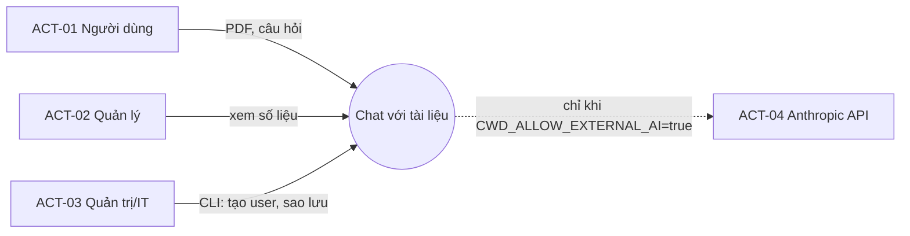

# Software Architecture Document (SAD) — Chat với tài liệu (MVP)

| Mục | Giá trị |
|---|---|
| Mã | SAD-CWD-001 · **v0.2** · Draft — chờ Architect + Tech Lead duyệt |
| Chuẩn | arc42 (12 mục) · ISO/IEC/IEEE 42010 · IEEE 1016 |
| Prompt | [SAD_Prompt_IEEE_standard.md](../prompts/SAD_Prompt_IEEE_standard.md) · Checklist: [SAD_IEEE_1016_Checklist.xlsx](../design/SAD_IEEE_1016_Checklist.xlsx) |
| Đầu vào | [BRD v0.2](../02-requirements/BRD.md) · [PRD v0.2](../03-analysis/PRD.md) · [USER_STORIES](../03-analysis/USER_STORIES.md) |
| Danh mục phần tử | [elements.yaml](elements.yaml) (CMP-xx, ENT-xx, endpoint) |
| Tác giả | Agent (Claude) |

### Lịch sử phiên bản
| Phiên bản | Ngày | Tóm tắt |
|---|---|---|
| 0.1 | 2026-10-27 | Bản đề xuất PostgreSQL + pgvector + Redis + React (commit `373616a`) |
| 0.2 | 2026-10-28 | Viết lại theo arc42; chuyển sang modular monolith Python + SQLite/FTS5 + SPA thuần do ràng buộc môi trường (ADR-001..008). Giữ nguyên các nguyên tắc v0.1: RAG, trích dẫn từ CSDL, ModelGateway, cô lập workspace |

---

## 1. Giới thiệu và mục tiêu

### 1.1 Yêu cầu chính (tóm tắt)
Người dùng tải PDF, hỏi bằng tiếng Việt, nhận câu trả lời **chỉ dựa trên tài liệu** kèm **trích dẫn tên tài liệu + trang** (US-201..305). Chi tiết: PRD §3.9.

### 1.2 Mục tiêu chất lượng (top 5, theo ISO 25010)
| # | Mục tiêu | Thước đo | Nguồn |
|---|---|---|---|
| Q1 | **Grounding & trích dẫn đúng** (Functional correctness) | 100% câu trả lời có trích dẫn hợp lệ; `not_found` ≥ 9/10 đúng | FR-011..013, NFR-002 |
| Q2 | **Bảo mật dữ liệu** (Confidentiality) | 0 rò rỉ giữa workspace; 0 lời gọi AI ngoài khi chưa cho phép | NFR-004, FR-003 |
| Q3 | **Hiệu năng** | P90 ≤ 2 s (cục bộ), ≤ 15 s (LLM ngoài) | NFR-001 |
| Q4 | **Khả năng thay thế** (Modifiability) | Đổi mô hình AI / kho dữ liệu không đổi API | ADR-002..004 |
| Q5 | **Khả năng kiểm thử** | Toàn bộ AC tự động hóa chạy offline < 10 phút | Phase 7 L0 |

### 1.3 Stakeholder của kiến trúc
| Stakeholder | Mối quan tâm |
|---|---|
| Tech Lead / Dev | Cấu trúc module, stack chạy được trên máy hiện có |
| IT / Bảo mật | Luồng dữ liệu (§8.1), xác thực, nhật ký |
| QA | Khả năng kiểm thử, điểm đo |
| PO | Rủi ro, đường nâng cấp |

## 2. Ràng buộc kiến trúc
| ID | Ràng buộc | Nguồn | Ảnh hưởng |
|---|---|---|---|
| TC-01 | Ứng dụng web, đầu vào PDF | CON-001, CON-004 | — |
| TC-02 | Python 3.15, Node 14, không Docker, không PostgreSQL/Redis | SRC-005 | ADR-001, 002, 006, 008 |
| TC-03 | Không gửi dữ liệu ra ngoài khi chưa có OQ-006 | BR-020 | ADR-003, ADR-004 |
| TC-04 | CI chạy offline, tất định | Process Phase 7 | ADR-003 (bộ sinh cục bộ) |
| OC-01 | Agent không merge/deploy; mọi ADR cần người duyệt | Process | §12 |

## 3. Bối cảnh và phạm vi

### 3.1 Bối cảnh nghiệp vụ (C4 mức 1)


### 3.2 Bối cảnh kỹ thuật
| Kênh | Giao thức | Dữ liệu |
|---|---|---|
| Trình duyệt ↔ ứng dụng | HTTP(S), JSON, multipart | Cookie phiên, PDF, câu hỏi, câu trả lời |
| Ứng dụng ↔ đĩa | File I/O | `cwd.db`, `files/*.pdf` |
| Ứng dụng ↔ Anthropic (tùy chọn) | HTTPS | Câu hỏi + chunk liên quan (không gửi cả tài liệu) |

## 4. Chiến lược giải pháp
| Mục tiêu | Chiến lược |
|---|---|
| Q1 | RAG: truy xuất chunk → sinh từ chunk → **kiểm tra trích dẫn với CSDL** (ADR-005); ngưỡng liên quan tuyệt đối để trả `not_found` (ADR-004) |
| Q2 | Mặc định bộ sinh cục bộ (ADR-003); mọi truy vấn lọc `user_id` (ADR-007); log không chứa nội dung |
| Q3 | FTS5 trong tiến trình; không gọi mạng ở chế độ cục bộ |
| Q4 | Interface `Retriever`, `AnswerGenerator`; schema SQL chuẩn |
| Q5 | Một tiến trình, CSDL tạm cho test, tác vụ nền tất định |

Kiểu kiến trúc: **modular monolith** phân lớp (Web UI → API → Service → Persistence).

## 5. Building block view

### 5.1 Mức 1 — container
| Container | Công nghệ | Chứa |
|---|---|---|
| Trình duyệt | HTML/CSS/JS thuần | CMP-01 |
| Ứng dụng | Python 3.15, FastAPI, Uvicorn | CMP-02..CMP-10, CMP-13 |
| Kho dữ liệu | SQLite file + thư mục `files/` | CMP-11 |
| CLI quản trị | Python | CMP-12 |

### 5.2 Mức 2 — thành phần

| ID | Thành phần | Module | Trách nhiệm | Phụ thuộc | Yêu cầu |
|---|---|---|---|---|---|
| CMP-01 | Web UI | `app/web/` | SPA tiếng Việt, polling trạng thái, panel trích dẫn | CMP-02 (HTTP) | UX-001..011, NFR-009 |
| CMP-02 | API Gateway | `app/main.py` | App factory, router, lỗi problem+json, file tĩnh, khôi phục ingestion khi khởi động | CMP-03..CMP-13 | NFR-005 |
| CMP-03 | Auth & Session | `app/auth.py` | Đăng nhập, phiên, CSRF, giới hạn sai, vai trò | CMP-10, CMP-11 | FR-001, FR-002, NFR-010 |
| CMP-04 | Document Service | `app/documents.py` | Kiểm tra file, lưu, danh sách, xóa | CMP-05, CMP-10, CMP-11 | FR-004, FR-005, FR-007, FR-008 |
| CMP-05 | Ingestion Pipeline | `app/ingestion.py` | pypdf → chunk → FTS, trạng thái | CMP-06 (chuẩn hóa), CMP-11 | FR-006 |
| CMP-06 | Retriever | `app/retrieval.py` | Chuẩn hóa, FTS5, điểm IDF, ngưỡng, phạm vi | CMP-11 | FR-010, FR-012, FR-014, FR-015 |
| CMP-07 | Answer Generator | `app/generation.py` | Cục bộ (trích đoạn) / Anthropic | ACT-04 (tùy chọn) | FR-011, FR-003 |
| CMP-08 | Chat Service | `app/chat.py` | Hội thoại, điều phối, kiểm tra trích dẫn, lưu lượt | CMP-06, CMP-07, CMP-11 | FR-009, FR-013, FR-016 |
| CMP-09 | Feedback & Metrics | `app/metrics.py` | Đánh giá, thống kê tuần | CMP-11 | FR-017, FR-018 |
| CMP-10 | Audit Log | `app/audit.py` | Ghi sự kiện kiểm toán | CMP-11 | FR-019 |
| CMP-11 | Persistence | `app/db.py`, `app/schema.sql` | Kết nối, schema, giao dịch | — | NFR-006 |
| CMP-12 | Admin CLI | `app/cli.py` | Tạo user, demo, backup/restore, dọn nhật ký | CMP-03, CMP-11 | NFR-006, NFR-007 |
| CMP-13 | Configuration | `app/config.py` | Biến môi trường `CWD_*` | — | FR-003 |

Sơ đồ: [diagrams/component_diagram.drawio](diagrams/component_diagram.drawio), [diagrams/class_diagram.drawio](diagrams/class_diagram.drawio).

### 5.3 Interface nội bộ chính
```python
class Retriever(Protocol):
    def retrieve(
        self, user_id: int, question: str, history: list[str], document_ids: list[str] | None
    ) -> list[RetrievedChunk]: ...


class AnswerGenerator(Protocol):
    mode: str  # "local" | "external"

    def generate(self, question: str, chunks: list[RetrievedChunk]) -> GeneratedAnswer: ...
```

## 6. Runtime view

### 6.1 Hỏi đáp (US-301..305) — chi tiết: [diagrams/sequence_diagram.drawio](diagrams/sequence_diagram.drawio)
| # | Bước | Thành phần | Quy tắc |
|---|---|---|---|
| 1 | Xác thực phiên + CSRF; kiểm tra hội thoại thuộc người dùng | CMP-03, CMP-08 | 401/403/404 |
| 2 | Kiểm tra câu hỏi 1–2000 ký tự | CMP-08 | `chat.invalid_question` (422) |
| 3 | Kiểm tra có tài liệu `ready` trong phạm vi | CMP-08 | `chat.no_ready_documents` (409) |
| 4 | Lấy 3 câu hỏi trước làm ngữ cảnh phụ | CMP-08 | FR-014 |
| 5 | Truy xuất + tính `rel`; lọc `rel ≥ 0.6`; ≤ 6 chunk, ≤ 2/tài liệu | CMP-06 | ADR-004 |
| 6 | Không có chunk ⇒ `not_found`, **không gọi bộ sinh** | CMP-08 | FR-012 |
| 7 | Sinh câu trả lời với `[n]` | CMP-07 | ADR-003 |
| 8 | Lọc `[n]` không hợp lệ; trích dẫn lấy từ CSDL; không còn trích dẫn ⇒ `not_found` | CMP-08 | ADR-005 |
| 9 | Lưu lượt (latency_ms) và trả về; `warning=docs_processing` nếu còn tài liệu đang xử lý | CMP-08 | AC-203.4 |

### 6.2 Tải lên và xử lý (US-201..203) — [diagrams/activity_diagram.drawio](diagrams/activity_diagram.drawio)
Kiểm tra số lượng → với mỗi file: kiểm tra chữ ký `%PDF-` và kích thước → lưu file + bản ghi `processing` → audit `document.upload` → trả kết quả từng file → tác vụ nền: pypdf từng trang → chunk ~800 ký tự theo ranh giới câu, chồng lấn 100 → một transaction ghi chunk + FTS → `ready` / `no_text` (tổng văn bản < 20 ký tự) / `failed` (`pdf.encrypted`, `pdf.corrupt`).

### 6.3 Xóa tài liệu (US-205)
Kiểm tra sở hữu → `DELETE documents` (cascade chunk, trigger FTS) → xóa file → audit `document.delete`. Câu hỏi sau đó không thể truy xuất chunk đã xóa (AC-205.2).

### 6.4 Đăng nhập (US-101)
Giới hạn sai 5/5 phút → xác minh PBKDF2 (thời gian hằng) → tạo token, lưu băm → cookie + CSRF → audit.

## 7. Deployment view — [diagrams/deployment_diagram.drawio](diagrams/deployment_diagram.drawio)
| Node | Phần mềm | Ghi chú |
|---|---|---|
| Máy trạm người dùng | Trình duyệt hiện đại | — |
| Reverse proxy (khuyến nghị khi triển khai) | IIS/Nginx/Caddy, TLS | Bật `CWD_COOKIE_SECURE=true` |
| Máy chủ ứng dụng | Python ≥ 3.12, `uvicorn app.main:app` (1 worker) | Windows hoặc Linux |
| Đĩa máy chủ | `CWD_DATA_DIR` (`cwd.db`, `files/`, `backups/`) | Mã hóa đĩa do IT quản lý |
| Anthropic API (tùy chọn) | HTTPS | Chỉ khi IT cho phép |

Môi trường: `dev` (máy dev), `test` (CI, CSDL tạm), `prod` (máy chủ nội bộ, DEP-003). Cấu hình qua biến môi trường, không có secret trong mã.

## 8. Khái niệm xuyên suốt

### 8.1 Bảo mật và luồng dữ liệu (cho IT ký AC-102.3)
| Dữ liệu | Nơi lưu | Rời máy chủ? |
|---|---|---|
| File PDF, văn bản chunk | Đĩa máy chủ | **Không** ở chế độ `local`. Chế độ `external`: tối đa 6 chunk liên quan mỗi câu hỏi gửi tới Anthropic |
| Câu hỏi, câu trả lời | `turns` | Như trên |
| Mật khẩu | Băm PBKDF2 | Không |
| Token phiên | Cookie (thô), CSDL (băm) | Không |
| Log ứng dụng | stdout | Chỉ metadata: method, path, status, latency, user_id; **không** nội dung (NFR-008) |

Phòng thủ prompt injection: chunk được coi là dữ liệu; bộ sinh cục bộ không diễn giải chỉ thị; bộ sinh ngoài nhận chunk trong thẻ `<document>`, hệ thống nhắc rõ không làm theo chỉ dẫn trong tài liệu, không có công cụ; trích dẫn kiểm tra với CSDL. Header bảo mật: `X-Content-Type-Options: nosniff`, `X-Frame-Options: DENY`, `Referrer-Policy: no-referrer`, `Content-Security-Policy: default-src 'self'`.

### 8.2 Xử lý lỗi
Lỗi nghiệp vụ → `ProblemError(code, status)` → problem+json với `title` tiếng Việt. Lỗi không lường trước → 500 `internal` không có stack trace; log có `request_id`.

### 8.3 Chuẩn hóa tiếng Việt
Hàm duy nhất `app/textnorm.fold()` dùng cho cả lập chỉ mục và truy vấn (ADR-004).

### 8.4 Quan sát
Middleware ghi log JSON mỗi request; `latency_ms` lưu trong `turns` cho NFR-001; `/api/health` cho giám sát; dashboard `metrics/weekly`.

### 8.5 Cấu hình
| Biến | Mặc định | Ý nghĩa |
|---|---|---|
| `CWD_DATA_DIR` | `./data` | Thư mục dữ liệu |
| `CWD_MAX_FILE_MB` | 20 | OQ-011 |
| `CWD_MAX_DOCS` | 50 | OQ-011 |
| `CWD_MIN_RELEVANCE` | 0.6 | ADR-004 |
| `CWD_TOP_K` | 6 | ADR-004 |
| `CWD_SESSION_IDLE_HOURS` | 8 | FR-002 |
| `CWD_ALLOW_EXTERNAL_AI` | false | FR-003 |
| `CWD_ANTHROPIC_MODEL` | claude-opus-5-5 | ADR-003 |
| `CWD_ANSWER_TIMEOUT_S` | 15 | OQ-012 |
| `CWD_COOKIE_SECURE` | false | ADR-007 |

## 9. Quyết định kiến trúc
| ADR | Quyết định | Trạng thái |
|---|---|---|
| [ADR-001](adr/ADR-001-backend-python-fastapi.md) | Python + FastAPI, modular monolith | Proposed |
| [ADR-002](adr/ADR-002-sqlite-fts5-storage.md) | SQLite + FTS5 thay PostgreSQL/pgvector/Redis | Proposed |
| [ADR-003](adr/ADR-003-model-gateway-local-first.md) | ModelGateway, mặc định cục bộ | Proposed — cần IT |
| [ADR-004](adr/ADR-004-lexical-retrieval-vietnamese.md) | Truy xuất từ vựng + ngưỡng IDF | Proposed |
| [ADR-005](adr/ADR-005-citations-from-database.md) | Trích dẫn từ CSDL | Proposed |
| [ADR-006](adr/ADR-006-vanilla-spa-no-build.md) | SPA thuần không build | Proposed |
| [ADR-007](adr/ADR-007-local-accounts-server-sessions.md) | Tài khoản cục bộ, phiên máy chủ | Proposed — review L3 |
| [ADR-008](adr/ADR-008-in-process-background-ingestion.md) | Ingestion nền trong tiến trình | Proposed |

## 10. Yêu cầu chất lượng — kịch bản
| ID | Thuộc tính | Kích thích → Phản hồi | Thước đo | Kiểm chứng |
|---|---|---|---|---|
| QS-01 | Correctness | Hỏi câu không có trong tài liệu → `not_found`, không trích dẫn | ≥ 9/10 | `tests/eval` |
| QS-02 | Correctness | Đáp án ở 2 tài liệu → trích dẫn cả 2 | 100% trên bộ test | test tích hợp |
| QS-03 | Security | PDF chứa "bỏ qua mọi hướng dẫn…" → không thực thi | 0 hành động | test injection |
| QS-04 | Security | User B đọc tài nguyên của A → 404 | 0 rò rỉ | test cô lập |
| QS-05 | Performance | 50 tài liệu, hỏi ở chế độ cục bộ | P90 ≤ 2 s | `tests/eval` |
| QS-06 | Modifiability | Bật LLM ngoài | Chỉ đổi cấu hình | AC-102.2 |
| QS-07 | Recoverability | Mất dữ liệu → khôi phục từ backup | ≤ 4 h | Runbook diễn tập |

## 11. Rủi ro và nợ kỹ thuật
| ID | Rủi ro | Mức | Giảm thiểu | Owner |
|---|---|---|---|---|
| R-01 | Truy xuất từ vựng bỏ sót đồng nghĩa → `not_found` sai | Trung bình | Đo bằng bộ câu hỏi chuẩn; thêm embedding khi OQ-006 mở | Tech Lead |
| R-02 | Câu trả lời trích đoạn kém tự nhiên → ít dùng (RSK-003) | Trung bình | Bật LLM khi được phép; thu đánh giá US-501 | PO |
| R-03 | SQLite không mã hóa khi lưu | Trung bình | Mã hóa đĩa máy chủ; quyền thư mục | IT |
| R-04 | Một tiến trình: ingestion nặng làm chậm hỏi đáp | Thấp | Quy mô nhỏ; tách worker khi vượt trigger ADR-002 | Tech Lead |
| R-05 | Đoạn trích còn trong lượt cũ sau khi xóa tài liệu | Thấp | ≤ 300 ký tự, cùng workspace; ghi trong hướng dẫn | PO |
| R-06 | Giới hạn đăng nhập sai mất khi khởi động lại | Thấp | Chấp nhận MVP | IT |
| TD-01 | Không có streaming (UX-005) | — | Thêm khi bật LLM ngoài | Tech Lead |

## 12. Thuật ngữ và phê duyệt
Thuật ngữ: [glossary.md](../01-intake/glossary.md).

| Vai trò | Tên | Quyết định | Ngày |
|---|---|---|---|
| Architect | | ☐ Approve ☐ Reject | |
| Tech Lead | | ☐ Approve ☐ Reject | |
| IT / Bảo mật (§8.1, ADR-003, ADR-007) | | ☐ Approve ☐ Reject | |
