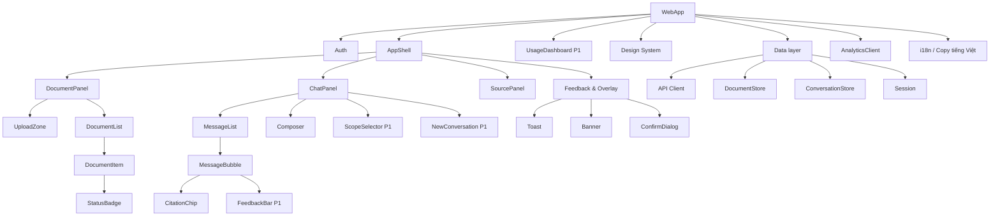
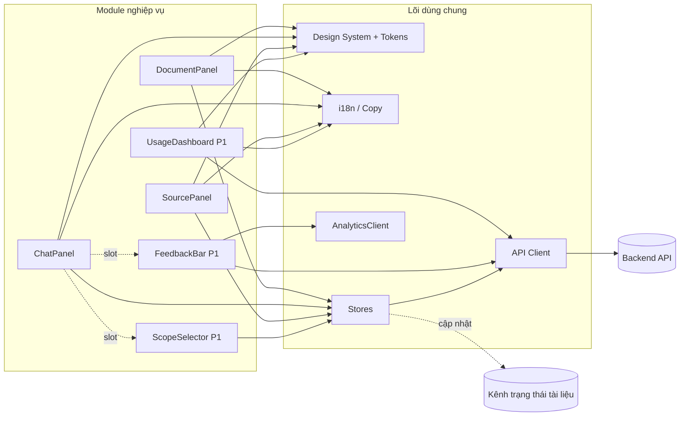
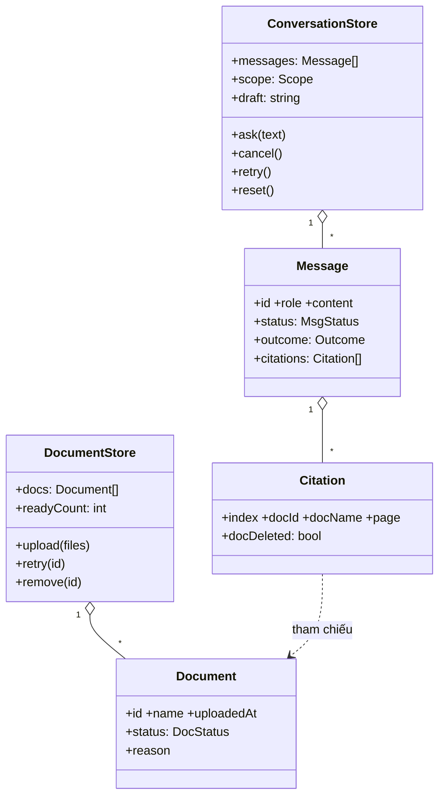
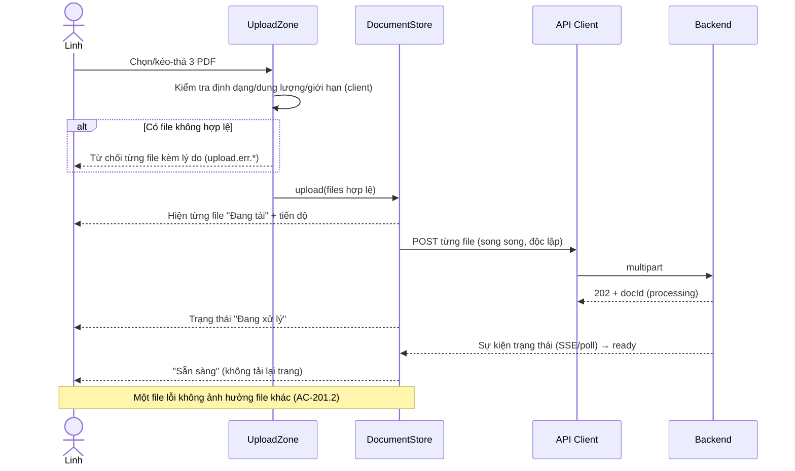
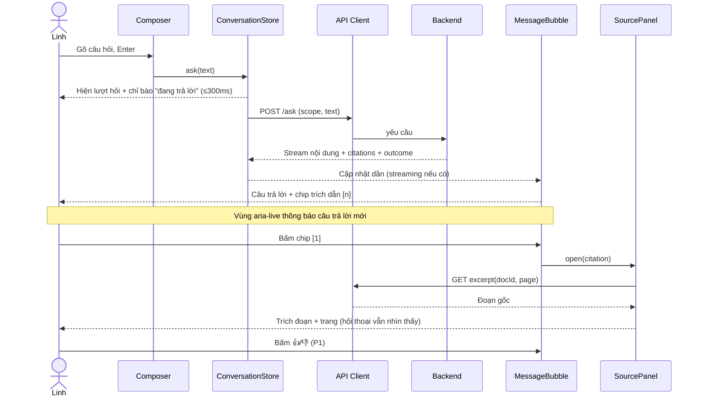
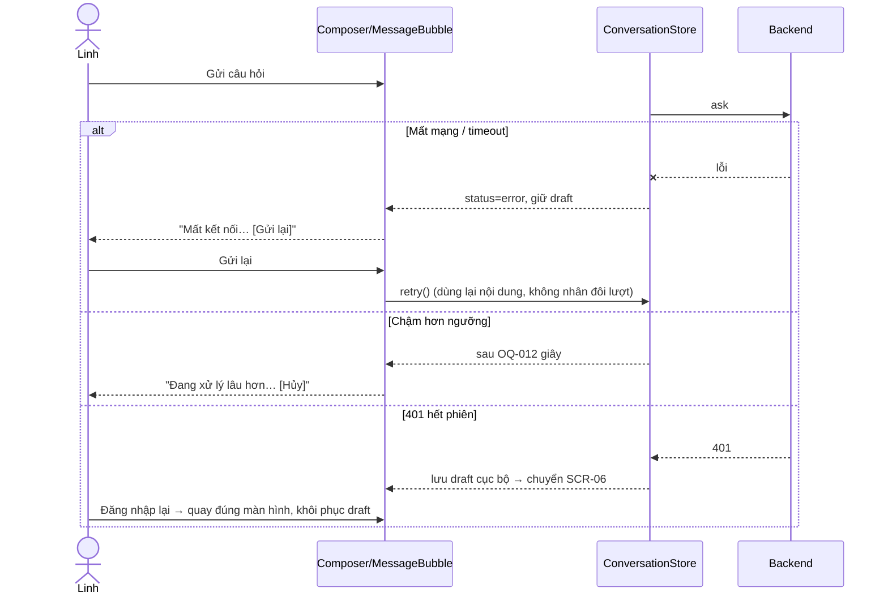
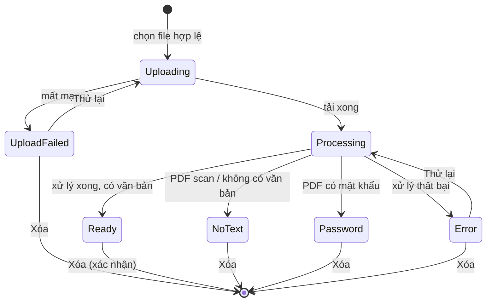
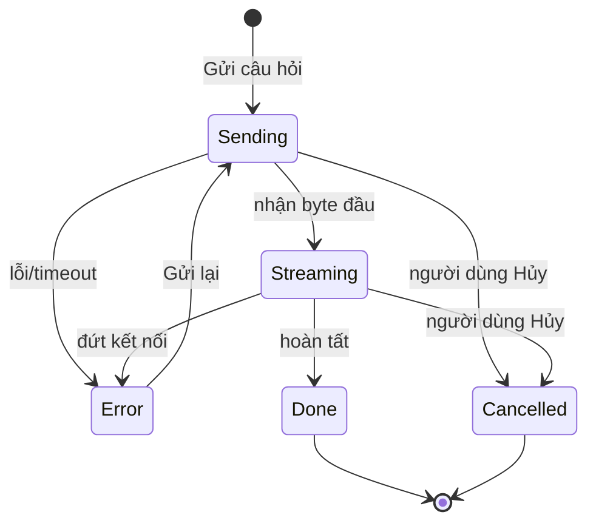

# Blueprint Design UI/UX (SDD) — Công cụ "Chat với tài liệu" (MVP)

> **Chuẩn áp dụng:** IEEE 1016-2009 (Software Design Descriptions)
> **Mã tài liệu:** SDD-UIUX-CWD-001 · **Phiên bản:** 0.1 · **Trạng thái:** Draft
> **Đầu vào:** [PRD-CWD-001 v0.1](../requirements/PRD.md) · [BRD-CWD-001 v0.1](../requirements/BRD.md) · **Prompt nguồn:** [bluePrint_design_prompt.md](../prompts/bluePrint_design_prompt.md)
> **Phạm vi:** Thiết kế **UI/UX** (lớp giao diện web). Kiến trúc backend, mô hình AI và hạ tầng thuộc SAD/SRS riêng.

**Quy ước:** `[TBD: …]` = chưa có giá trị, đang chờ câu hỏi mở (OQ-xxx của BRD, PQ-xxx của PRD). `[Đề xuất]` = do đội Design đề xuất, **chưa được duyệt**. Mã `US-`, `AC-`, `UX-`, `EC-`, `LG-`, `BR-`, `RSK-` lấy từ PRD/BRD để truy vết. Mã `C-xx` (concern), `QA-xx`, `SCR-xx`, `CMP-xx`, `DT-xx` do tài liệu này định nghĩa.

> **Ghi chú về prompt nguồn:** Prompt chỉ mô tả chi tiết Mục 1, 2 và View 3.1 (Composition) dù nêu "tám view". Tài liệu này giữ nguyên các mục đó và hoàn thiện **8 view** theo viewpoint IEEE 1016-2009: Composition, Dependency, Logical, Information, Interface, Interaction, State Dynamics, Patterns Use.

---

## 1. Bối cảnh và đối tượng thiết kế

### 1.1 Nhận diện hệ thống

| Thuộc tính | Giá trị |
|---|---|
| **Tên hệ thống** | Công cụ "Chat với tài liệu" (MVP) |
| **Phiên bản SDD** | v0.1 |
| **Ngày tài liệu** | 2026-10-27 |
| **Chủ sở hữu tài liệu** | Đội Design / Product (minhtrungle) — [TBD: xác nhận Lead Architect] |
| **Lịch sử sửa đổi** | Xem Mục 8 |

### 1.2 Phạm vi hệ thống và ranh giới bên ngoài

| Loại ranh giới | Mô tả |
|---|---|
| **Mục đích hệ thống** | Web app cho phép tải PDF, hỏi đáp bằng tiếng Việt, nhận câu trả lời **chỉ dựa trên tài liệu**, kèm trích dẫn (tên tài liệu + số trang) kiểm chứng được. Giá trị: tìm thông tin nhanh hơn thủ công mà vẫn đáng tin (BO-001..003). |
| **Hệ thống bên ngoài** | Dịch vụ AI/LLM [TBD: OQ-006]; dịch vụ xác thực (SSO nội bộ hoặc tài khoản riêng) [TBD: OQ-006, DEP-003]; lưu trữ tệp; dịch vụ analytics (§5.2 PRD). Thuộc lớp backend — UI chỉ giao tiếp qua API của ứng dụng. |
| **Loại người dùng** | **Linh** — chuyên viên kinh doanh (chính); **Hùng** — quản lý dự án (xem số liệu); **Mai** — IT/Bảo mật (không dùng trực tiếp, có thể chặn go-live) [Unverified]. |
| **Giao diện bên ngoài** | UI ↔ Backend qua HTTPS API (REST/stream) [TBD: SAD]; cập nhật trạng thái tài liệu theo thời gian thực (polling/SSE/WebSocket) [TBD: SAD]; tải tệp multipart. |
| **Ranh giới tin cậy** | Trình duyệt người dùng (không tin cậy) → mạng nội bộ → ứng dụng → dịch vụ AI bên ngoài (ranh giới tin cậy riêng, OQ-006). **Nội dung PDF là dữ liệu không tin cậy** (RSK-P1, AC-303.2): UI phải hiển thị như văn bản thuần, không thực thi/render HTML. |
| **Môi trường triển khai** | Trình duyệt hiện đại trên máy tính; mạng nội bộ [Đề xuất]; môi trường backend [TBD: DEP-003]. Mobile ngoài phạm vi MVP (UX-010). |

### 1.3 Giả định và ràng buộc

| Loại | Mô tả |
|---|---|
| **Ràng buộc kỹ thuật** | CON-001: desktop web, trình duyệt hiện đại; chỉ PDF; độ rộng tối thiểu [TBD: ASM-004, UX-010]; công nghệ front-end [TBD: SAD] — tài liệu này **không chọn framework**. |
| **Ràng buộc kinh doanh** | MVP tối thiểu; P1/P2 không chặn launch (RSK-006); các tính năng BA đề xuất chờ duyệt (OQ-013, PQ-005). |
| **Giả định môi trường** | Mạng nội bộ ổn định; người dùng dùng Chrome/Edge/Firefox/Safari bản mới [Đề xuất]; A-1: một workspace dùng chung (OQ-007). |
| **Giả định dữ liệu** | Giới hạn dung lượng/số tài liệu [TBD: OQ-011]; PDF có lớp văn bản (ASM-001) — PDF scan chỉ hiển thị cảnh báo; ngưỡng phản hồi [TBD: OQ-012, tạm đề xuất ≤ 15 s]; ngôn ngữ giao diện chỉ tiếng Việt (P-4). |

---

## 2. Stakeholder và mối quan tâm

### 2.1 Nhận diện stakeholder

| Stakeholder | Vai trò | Mối quan tâm chính |
|---|---|---|
| Linh (STK-002) | Người dùng cuối — đội kinh doanh | Tin cậy được đáp án, ít thao tác, biết nguồn, trạng thái rõ ràng |
| Hùng (STK-001) | Quản lý dự án / sponsor | Số liệu sử dụng, chất lượng, chứng minh giá trị MVP |
| Mai (STK-005) | IT / Bảo mật | Dữ liệu đi đâu, ai truy cập, không rò rỉ qua UI |
| Lập trình viên front-end | Đội kỹ thuật | Dễ hiểu, dễ bảo trì, tái sử dụng component, dễ kiểm thử |
| QA | Kiểm thử | Mỗi hành vi UI kiểm chứng được; trạng thái/lỗi có định nghĩa rõ |
| Product Owner | Business | Giữ phạm vi P0 tối thiểu, đo được hành vi |

### 2.2 Mối quan tâm của stakeholder (IEEE 1016-2009)

| ID | Stakeholder | Mối quan tâm | Ưu tiên | Tiêu chí chấp nhận |
|---|---|---|---|---|
| C-01 | Linh | **Kiểm chứng được câu trả lời** — mỗi câu trả lời có trích dẫn bấm được, xem đoạn gốc | Cao | 100% câu trả lời có thông tin đều có trích dẫn; bấm trích dẫn → thấy đoạn gốc + trang (AC-305.1, 305.2) |
| C-02 | Linh | **Biết trạng thái tài liệu** — không hỏi khi chưa sẵn sàng | Cao | Trạng thái cập nhật không cần tải lại trang (AC-203.2); cảnh báo khi hỏi lúc còn tài liệu chưa sẵn sàng (AC-203.4) |
| C-03 | Linh | **Tối thiểu thao tác** — upload → hỏi, không cấu hình | Cao | Hai vùng trên màn hình chính; không bước cấu hình bắt buộc (UX-001) |
| C-04 | Linh | **Lỗi dễ hiểu, hồi phục được** — không mất câu hỏi đã nhập | Cao | Thông báo nêu nguyên nhân + hành động; giữ nội dung đã nhập khi lỗi mạng/hết phiên (UX-008, EC-04, EC-15) |
| C-05 | Linh | **Tiếng Việt hạng nhất** | Cao | 100% chuỗi UI tiếng Việt; không hiển thị mã lỗi thô (UX-008, AC-301.2) |
| C-06 | Linh | **Chờ phản hồi AI không bồn chồn** | Trung bình | Chỉ báo "đang trả lời" ≤ 300 ms; streaming nếu khả thi; thông báo chậm + nút hủy (UX-005, EC-06) |
| C-07 | Linh | **Kiểm soát phạm vi tài liệu** | Trung bình | Phạm vi luôn hiển thị cạnh ô nhập (UX-006, US-402) |
| C-08 | Mai | **Không rò rỉ / chặn truy cập trái phép qua UI** | Cao | Chưa đăng nhập không thấy tên tài liệu/hội thoại (AC-101.1); nội dung PDF hiển thị thuần văn bản (AC-303.2) |
| C-09 | Hùng | **Đo được hành vi người dùng** | Trung bình | Mọi tương tác quan trọng phát đủ sự kiện analytics (PRD §5.2); không ghi nội dung thô |
| C-10 | Hùng | **Thu thập phản hồi chất lượng** | Trung bình | Nút hữu ích/không hữu ích trên mỗi câu trả lời (UX-007, US-501) |
| C-11 | Mọi người dùng | **Khả năng tiếp cận** | Cao | Tương phản ≥ 4.5:1, điều hướng bàn phím, trình đọc màn hình (UX-011, UX-009); mức WCAG [TBD: PQ-003] |
| C-12 | Lập trình viên | **Dễ bảo trì, nhất quán** — design system/component tái sử dụng | Trung bình | Mọi màu/khoảng cách/kiểu chữ lấy từ design token; không giá trị cứng trong component |
| C-13 | QA | **Kiểm thử được** — mọi trạng thái có định nghĩa, có `data-testid`/nhãn ổn định | Trung bình | Mỗi story P0 có ≥ 1 test UI chạy đạt (LG-18) |
| C-14 | Product Owner | **Giữ phạm vi MVP** — P1/P2 gắn được/gỡ được mà không phá P0 | Trung bình | P1/P2 là component tùy chọn, không phụ thuộc ngược từ P0 (xem 3.3) |

### 2.3 Kịch bản chất lượng (hệ thống — phạm vi giao diện)

Định dạng 6 phần: Source / Stimulus / Artifact / Environment / Response / Response Measure. Các giá trị `[Đề xuất]` chờ xác nhận.

| Thuộc tính | Kịch bản |
|---|---|
| **Hiệu năng** (QA-01) | *Người dùng* mở màn hình chính, *trong* điều kiện mạng nội bộ với ≤ [TBD: OQ-011] tài liệu, *thì* tải xong giao diện tương tác được trong **≤ 3 s** (LG-12). |
| **Độ trễ cảm nhận** (QA-02) | *Linh* gửi câu hỏi → chỉ báo "đang trả lời" hiện trong **≤ 300 ms**; kết quả đầy đủ P90 **≤ [TBD: OQ-012] (đề xuất 15 s)** (LG-09). |
| **Tính khả dụng** (QA-03) | *UI* khi API lỗi/timeout → hiển thị thông báo + nút thử lại trong **≤ 1 s** sau khi phát hiện lỗi; không hiển thị câu trả lời dang dở như hoàn chỉnh (EC-04/05). |
| **Bảo mật** (QA-04) | *Người chưa đăng nhập* mở bất kỳ URL nào → chuyển về đăng nhập; 0 byte tên tài liệu/hội thoại trong phản hồi (AC-101.1). Nội dung PDF/câu trả lời được escape, **0** thực thi script. |
| **Bảo trì** (QA-05) | Một thay đổi token (ví dụ màu chính) lan truyền toàn UI **không sửa component**; thay đổi 1 component P1 ảnh hưởng **0** component P0. |
| **Khả năng kiểm thử** (QA-06) | 100% hành vi P0 có thể tự động hóa qua nhãn truy cập (accessible name) hoặc `data-testid`; test UI trên bộ trạng thái chạy < [TBD] phút. |
| **Quan sát** (QA-07) | Mỗi hành động trong bảng sự kiện PRD §5.2 phát đúng 1 sự kiện với thuộc tính bắt buộc; không chứa nội dung câu hỏi/tài liệu thô. |

### 2.4 Kịch bản chất lượng UX/UI

| Thuộc tính | Kịch bản UX/UI |
|---|---|
| **Khả dụng** (UQ-01) | Người dùng lần đầu, **không đào tạo**, tải 1 PDF và nhận câu trả lời có trích dẫn đầu tiên trong **≤ 3 phút** [Đề xuất], tối đa **4 thao tác** (mở → tải lên → chờ Sẵn sàng → gõ + gửi). |
| **Tiếp cận** (UQ-02) | Mọi điều khiển tương tác dùng được bằng bàn phím và có tên truy cập; câu trả lời mới được thông báo qua vùng `aria-live`; tương ứng WCAG 2.1 AA [TBD: PQ-003]. |
| **Hiệu năng giao diện** (UQ-03) | FCP < 1.5 s, LCP < 2.5 s trên mạng nội bộ/4G [Đề xuất]; danh sách 100 tài liệu cuộn mượt (không giật > 100 ms) [Đề xuất]. |
| **Đáp ứng kích thước** (UQ-04) | Bố cục hai vùng dùng tốt từ **1024 px** trở lên [Đề xuất — chốt theo ASM-004]; dưới 1024 px thu gọn danh sách tài liệu thành ngăn kéo; **không có cuộn ngang** ở độ rộng hỗ trợ. Mobile ngoài phạm vi. |
| **Nhất quán thị giác** (UQ-05) | 100% màu, cỡ chữ, khoảng cách, bo góc lấy từ token (Mục 3.2/3.7); trạng thái tài liệu luôn dùng đúng một bộ icon + chữ + màu. |
| **Hồi phục lỗi** (UQ-06) | Mọi lỗi nêu **nguyên nhân + hành động tiếp theo**, hồi phục không cần tải lại trang; câu hỏi đã gõ **không bị mất** (EC-03, EC-04, EC-15). |
| **Phản hồi & affordance** (UQ-07) | Mọi phần tử bấm được có trạng thái hover/focus/active/disabled; thao tác async hiện loading ≤ 300 ms. |
| **Kiến trúc thông tin** (UQ-08) | Mọi chức năng P0 đạt tới trong **≤ 1 lần bấm** từ màn hình chính (chỉ có 2 vùng). |
| **Bản địa hóa** (UQ-09) | MVP chỉ tiếng Việt; chuỗi UI tách khỏi code để mở rộng ngôn ngữ sau; chịu được mở rộng chuỗi +30% mà không vỡ bố cục. Định dạng ngày `dd/MM/yyyy`. |
| **Trải nghiệm di động** (UQ-10) | **Không áp dụng** cho MVP (UX-010). Vẫn giữ vùng chạm ≥ 44 px cho điều khiển chính để thuận tiện màn hình cảm ứng laptop [Đề xuất]. |

### 2.5 Ma trận ràng buộc UX/UI

| Ràng buộc | Yêu cầu | Công cụ/Chuẩn | Cách kiểm chứng |
|---|---|---|---|
| **Tương phản màu** | ≥ 4.5:1 cho chữ thường, ≥ 3:1 cho chữ lớn/biểu tượng (UX-011) | WCAG 2.1 AA | Kiểm tra tự động (axe/Lighthouse) + thủ công |
| **Kiểu chữ** | Chữ nội dung ≥ 16 px (14 px cho nhãn phụ); phông hỗ trợ đầy đủ dấu tiếng Việt | Design system (Mục 3.7) | Rà soát thiết kế + thử với chuỗi có dấu |
| **Vùng chạm** | Nút ≥ 44×44 px (vùng bấm), icon-button có nhãn | Apple HIG / Material | UI test, rà soát |
| **Trạng thái tải** | Skeleton/spinner trong ≤ 300 ms | UX best practice | Giám sát hiệu năng |
| **Thông báo lỗi** | Rõ ràng, hành động được, không mã kỹ thuật (UX-008) | Hướng dẫn UX writing tiếng Việt | Rà soát nội dung với kho chuỗi (Mục 3.4) |
| **Trạng thái trống** | Mỗi trạng thái trống dẫn tới hành động kế tiếp (EC-01, EC-02) | UX best practice | Kiểm kê UI (Mục 3.5) |
| **Thông báo** | Không chặn thao tác; tự ẩn thông báo thành công; lỗi phải được xác nhận | UX best practice | Test người dùng |
| **Trợ giúp & hướng dẫn** | Có hướng dẫn ngắn nêu giới hạn (PDF scan) và cách kiểm chứng trích dẫn (LG-24) | UX best practice | Chỉ số hoàn thành tác vụ (UQ-01) |
| **Không dựa vào màu** | Trạng thái dùng icon + chữ, không chỉ màu (UX-002) | WCAG 1.4.1 | Rà soát thiết kế, kiểm thử thang xám |
| **Bàn phím** | Enter gửi, Shift+Enter xuống dòng, Tab tới mọi điều khiển chính (UX-009) | WAI-ARIA APG | UI test bàn phím |

---

## 3. Các view thiết kế (IEEE 1016-2009)

Mỗi view liên kết ngược tới mối quan tâm (C-xx) ở Mục 2. Bảng truy vết đầy đủ ở Mục 4.

**Bản đồ view ↔ mối quan tâm:**

| View | Viewpoint IEEE 1016 | Mối quan tâm chính |
|---|---|---|
| 3.1 Composition | Phân rã cấu trúc | C-12, C-13, C-14 |
| 3.2 Dependency | Phụ thuộc | C-14, C-12 |
| 3.3 Logical | Cấu trúc tĩnh / component | C-12, C-13, C-14 |
| 3.4 Information | Dữ liệu & nội dung | C-02, C-05, C-08 |
| 3.5 Interface | Màn hình & giao diện | C-01, C-03, C-04, C-07, C-10, C-11 |
| 3.6 Interaction | Tương tác theo thời gian | C-01, C-04, C-06, C-09 |
| 3.7 State Dynamics | Máy trạng thái | C-02, C-04, C-06 |
| 3.8 Patterns Use | Mẫu thiết kế | C-03, C-08, C-11, C-12 |

---

### 3.1 Composition View

**Mục đích:** Mô tả cách UI được lắp ráp từ các đơn vị nhỏ hơn (module, container, component).
**Viewpoint:** Phân rã cấu trúc.
**Mối quan tâm:** C-12 (nhất quán), C-13 (kiểm thử), C-14 (phạm vi).

| Phần tử | Loại | Cha | Trách nhiệm | Phụ thuộc | Ưu tiên |
|---|---|---|---|---|---|
| **WebApp** | Root | — | Khởi tạo, định tuyến, nạp theme/token | Auth, Shell | P0 |
| **Auth** | Module | WebApp | Màn hình đăng nhập, bảo vệ route, xử lý hết phiên | API Client | P0 |
| **AppShell** | Module | WebApp | Khung trang: header, tên người dùng, bố cục 2 vùng | Auth | P0 |
| **DocumentPanel** | Module | AppShell | Vùng trái: tải lên, danh sách, trạng thái, xóa | DocumentStore | P0 |
| **UploadZone** | Component | DocumentPanel | Chọn/kéo-thả, kiểm tra phía client, tiến độ | DocumentStore | P0 |
| **DocumentList / DocumentItem** | Component | DocumentPanel | Hiển thị tên, thời điểm, trạng thái; chọn phạm vi (P1); xóa (P1) | StatusBadge | P0 |
| **StatusBadge** | Component | DocumentItem | Icon + chữ + màu theo trạng thái | Tokens | P0 |
| **ChatPanel** | Module | AppShell | Vùng phải: hội thoại, ô nhập, phạm vi | ConversationStore | P0 |
| **MessageList** | Component | ChatPanel | Danh sách lượt hỏi/đáp, cuộn, vùng `aria-live` | MessageBubble | P0 |
| **MessageBubble** (User/Assistant) | Component | MessageList | Render nội dung (văn bản thuần), trạng thái đang trả lời/lỗi | CitationChip | P0 |
| **CitationChip** | Component | MessageBubble | Trích dẫn bấm được `[n] Tên — tr. X` | SourcePanel | P0 |
| **FeedbackBar** | Component | MessageBubble | 👍/👎 + lý do ngắn | AnalyticsClient | P1 |
| **Composer** | Component | ChatPanel | Ô nhập, Enter/Shift+Enter, đếm ký tự, nút Gửi/Hủy | ConversationStore | P0 |
| **ScopeSelector** | Component | ChatPanel | Hiển thị/chọn phạm vi tài liệu | DocumentStore | P1 (hiển thị "Tất cả" là P0) |
| **NewConversationButton** | Component | ChatPanel | Bắt đầu hội thoại mới | ConversationStore | P1 |
| **SourcePanel** | Module | AppShell | Ngăn bên phải/overlay xem đoạn gốc + số trang | API Client | P0 |
| **Feedback & Overlay** | Module | AppShell | Toast, Banner, ConfirmDialog | — | P0 |
| **UsageDashboard** | Module | WebApp | Số liệu WAU, số câu hỏi (cho Hùng) | API Client | P1 |
| **Shared/Design System** | Package | WebApp | Token, Button, Input, Icon, Dialog, Skeleton, EmptyState | — | P0 |
| **Data layer** | Package | WebApp | API Client, DocumentStore, ConversationStore, Session | — | P0 |
| **AnalyticsClient** | Package | WebApp | Phát sự kiện PRD §5.2 | — | P0 |
| **i18n / Copy** | Package | WebApp | Kho chuỗi tiếng Việt | — | P0 |

**Sơ đồ:**



---

### 3.2 Dependency View

**Mục đích:** Chỉ rõ phụ thuộc giữa các thành phần và với hệ thống ngoài, để kiểm soát ảnh hưởng thay đổi.
**Mối quan tâm:** C-14 (P1/P2 gỡ được), C-12.

**Quy tắc phụ thuộc (bắt buộc):**

1. Chiều phụ thuộc: `Module nghiệp vụ → Design System / Data layer`; **không** ngược lại.
2. Module P0 **không** import module P1/P2. P1/P2 cắm vào qua điểm mở rộng (slot): `FeedbackBar` vào `MessageBubble`, `ScopeSelector` vào `ChatPanel`, `UsageDashboard` là route riêng.
3. Component không gọi API trực tiếp; chỉ qua Store → API Client.
4. Mọi chuỗi hiển thị lấy từ i18n/Copy; mọi giá trị trực quan lấy từ Token.

| Từ | Phụ thuộc vào | Loại | Ghi chú |
|---|---|---|---|
| DocumentPanel | DocumentStore, Design System, Copy | Nội bộ | |
| ChatPanel | ConversationStore, DocumentStore (đọc phạm vi/số tài liệu sẵn sàng) | Nội bộ | Điều kiện kích hoạt Composer (AC-301.5) |
| MessageBubble | CitationChip | Nội bộ | |
| CitationChip | SourcePanel (qua sự kiện/Store), không import trực tiếp | Nội bộ | Giảm ghép nối |
| FeedbackBar (P1) | AnalyticsClient, API Client | Nội bộ | Gỡ được |
| API Client | Backend API; Session (gắn token, xử lý 401) | Ngoài | 401 → Auth chuyển về đăng nhập (EC-15) |
| DocumentStore | Kênh cập nhật trạng thái (polling/SSE/WS) [TBD: SAD] | Ngoài | AC-203.2 |
| AnalyticsClient | Dịch vụ analytics [TBD] | Ngoài | Không chặn luồng chính nếu lỗi |



---

### 3.3 Logical View

**Mục đích:** Mô tả cấu trúc tĩnh của component cốt lõi: trách nhiệm, thuộc tính, hợp đồng (props/events).
**Mối quan tâm:** C-12, C-13, C-14.

#### 3.3.1 Danh mục component chính

| ID | Component | Props / đầu vào chính | Sự kiện phát ra | Trạng thái nội bộ | Truy vết |
|---|---|---|---|---|---|
| CMP-01 | UploadZone | `maxSizeMB`, `maxDocs`, `disabled` | `onFilesSelected`, `onReject(file, reason)` | idle / dragOver | US-201, 202, UX-003 |
| CMP-02 | DocumentItem | `doc{id,name,uploadedAt,status,reason}`, `selected?` | `onRetry`, `onDelete`, `onToggleScope` | hover/focus | US-203, 204, UX-002 |
| CMP-03 | StatusBadge | `status` | — | — | UX-002, UX-011 |
| CMP-04 | MessageBubble | `message{role,content,status,citations,outcome}` | `onRetry`, `onCancel` | — | US-301, 304, UX-005 |
| CMP-05 | CitationChip | `citation{index,docName,page,docDeleted}` | `onOpen(citation)` | — | US-305, AC-305.4 |
| CMP-06 | SourcePanel | `citation`, `excerpt`, `loading`, `error` | `onClose` | open/closed | AC-305.2, UX-004 |
| CMP-07 | Composer | `disabledReason`, `maxLength`, `sending` | `onSubmit(text)`, `onCancel` | text (giữ khi lỗi) | AC-301.3..5, UX-009, EC-04/07/08 |
| CMP-08 | ScopeSelector (P1) | `docs`, `selectedIds` | `onChange` | — | US-402, UX-006 |
| CMP-09 | FeedbackBar (P1) | `messageId`, `rating?` | `onRate(rating, reason?)` | reasonOpen | US-501, UX-007 |
| CMP-10 | ConfirmDialog | `title`, `body`, `confirmLabel` | `onConfirm`, `onCancel` | — | EC-13, US-205 |
| CMP-11 | EmptyState | `title`, `body`, `cta?` | `onCta` | — | EC-01, EC-02 |
| CMP-12 | Banner / Toast | `severity`, `message`, `action?` | `onAction`, `onDismiss` | — | UX-008, EC-03..06 |

#### 3.3.2 Lớp dữ liệu phía giao diện (Store)

| Store | Trách nhiệm | Thao tác chính | Truy vết |
|---|---|---|---|
| **Session** | Trạng thái đăng nhập, user, xử lý hết hạn | `login`, `logout`, `onExpired` | US-101, EC-15 |
| **DocumentStore** | Danh sách tài liệu + trạng thái, đồng bộ thời gian thực | `upload`, `retry`, `remove`, `subscribe` | US-201..205, EC-16 |
| **ConversationStore** | Tin nhắn, lượt hỏi hiện tại, phạm vi, bản nháp | `ask`, `cancel`, `retry`, `reset`, `setScope` | US-301..304, 401..403 |
| **CitationStore** | Trích đoạn đang xem | `open`, `close` | US-305 |



---

### 3.4 Information View

**Mục đích:** Định nghĩa dữ liệu mà UI hiển thị/nhập, vòng đời, quy tắc hiển thị và kho nội dung (copy).
**Mối quan tâm:** C-02, C-05, C-08.

#### 3.4.1 Thực thể giao diện

| Thực thể | Thuộc tính | Quy tắc hiển thị |
|---|---|---|
| **Document** | `id`, `name`, `uploadedAt`, `status` (`uploading` \| `processing` \| `ready` \| `error` \| `no_text` \| `password`), `reason`, `pageCount?` | Tên cắt giữa với tooltip đầy đủ; ngày `dd/MM`, đầy đủ khi hover; luôn hiển thị `status` bằng icon + chữ |
| **Message** | `id`, `role` (`user` \| `assistant`), `content`, `status` (`sending` \| `streaming` \| `done` \| `error` \| `cancelled`), `outcome` (`answered` \| `not_found` \| `partial` \| `error`), `citations[]`, `createdAt` | `content` render **văn bản thuần** (không HTML); `not_found` **không** có trích dẫn (AC-304.3) |
| **Citation** | `index`, `docId`, `docName`, `page`, `excerpt`, `docDeleted` | Nếu `docDeleted` → nhãn "Tài liệu đã bị xóa", không bấm được/mở panel báo trạng thái (AC-305.4) |
| **Scope** | `type` (`all` \| `selected`), `docIds[]` | Mặc định `all`; luôn hiển thị gần ô nhập (UX-006) |
| **Feedback** (P1) | `messageId`, `rating`, `reason?` | Có thể đổi đánh giá (US-501) |

#### 3.4.2 Dữ liệu hiển thị và dữ liệu không được hiển thị

| Được hiển thị | Không được hiển thị |
|---|---|
| Tên tài liệu, trạng thái, lý do lỗi nghiệp vụ, đoạn trích dẫn, số trang | Mã lỗi/stack trace thô, URL nội bộ, ID kỹ thuật |
| Câu trả lời + trích dẫn | Nội dung tài liệu trong analytics/log phía client (LG-16) |
| Tên người dùng đang đăng nhập | Dữ liệu của người dùng chưa đăng nhập (AC-101.1) |

#### 3.4.3 Kho nội dung (copy) tiếng Việt — mẫu chuẩn

Mọi chuỗi nằm trong i18n/Copy, theo cấu trúc **nguyên nhân + hành động** (UX-008).

| Mã | Tình huống | Chuỗi đề xuất |
|---|---|---|
| `doc.status.processing` | Đang xử lý | "Đang xử lý" |
| `doc.status.ready` | Sẵn sàng | "Sẵn sàng" |
| `doc.status.error` | Lỗi | "Xử lý thất bại · Thử lại" |
| `doc.status.no_text` | PDF scan | "Không trích xuất được văn bản" |
| `doc.status.password` | PDF có mật khẩu | "Tài liệu có mật khẩu" |
| `upload.err.format` | Sai định dạng | "Chỉ chấp nhận tệp PDF. Vui lòng chọn lại." |
| `upload.err.size` | Quá dung lượng | "Tệp vượt quá {max} MB. Hãy chọn tệp nhỏ hơn." |
| `upload.err.limit` | Đạt giới hạn | "Đã đạt giới hạn {n} tài liệu. Hãy xóa bớt tài liệu cũ." |
| `chat.empty.nodocs` | Chưa có tài liệu | "Tải lên ít nhất một tài liệu PDF để bắt đầu hỏi." |
| `chat.empty.processing` | Tất cả đang xử lý | "Đang xử lý {n} tài liệu. Bạn có thể hỏi khi có ít nhất một tài liệu sẵn sàng." |
| `chat.warn.partialdocs` | Còn tài liệu chưa sẵn sàng | "Còn {n} tài liệu đang xử lý nên câu trả lời có thể chưa đầy đủ." |
| `chat.notfound` | Không có đáp án | "Tôi không tìm thấy thông tin này trong các tài liệu đã tải lên. Hãy thử diễn đạt khác hoặc kiểm tra xem đã tải đủ tài liệu chưa." |
| `chat.slow` | Phản hồi chậm | "Đang xử lý lâu hơn bình thường… [Hủy]" |
| `chat.err.network` | Mất kết nối | "Mất kết nối. Câu hỏi của bạn vẫn được giữ lại. [Gửi lại]" |
| `chat.err.ai` | Dịch vụ AI lỗi | "Hệ thống chưa trả lời được lúc này. Vui lòng thử lại sau ít phút. [Thử lại]" |
| `cite.deleted` | Tài liệu đã xóa | "Tài liệu đã bị xóa" |
| `auth.expired` | Hết phiên | "Phiên đăng nhập đã hết hạn. Vui lòng đăng nhập lại — câu hỏi đang nhập sẽ được giữ lại." |
| `limit.reached` | Hết hạn mức | "Đã đạt giới hạn sử dụng. Vui lòng thử lại sau hoặc liên hệ quản trị." |

> Chuỗi cuối cùng cần được Product owner/UX writer duyệt.

---

### 3.5 Interface View

**Mục đích:** Đặc tả màn hình, bố cục, thành phần và hành vi thể hiện cho người dùng.
**Mối quan tâm:** C-01, C-03, C-04, C-07, C-10, C-11.

#### 3.5.1 Danh mục màn hình

| ID | Màn hình | Mô tả | Ưu tiên | Story |
|---|---|---|---|---|
| SCR-01 | Đăng nhập | Form đăng nhập/SSO; thông báo từ chối | P0 | US-101 |
| SCR-02 | Màn hình chính (Workspace) | 2 vùng: Tài liệu / Hội thoại | P0 | US-201..204, 301..305 |
| SCR-03 | Panel xem trích đoạn nguồn | Ngăn bên phải mở khi bấm trích dẫn | P0 | US-305 |
| SCR-04 | Hộp thoại xác nhận xóa | Xác nhận xóa tài liệu | P1 | US-205 |
| SCR-05 | Màn hình số liệu sử dụng | WAU, câu hỏi/tuần, tỷ lệ hữu ích | P1 | US-502 |
| SCR-06 | Hết phiên / Lỗi toàn trang | Hết phiên đăng nhập, mất kết nối nghiêm trọng | P0 | EC-15 |

> **Chờ PQ-001:** nếu cần xem PDF gốc đầy đủ, SCR-03 mở rộng thành viewer; MVP đề xuất chỉ hiển thị **trích đoạn + số trang**.

#### 3.5.2 SCR-02 — Màn hình chính (wireframe)

```
+---------------------------------------------------------------------------------+
| [Logo] Chat với tài liệu                                    [Linh ▾]            |
+-----------------------------+---------------------------------------+-----------+
| TÀI LIỆU (3)                | HỘI THOẠI            [Cuộc hội thoại mới] | NGUỒN [x] |
| [+ Tải lên PDF] hoặc kéo thả|                                       | (SCR-03,  |
| --------------------------- | Phạm vi: [Tất cả tài liệu ▾]          | mở khi    |
| ☑ ✔ HopDong_A.pdf           | ------------------------------------- | bấm [n])  |
|     Sẵn sàng · 27/10        | Bạn: Giá trị hợp đồng A là bao nhiêu? |           |
| ☑ ◌ DeXuat_B.pdf            |                                       | HopDong_A |
|     Đang xử lý              | AI:  Giá trị hợp đồng A là … [1][2]   | — trang 12|
| ☐ ⚠ Spec_C.pdf              |      Nguồn:                           | "…đoạn    |
|     Lỗi · [Thử lại] [Xóa]   |      [1] HopDong_A.pdf — tr. 12       | gốc…"     |
|                             |      [2] DeXuat_B.pdf — tr. 3         |           |
|                             |      [👍 Hữu ích] [👎 Không hữu ích]  |           |
|                             | ------------------------------------- |           |
|                             | [ Nhập câu hỏi…              ] [Gửi]  |           |
|                             | Enter: gửi · Shift+Enter: xuống dòng  |           |
+-----------------------------+---------------------------------------+-----------+
Cột: Tài liệu 280–320 px · Hội thoại linh hoạt (nội dung tối đa ~760 px) · Nguồn 360 px (đóng mặc định)
```

**Quy tắc bố cục:**

| ID | Quy tắc | Truy vết |
|---|---|---|
| L-01 | Chỉ hai vùng cố định; **SourcePanel** là lớp phụ mở/đóng, không đẩy mất ngữ cảnh hội thoại | UX-001, UX-004 |
| L-02 | Trạng thái tài liệu: icon + chữ + màu (không chỉ màu) | UX-002, UX-011 |
| L-03 | Ô nhập cố định đáy vùng hội thoại; MessageList cuộn độc lập; tự cuộn xuống khi có tin mới trừ khi người dùng đang cuộn lên | UX-005 |
| L-04 | Phạm vi áp dụng hiển thị ngay trên ô nhập | UX-006 |
| L-05 | Dưới 1024 px: vùng Tài liệu thu thành ngăn kéo; Nguồn thành overlay | UQ-04 |
| L-06 | Trích dẫn dạng chip `[n] Tên — tr. X`, ≥ 44 px vùng bấm, focus ring rõ | UX-004, UX-009 |

#### 3.5.3 Bảng trạng thái hiển thị của vùng Hội thoại

| Điều kiện | Ô nhập | Nội dung hiển thị | Truy vết |
|---|---|---|---|
| Chưa có tài liệu | Vô hiệu | EmptyState `chat.empty.nodocs` + CTA "Tải tài liệu đầu tiên" | EC-01, AC-301.5 |
| Có tài liệu, chưa tài liệu nào Sẵn sàng | Vô hiệu | `chat.empty.processing` | EC-02 |
| ≥ 1 Sẵn sàng, chưa có hội thoại | Bật | Gợi ý ví dụ câu hỏi + hướng dẫn ngắn về trích dẫn (LG-24) | EC-02, UQ-01 |
| Đang chờ trả lời | Cho phép gõ tiếp nhưng **không gửi trùng**; nút Gửi → Hủy | Chỉ báo "đang trả lời" ≤ 300 ms | AC-301.3 |
| Lỗi | Bật, giữ nội dung đã nhập | Banner lỗi + nút thử lại | EC-04, EC-05 |

#### 3.5.4 SCR-01 — Đăng nhập (wireframe)

```
+--------------------------------------------+
|            [Logo] Chat với tài liệu         |
|   Hỏi đáp trên tài liệu dự án của bạn      |
|                                            |
|   [ Tên đăng nhập / Email ]                |
|   [ Mật khẩu ]                             |
|   [        Đăng nhập        ]              |   (hoặc nút SSO [TBD: OQ-006])
|   ⚠ "Thông tin không đúng hoặc tài khoản   |
|     chưa được cấp quyền." (không tiết lộ   |
|     tài khoản có tồn tại)                  |
+--------------------------------------------+
```

#### 3.5.5 SCR-03 — Panel nguồn

| Phần | Nội dung |
|---|---|
| Tiêu đề | Tên tài liệu · Trang X · nút Đóng (Esc) |
| Thân | Đoạn văn bản gốc, **làm nổi bật** phần được dùng; có thể có đoạn ngữ cảnh trước/sau |
| Trạng thái | Loading (skeleton) · Lỗi tải trích đoạn (+ thử lại) · "Tài liệu đã bị xóa" (AC-305.4) |
| Điều hướng | Chuyển giữa các trích dẫn của cùng câu trả lời (←/→) |
| Truy cập | Focus chuyển vào panel khi mở và **trả về chip** khi đóng |

#### 3.5.6 SCR-04 / SCR-05 / SCR-06 (tóm tắt)

| Màn hình | Thành phần chính | Ghi chú |
|---|---|---|
| SCR-04 Xác nhận xóa | Tiêu đề "Xóa tài liệu?", tên tệp, cảnh báo "AI sẽ không dùng tài liệu này nữa", [Hủy] (focus mặc định) [Xóa] | Nút phá hủy dùng màu cảnh báo + chữ; EC-13 |
| SCR-05 Số liệu | Thẻ số: WAU, câu hỏi/tuần, tỷ lệ hữu ích; biểu đồ theo tuần | Chỉ dành vai trò quản lý [TBD: phân quyền, OQ-007]; áp dụng nguyên tắc biểu đồ dễ đọc, không chỉ dựa vào màu |
| SCR-06 Hết phiên | Thông báo `auth.expired`, nút "Đăng nhập lại" | Giữ bản nháp câu hỏi (EC-15) |

---

### 3.6 Interaction View

**Mục đích:** Mô tả tương tác theo thời gian giữa người dùng, UI và backend.
**Mối quan tâm:** C-01, C-04, C-06, C-09.

#### 3.6.1 Tải lên tài liệu (US-201..203)



> Kiểm tra phía client chỉ để phản hồi nhanh; **backend vẫn phải kiểm tra lại** (UI không phải ranh giới bảo mật).

#### 3.6.2 Hỏi đáp và kiểm chứng trích dẫn (US-301..305)



#### 3.6.3 Luồng lỗi và hồi phục (EC-03..06, EC-15)



#### 3.6.4 Bảng tương tác và sự kiện analytics

| Hành động UI | Sự kiện (PRD §5.2) | Thuộc tính |
|---|---|---|
| Đăng nhập OK / lỗi | `login_succeeded` / `login_failed` | `reason` |
| Mở màn hình chính | `workspace_viewed` | `doc_count`, `ready_doc_count` |
| Bắt đầu tải / bị từ chối | `document_upload_started` / `document_upload_rejected` | `file_size_bucket`, `batch_size` / `reason` |
| Xóa tài liệu | `document_deleted` | — |
| Gửi câu hỏi | `question_submitted` | `scope_type`, `selected_doc_count`, `question_length_bucket`, `is_followup` |
| Hiển thị xong câu trả lời | `answer_displayed` | `latency_ms`, `citation_count`, `outcome` |
| Lỗi trả lời | `answer_error` | `error_type` |
| Bấm trích dẫn | `citation_opened` | `citation_index` |
| Bấm hữu ích/không | `answer_feedback_submitted` | `rating`, `has_reason` |
| Hội thoại mới | `conversation_started` | — |

---

### 3.7 State Dynamics View

**Mục đích:** Mô tả hành vi theo trạng thái của các đối tượng quan trọng.
**Mối quan tâm:** C-02, C-04, C-06.

#### 3.7.1 Trạng thái tài liệu



| Trạng thái | Icon + chữ | Hỏi được? | Hành động có sẵn | Truy vết |
|---|---|---|---|---|
| Uploading | ⬆ "Đang tải · n%" | Không | Hủy | AC-201.3 |
| Processing | ◌ "Đang xử lý" | Không | — | AC-203.1 |
| Ready | ✔ "Sẵn sàng" | **Có** | Chọn phạm vi (P1), Xóa | AC-203.2 |
| Error | ⚠ "Lỗi · lý do" | Không | Thử lại, Xóa | AC-203.3 |
| NoText | ⚠ "Không trích xuất được văn bản" | Không | Xóa | AC-203.5, EC-11 |
| Password | 🔒 "Tài liệu có mật khẩu" | Không | Xóa | EC-11 |

#### 3.7.2 Trạng thái lượt trả lời (Message)



`Done` mang `outcome` ∈ {`answered`, `partial`, `not_found`}. Khi `Error` ở giữa luồng, **không** để nội dung dở dang trông như hoàn chỉnh (EC-04) — gắn nhãn "Chưa hoàn tất" và ẩn FeedbackBar.

#### 3.7.3 Trạng thái Composer

| Điều kiện | Trạng thái | Nút | Truy vết |
|---|---|---|---|
| Không có tài liệu Sẵn sàng | `disabled` (kèm lý do) | — | AC-301.5 |
| Ô nhập rỗng/khoảng trắng | `idle-empty` | Gửi bị vô hiệu | AC-301.4, EC-07 |
| Có nội dung hợp lệ | `idle-ready` | Gửi bật | — |
| Vượt độ dài | `over-limit` | Gửi bị vô hiệu + đếm ký tự | EC-08 |
| Đang chờ trả lời | `busy` | Gửi → Hủy; chặn gửi trùng | AC-301.3 |
| Lỗi | `error` | Giữ nội dung + "Gửi lại" | EC-04 |

#### 3.7.4 Phiên đăng nhập

`Anonymous → Authenticated → Expired → (đăng nhập lại) Authenticated`. Ở `Expired`: lưu draft cục bộ, chuyển SCR-06, sau đăng nhập khôi phục (EC-15). Ở `Anonymous`: mọi route trừ SCR-01 chuyển hướng (AC-101.1).

---

### 3.8 Patterns Use View

**Mục đích:** Ghi các mẫu thiết kế đã áp dụng và lý do, giúp nhất quán và bảo trì.
**Mối quan tâm:** C-03, C-08, C-11, C-12.

| ID | Mẫu | Áp dụng ở | Lý do | Truy vết |
|---|---|---|---|---|
| DP-01 | **Master–Detail / Split view** | Tài liệu (master) ↔ Hội thoại (detail) | Giữ 2 vùng, tối thiểu điều hướng | UX-001, C-03 |
| DP-02 | **Chat interface** với Composer cố định đáy | ChatPanel | Mô hình quen thuộc, không cần học | P-2 |
| DP-03 | **Progressive disclosure** | SourcePanel, lý do 👎 | Chỉ hiện chi tiết khi cần, không làm rối chính | UX-004, US-501 |
| DP-04 | **Inline citation chips** | MessageBubble | Kiểm chứng ngay tại chỗ, không mất ngữ cảnh | P-1, C-01 |
| DP-05 | **Optimistic UI có hồi phục** | Hiện lượt hỏi ngay, đánh dấu lỗi nếu thất bại | Giảm độ trễ cảm nhận; giữ draft | C-06, C-04 |
| DP-06 | **Skeleton / spinner + streaming** | Loading danh sách, trả lời | Phản hồi ≤ 300 ms | UQ-07 |
| DP-07 | **Empty state có CTA** | Vùng tài liệu/hội thoại | Dẫn hướng hành động kế tiếp | EC-01, EC-02 |
| DP-08 | **Confirm cho hành động phá hủy** | Xóa tài liệu | Tránh xóa nhầm (workspace dùng chung) | EC-13 |
| DP-09 | **Store + Container/Presentational** | Data layer ↔ Component | Dễ kiểm thử, tách UI khỏi dữ liệu | C-12, C-13 |
| DP-10 | **Design tokens** | Toàn UI | Một nguồn sự thật về trực quan | C-12 |
| DP-11 | **Slot / extension point** | FeedbackBar, ScopeSelector | Gắn/gỡ P1/P2 không phá P0 | C-14 |
| DP-12 | **Output encoding mặc định** | Render nội dung AI/PDF | Chống XSS/prompt-injection hiển thị | C-08, AC-303.2 |
| DP-13 | **aria-live + quản lý focus** | MessageList, SourcePanel, Dialog | Trình đọc màn hình theo kịp thay đổi | UX-011 |

#### Quyết định thiết kế chính (Design Decisions)

| ID | Quyết định | Phương án đã cân nhắc | Lý do | Trạng thái |
|---|---|---|---|---|
| DT-01 | Hiển thị **trích đoạn + số trang** trong SourcePanel | Viewer PDF đầy đủ | Rẻ hơn, đủ để kiểm chứng; đáp ứng P-1 | **Chờ PQ-001** |
| DT-02 | **Panel nguồn** là lớp phụ bên phải, không điều hướng khỏi hội thoại | Modal; trang riêng | Giữ ngữ cảnh (UX-004) | Đề xuất |
| DT-03 | Chặn gửi trùng, nhưng cho gõ tiếp khi đang chờ | Khóa toàn bộ ô nhập | Không làm gián đoạn người dùng | Đề xuất |
| DT-04 | Không thông báo lỗi cho câu hỏi rỗng | Báo lỗi | Giảm phiền (EC-07) | Theo PRD |
| DT-05 | Trùng tên file: cảnh báo, hành vi chọn **[TBD: PQ-002]** | Ghi đè/giữ cả hai | Chờ Product owner | Mở |
| DT-06 | Nút "Sao chép câu trả lời kèm trích dẫn" | Không có | Giá trị cao, chi phí thấp | **Chờ PQ-004** |
| DT-07 | Chỉ hỗ trợ giao diện sáng ở MVP | Light + Dark | Giảm phạm vi; token sẵn để thêm sau [Đề xuất] | Đề xuất |

#### 3.8.1 Design Tokens (đề xuất)

Giá trị `[Đề xuất]`, **phải kiểm tra tương phản** trước khi chốt (≥ 4.5:1 với chữ thường).

| Nhóm | Token | Giá trị đề xuất | Ghi chú |
|---|---|---|---|
| Màu | `color.primary` | `#1D4ED8` | Nút chính, liên kết, chip trích dẫn |
| | `color.text` / `color.text-muted` | `#111827` / `#4B5563` | Trên nền trắng đều > 7:1 / ≈ 7:1 |
| | `color.surface` / `color.bg` | `#FFFFFF` / `#F3F4F6` | |
| | `color.success` | `#047857` | Trạng thái Sẵn sàng (kèm icon ✔ + chữ) |
| | `color.warning` | `#B45309` | Cảnh báo (kèm icon ⚠ + chữ) |
| | `color.danger` | `#B91C1C` | Lỗi, xóa (kèm icon + chữ) |
| | `color.focus-ring` | `#1D4ED8`, 2 px, offset 2 px | Luôn hiển thị khi focus bàn phím |
| Chữ | `font.family` | Hệ thống/Inter/Be Vietnam Pro [TBD: kiểm tra dấu tiếng Việt] | Bắt buộc hỗ trợ đầy đủ dấu |
| | `font.body` / `font.small` | 16 / 14 px; line-height 1.5 | Nội dung ≥ 16 px (UX-011) |
| Khoảng cách | `space.1..6` | 4 / 8 / 12 / 16 / 24 / 32 px | Lưới 4 px |
| Hình dạng | `radius.sm/md` | 6 / 10 px | |
| Hiệu ứng | `motion.fast` | 150 ms; tôn trọng `prefers-reduced-motion` | |

#### 3.8.2 Danh mục kiểm tra trạng thái trống/lỗi (Inventory)

| Mã | Vị trí | Có xử lý? | Chuỗi |
|---|---|---|---|
| EC-01 | Vùng tài liệu + Composer | Bắt buộc | `chat.empty.nodocs` |
| EC-02 | Composer | Bắt buộc | `chat.empty.processing` |
| EC-03 | DocumentItem | Bắt buộc | Lỗi tải + Thử lại từng file |
| EC-04 | MessageBubble/Composer | Bắt buộc | `chat.err.network` |
| EC-05 | MessageBubble | Bắt buộc | `chat.err.ai` |
| EC-06 | MessageBubble | Bắt buộc | `chat.slow` |
| EC-08 | Composer | Bắt buộc | Đếm ký tự còn lại |
| EC-09 | MessageBubble | Theo OQ-010 | [TBD] |
| EC-10, EC-11, EC-12 | UploadZone/DocumentItem | Bắt buộc | `upload.err.*`, `doc.status.*` |
| EC-13 | ConfirmDialog | P1 | Xác nhận xóa |
| EC-14 | MessageBubble | Bắt buộc | `chat.notfound` |
| EC-15 | SCR-06 | Bắt buộc | `auth.expired` |
| EC-16 | DocumentStore | Bắt buộc | Đồng bộ danh sách khi tải lại |
| EC-17 | Banner | Bắt buộc | `limit.reached` |

---

## 4. Truy vết: Stakeholder → Mối quan tâm → Thiết kế → Yêu cầu

| Mối quan tâm | Yêu cầu PRD | View/phần tử thiết kế | Màn hình / Component | Kiểm chứng |
|---|---|---|---|---|
| C-01 Kiểm chứng | US-305, UX-004, AC-305.1..4 | 3.3, 3.4, 3.5, 3.6.2, 3.8 (DP-04) | CMP-04, CMP-05, CMP-06, SCR-03 | Test UI: bấm chip → thấy đoạn gốc |
| C-02 Trạng thái tài liệu | US-203, UX-002, AC-203.1..5 | 3.4, 3.7.1 | CMP-02, CMP-03 | Test cập nhật trạng thái không tải lại |
| C-03 Tối thiểu thao tác | UX-001, P-2 | 3.1, 3.5.2, 3.8 (DP-01) | SCR-02 | Đo UQ-01 (≤ 4 thao tác) |
| C-04 Lỗi hồi phục | UX-008, EC-03..05, 15, US-202 | 3.4.3, 3.6.3, 3.7 | CMP-07, CMP-12, SCR-06 | Test mô phỏng lỗi, giữ draft |
| C-05 Tiếng Việt | UX-008, AC-301.2, P-4 | 3.4.3 | i18n/Copy | Rà soát chuỗi, không mã thô |
| C-06 Chờ phản hồi | UX-005, EC-06, LG-09 | 3.6.2, 3.7.2, 3.8 (DP-05, DP-06) | CMP-04, CMP-07 | Đo ≤ 300 ms chỉ báo; P90 |
| C-07 Phạm vi tài liệu | UX-006, US-402 | 3.5.2 (L-04), 3.3 | CMP-08 | Test phạm vi hiển thị/giới hạn trích dẫn |
| C-08 Bảo mật qua UI | US-101, US-303, AC-101.1, AC-303.2, LG-14, LG-16 | 3.4.2, 3.7.4, 3.8 (DP-12) | SCR-01, mọi nơi render nội dung | Test route guard; test escape nội dung |
| C-09 Đo hành vi | PRD §5.2 | 3.6.4 | AnalyticsClient | Test phát đúng sự kiện |
| C-10 Phản hồi chất lượng | US-501, UX-007 | 3.3, 3.8 (DP-11) | CMP-09 | Test đánh giá ghi nhận |
| C-11 Tiếp cận | UX-009, UX-011, PQ-003 | 3.8 (DP-13), 2.5 | Toàn bộ | axe/Lighthouse + thủ công bàn phím, SR |
| C-12 Nhất quán/Bảo trì | — | 3.1, 3.2, 3.8 (DP-09, DP-10) | Design System | Rà soát: 0 giá trị cứng |
| C-13 Kiểm thử | LG-18 | 3.3, 3.7 | Tất cả | Mỗi P0 có ≥ 1 test |
| C-14 Phạm vi MVP | RSK-006, PQ-005 | 3.2, 3.8 (DP-11) | P1/P2 slot | Gỡ P1 vẫn chạy P0 |

#### 4.1 Truy vết Story P0/P1 → màn hình/component

| Story | Màn hình / Component |
|---|---|
| US-101 | SCR-01, SCR-06, Auth, Session |
| US-102 | (Không có UI trực tiếp; yêu cầu tài liệu/ký duyệt) |
| US-201, US-202 | UploadZone (CMP-01), CMP-12 |
| US-203, US-204 | DocumentList, CMP-02, CMP-03, EmptyState (CMP-11) |
| US-205 (P1) | CMP-10, SCR-04 |
| US-301 | Composer (CMP-07), MessageList, CMP-04 |
| US-302 | CMP-04, CMP-05 |
| US-303, US-304 | CMP-04 (outcome `not_found`/`partial`), `chat.notfound` |
| US-305 | CMP-05, CMP-06, SCR-03 |
| US-306 | (Đo lường — không thuộc giao diện) |
| US-401..403 (P1) | ConversationStore, CMP-08, NewConversationButton |
| US-501, US-502 (P1) | CMP-09, SCR-05 |
| US-404, US-601 (P2) | Ngoài phạm vi thiết kế chi tiết của MVP |

---

## 5. Chiến lược xác minh thiết kế UI/UX

| Mức | Nội dung | Công cụ [Đề xuất] |
|---|---|---|
| Rà soát thiết kế | Token, tương phản, copy, trạng thái trống/lỗi (3.8.2) | Figma/bản mẫu + checklist |
| Test thành phần | Mỗi component ở mọi trạng thái (3.3, 3.7) | Storybook-style catalog [TBD: SAD] |
| Test tự động tiếp cận | Quét a11y mỗi màn hình | axe, Lighthouse |
| Test E2E | Luồng P0: đăng nhập → tải → hỏi → trích dẫn; lỗi mạng; hết phiên | Playwright/Cypress [TBD] |
| Test thủ công | Bàn phím, trình đọc màn hình, thang xám | NVDA/VoiceOver |
| UAT | Đại diện đội kinh doanh, đo UQ-01 | LG-21 |
| Hiệu năng | FCP/LCP, tải 100 tài liệu | Lighthouse, đo thực tế |

---

## 6. Rủi ro và vấn đề mở của thiết kế

| ID | Vấn đề | Ảnh hưởng | Biện pháp / Người chịu trách nhiệm |
|---|---|---|---|
| DR-01 | Chưa chốt có cần viewer PDF đầy đủ (PQ-001) | SCR-03, chi phí | Thiết kế theo trích đoạn; chừa chỗ mở rộng — Product owner |
| DR-02 | Chưa rõ mức WCAG yêu cầu (PQ-003) | Phạm vi test a11y | Thiết kế theo AA mặc định — IT/Product owner |
| DR-03 | Chưa rõ độ rộng tối thiểu/trình duyệt (ASM-004) | L-05, UQ-04 | Chốt với IT — IT |
| DR-04 | Kênh cập nhật trạng thái (poll/SSE/WS) chưa chọn | AC-203.2 | Chốt trong SAD — Trưởng nhóm kỹ thuật |
| DR-05 | Phụ thuộc OQ-006/007 (xác thực, chia sẻ tài liệu) | SCR-01, EC-16, SCR-05 | Thiết kế theo A-1, đánh dấu [TBD] — Product owner |
| DR-06 | Giới hạn dung lượng/số tài liệu/ngưỡng thời gian chưa có (OQ-011/012) | Chuỗi thông báo, EC-06 | Dùng biến cấu hình, không viết cứng — BA |
| DR-07 | Hành vi trùng tên (PQ-002), sao chép câu trả lời (PQ-004), ngôn ngữ khác (OQ-010) | DT-05, DT-06, EC-09 | Chờ quyết định — Product owner |
| DR-08 | Tính năng P1/P2 chờ quản lý duyệt (PQ-005) | Phạm vi SCR-04, SCR-05 | Thiết kế dạng slot, không chặn launch — Quản lý dự án |
| DR-09 | Giá trị token chưa kiểm tra tương phản/phông tiếng Việt thực tế | UX-011 | Kiểm tra trước khi chốt — Design |

---

## 7. Phụ lục

### 7.1 Thuật ngữ

| Thuật ngữ | Nghĩa |
|---|---|
| Trích dẫn (citation) | Tham chiếu tới tên tài liệu + số trang mà câu trả lời dựa vào |
| Phạm vi (scope) | Tập tài liệu được dùng để trả lời một câu hỏi |
| Token | Biến thiết kế (màu, cỡ chữ, khoảng cách) dùng làm nguồn sự thật duy nhất |
| Outcome | Kết quả của một câu trả lời: answered / partial / not_found / error |

### 7.2 Tài liệu tham chiếu

- IEEE 1016-2009 — Software Design Descriptions
- [PRD-CWD-001](../requirements/PRD.md), [BRD-CWD-001](../requirements/BRD.md)
- [Use case diagram](use_case_diagram.drawio)
- WCAG 2.1, WAI-ARIA Authoring Practices

---

## 8. Phê duyệt và lịch sử phiên bản

| Vai trò | Tên | Quyết định | Chữ ký / ngày |
|---|---|---|---|
| Product owner | [TBD: OQ-001] | [Approve / Reject] | |
| Trưởng nhóm kỹ thuật | [TBD] | [Approve / Reject] | |
| UX/Design lead | [TBD] | [Approve / Reject] | |
| QA | [TBD] | [Approve / Reject] | |
| IT / Bảo mật | [TBD: OQ-006] | [Approve / Reject] | |

| Phiên bản | Ngày | Tác giả | Tóm tắt thay đổi |
|---|---|---|---|
| 0.1 | 2026-10-27 | Đội Design / Product | Bản nháp đầu tiên dựa trên PRD v0.1: 8 view IEEE 1016-2009 cho UI/UX, truy vết concern → thiết kế → yêu cầu |

**Tuyên bố mức độ sẵn sàng:** **Ready with conditions** — đủ để dựng wireframe/prototype và bắt đầu SAD phần front-end; **chưa sẵn sàng baseline** cho tới khi giải quyết các mục chặn ở Mục 6 (đặc biệt DR-01, DR-03, DR-05, DR-06).
