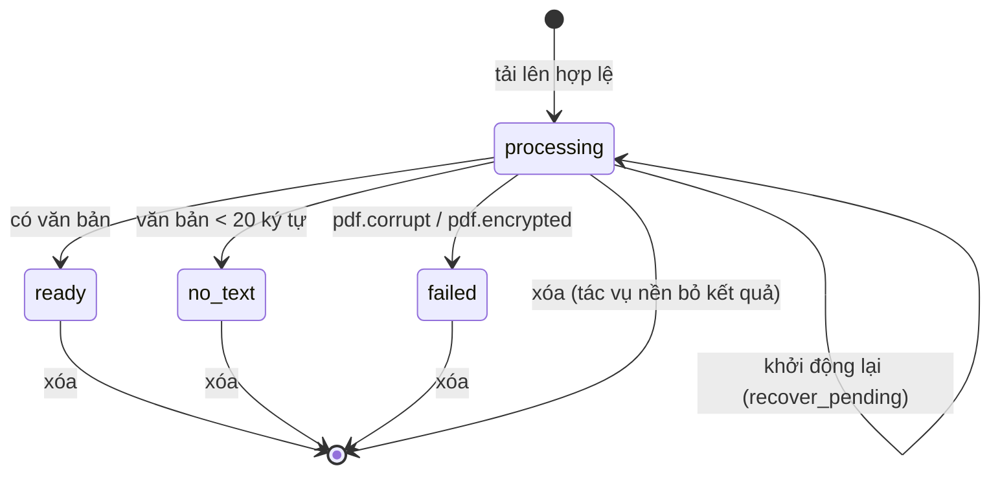

# Design Blueprint (IEEE 1016-2009) — Chat với tài liệu (MVP)

> **Prompt:** [bluePrint_design_prompt.md](../prompts/bluePrint_design_prompt.md) · **Checklist:** [BluePrint_Design_IEEE_1016_2009_Checklist.xlsx](../design/BluePrint_Design_IEEE_1016_2009_Checklist.xlsx)
> **Quan hệ với SAD:** SAD mô tả kiến trúc (arc42). Blueprint mô tả thiết kế chi tiết theo các *design view* IEEE 1016 để dev hiện thực trực tiếp. ID phần tử theo [elements.yaml](elements.yaml).
> **Phiên bản:** 0.2 · 2026-10-28 · Agent (Claude) · chờ Tech Lead duyệt

## 1. Bối cảnh và đối tượng thiết kế

### 1.1 Nhận diện hệ thống
CWD — ứng dụng web hỏi đáp trên PDF có trích dẫn. Đơn vị triển khai: một tiến trình Python + một thư mục dữ liệu.

### 1.2 Phạm vi và ranh giới
Trong: CMP-01..CMP-13. Ngoài: IdP/SSO, OCR, kho tài liệu khác, Anthropic API (hệ thống ngoài tùy chọn).

### 1.3 Giả định và ràng buộc
TC-01..TC-04 (SAD §2); ASM-001 (PDF có lớp văn bản); quy mô PRD §3.9.4.

## 2. Stakeholder và mối quan tâm

| Stakeholder | Mối quan tâm thiết kế | View trả lời |
|---|---|---|
| Dev | Module nào làm gì, gọi nhau thế nào | Composition, Dependency, Interface |
| QA | Trạng thái, luồng, điểm kiểm thử | State dynamics, Interaction |
| IT/Bảo mật | Dữ liệu nào lưu ở đâu | Information, SAD §8.1 |
| UX | Trạng thái giao diện | State dynamics, UI_UX_design |

### 2.1 Kịch bản chất lượng
Xem SAD §10 (QS-01..QS-07).

### 2.2 Kịch bản chất lượng UX/UI
| ID | Kịch bản | Thước đo |
|---|---|---|
| UQ-01 | Người dùng mới đăng nhập lần đầu, workspace trống → thấy hướng dẫn tải tài liệu, ô hỏi bị khóa có lý do | 100% (EC-01) |
| UQ-02 | Chỉ dùng bàn phím: tải lên, hỏi, mở trích dẫn, đóng panel | Hoàn thành không cần chuột |
| UQ-03 | Trình đọc màn hình đọc câu trả lời mới | Vùng `aria-live="polite"` |
| UQ-04 | Tài liệu chuyển `processing → ready` | UI cập nhật ≤ 4 s, không tải lại trang |

### 2.3 Ma trận ràng buộc UX/UI
| Ràng buộc | Giá trị | Nguồn |
|---|---|---|
| Ngôn ngữ | 100% tiếng Việt | NFR-003 |
| Tương phản | ≥ 4.5:1 | NFR-009 |
| Vùng chạm | ≥ 44 px | Design token prototype |
| Độ rộng tối thiểu | 1280 px | PRD §3.9.4 |
| Trạng thái | Biểu tượng + chữ, không chỉ màu | UX-002 |

## 3. Design views

### 3.1 Composition view
```
app/
├── main.py         CMP-02  create_app(settings) → FastAPI
├── config.py       CMP-13  Settings (dataclass, đọc env)
├── db.py           CMP-11  connect(), init_schema(), transaction()
├── schema.sql      CMP-11
├── errors.py       CMP-02  ProblemError, handlers, thông điệp tiếng Việt
├── security.py     CMP-03  hash_password, verify_password, new_token, LoginLimiter
├── auth.py         CMP-03  router /api/auth/*, current_user, require_csrf, require_manager
├── audit.py        CMP-10  record(conn, action, user, target)
├── documents.py    CMP-04  router /api/documents*, validate_upload
├── ingestion.py    CMP-05  ingest_document(), extract_pages(), chunk_page(), recover_pending()
├── textnorm.py     CMP-06  fold(), tokens(), content_terms()
├── retrieval.py    CMP-06  FtsRetriever, RetrievedChunk
├── generation.py   CMP-07  LocalExtractiveGenerator, AnthropicGenerator, build_generator()
├── chat.py         CMP-08  router /api/conversations*, /api/chunks/*, ask()
├── metrics.py      CMP-09  router /api/turns/*/feedback, /api/metrics/weekly
├── cli.py          CMP-12  create-user, seed-demo, backup, restore, prune-audit
└── web/            CMP-01  index.html, styles.css, api.js, app.js
```

### 3.2 Dependency view
Quy tắc phụ thuộc (kiểm tra trong review): `web → (HTTP) → main → {auth, documents, chat, metrics} → {retrieval, generation, ingestion, audit} → db`. `textnorm`, `config`, `errors` là lá. Không module nghiệp vụ nào import `main`. `generation` không import `db` (chỉ nhận chunk).

### 3.3 Logical view (lớp chính) — [diagrams/class_diagram.drawio](diagrams/class_diagram.drawio)
| Lớp / kiểu | Thuộc tính / phương thức | Ghi chú |
|---|---|---|
| `Settings` | `data_dir, max_file_mb, max_docs, min_relevance, top_k, per_doc_limit, session_idle_hours, allow_external_ai, anthropic_model, answer_timeout_s, cookie_secure`; `from_env()` | frozen dataclass |
| `CurrentUser` | `id, username, role, csrf_token` | |
| `RetrievedChunk` | `chunk_id, document_id, document_name, page, text, relevance` | |
| `FtsRetriever` | `retrieve(conn, user_id, question, history, document_ids)` | ADR-004 |
| `GeneratedAnswer` | `text, used_indices: list[int]` | chỉ số 1-based |
| `AnswerGenerator` (Protocol) | `mode`, `generate(question, chunks)` | |
| `LocalExtractiveGenerator` | chọn câu theo điểm từ, ≤ 1 câu tốt nhất mỗi chunk, ≤ 4 câu | ADR-003 |
| `AnthropicGenerator` | `client, model, timeout`; `generate()` | ADR-003 |
| `LoginLimiter` | `max_failures=5, window_s=300`; `check(key)`, `fail(key)`, `reset(key)` | ADR-007 |
| `ProblemError` | `status, code, detail` | |

### 3.4 Information view
Xem [data/model.md](data/model.md). Thông tin nhạy cảm: `documents/chunks/turns` (nội dung kinh doanh), `users.password_hash`, `sessions`. Không bảng nào lưu token thô.

### 3.5 Interface view
- API ngoài: [openapi.yaml](openapi.yaml), giải thích ở [openapi.md](openapi.md).
- Interface nội bộ: SAD §5.3.
- Hợp đồng lỗi: problem+json, `code` cố định (enum trong openapi).

### 3.6 Interaction view
| Tương tác | Sơ đồ |
|---|---|
| Hỏi đáp | [sequence_diagram.drawio](diagrams/sequence_diagram.drawio) (trang "Hỏi đáp") |
| Đăng nhập | [sequence_diagram.drawio](diagrams/sequence_diagram.drawio) (trang "Đăng nhập") |
| Tải lên + xử lý | [activity_diagram.drawio](diagrams/activity_diagram.drawio) |
| Use case | [use_case_diagram.drawio](diagrams/use_case_diagram.drawio) |

### 3.7 State dynamics view

**Tài liệu (ENT-03)**


**Ô hỏi trên UI (SCR-02)** — bộ tên **chuẩn duy nhất** (DF-04); UIUX_Blueprint §3.7.3 tham chiếu bảng này.
| Trạng thái | Điều kiện | Hiển thị |
|---|---|---|
| `disabled_empty` | 0 tài liệu | "Hãy tải tài liệu để bắt đầu hỏi." |
| `disabled_processing` | 0 `ready`, ≥ 1 `processing` | "Đang xử lý n tài liệu, bạn có thể hỏi khi có ít nhất một tài liệu sẵn sàng." |
| `disabled_no_ready` | 0 `ready`, 0 `processing` (chỉ còn `failed`/`no_text`) | "Chưa có tài liệu nào sẵn sàng để hỏi." |
| `ready` | ≥ 1 `ready`, ô nhập có nội dung | Bộ đếm "n/2000 ký tự", nút Gửi bật |
| `ready_empty` | ≥ 1 `ready`, ô rỗng | Nút Gửi tắt |
| `over_limit` | Không thể xảy ra: `maxlength=2000` trên ô nhập (EC-08) | — |
| `sending` | Đã gửi, chờ phản hồi | "Đang trả lời…", khóa nút gửi |
| `error` | Lỗi mạng / 503 | Giữ câu hỏi, nút "Gửi lại" |

### 3.8 Patterns use view
| Mẫu | Nơi dùng | Lý do |
|---|---|---|
| RAG | CMP-06/07/08 | Grounding + trích dẫn |
| Strategy | `AnswerGenerator` | Đổi mô hình bằng cấu hình |
| Repository (hàm truy vấn tập trung) | `db.py` + từng service | Cô lập SQL |
| App factory | `create_app(settings)` | Test với cấu hình riêng |
| Double-submit CSRF token | CMP-03 | Cookie SameSite + header |

### 3.9 Algorithm view (bổ sung theo DF-09)

**3.9.1 Cắt chunk** (`app/ingestion.chunk_page`, mỗi trang độc lập — chunk không vắt qua trang để số trang trích dẫn luôn đúng)
```
text ← gộp khoảng trắng của trang
câu ← tách tại [.!?;:…] + khoảng trắng; câu > 800 ký tự bị cắt cứng mỗi 800
với mỗi câu s:
    nếu chunk hiện tại + s > 800: đóng chunk; mang sang các câu cuối (mỗi câu ≤ 100 ký tự, tổng ≤ 100 + độ dài câu) làm phần chồng lấn
    thêm s
tài liệu no_text nếu tổng văn bản các trang < 20 ký tự
```

**3.9.2 Truy xuất** (`app/retrieval.FtsRetriever`, ADR-004)
```
T ← content_terms(câu hỏi)                 # fold + bỏ stopword + bỏ trùng
nếu T rỗng → []
H ← content_terms(3 câu hỏi trước) \ T
phạm vi ← tài liệu ready của user (∩ document_ids nếu có)
N ← số chunk trong phạm vi;  idf(t) = ln(1 + N / max(df(t),1))
ứng viên ← FTS5 MATCH ("t1" OR … OR "h1" …) trong phạm vi, 50 kết quả theo bm25
rel(c) = Σ idf(t ∈ T ∩ c) / Σ idf(t ∈ T)          ∈ [0,1]
giữ c nếu rel(c) ≥ 0.6
xếp hạng theo rel + 0.1·|H ∩ c|/|H| + 0.1·[c thuộc tài liệu được trích dẫn đầu tiên ở lượt trước], rồi −bm25
lấy ≤ 6 chunk, ≤ 2 chunk mỗi tài liệu
```

**3.9.3 Bộ sinh cục bộ và kiểm tra trích dẫn**
```
LocalExtractiveGenerator: với chunk thứ i (theo hạng): câu có tỷ lệ |T ∩ câu|/|T| cao nhất (> 0) → "- câu [i]"; bỏ câu trùng; tối đa 4 câu
validate_citations(text): với mỗi [n]: giữ nếu 1 ≤ n ≤ số chunk, ngược lại xóa khỏi text;
    citation = (n, chunk_id, document_id, tên, trang, 300 ký tự đầu) lấy từ chunk n trong CSDL
không còn citation nào → outcome = not_found, answer = thông điệp FR-012
```

**3.9.4 Chỉ số theo tuần** (`app/metrics.weekly_metrics`) — tuần ISO (UTC) theo `turns.created_at`
| Chỉ số | Định nghĩa SQL tương đương |
|---|---|
| active_users | `COUNT(DISTINCT conversations.user_id)` của các lượt trong tuần (người **hỏi**, không phải người đăng nhập) |
| questions | `COUNT(turns)` trong tuần |
| not_found_rate | `SUM(outcome='not_found') / questions`; 0 khi không có câu hỏi |
| positive_feedback_rate | `up / (up + down)` của đánh giá trên các **lượt tạo trong tuần**; `null` nếu chưa có đánh giá |

## 4. Truy vết Stakeholder → Concern → Thiết kế → Yêu cầu
| Concern | Thiết kế | Yêu cầu |
|---|---|---|
| Tin được câu trả lời | ADR-004 ngưỡng, ADR-005 trích dẫn | FR-011..013 |
| Không lộ dữ liệu | ADR-003, ADR-007, SAD §8.1 | FR-003, NFR-004, NFR-008 |
| Dễ dùng tiếng Việt | textnorm, UI tiếng Việt | NFR-003 |
| Đo được giá trị | CMP-09 | FR-017, FR-018 |

## 5. Chiến lược xác minh thiết kế
1. Cross-view audit tự động: [cross-view-audit.md](cross-view-audit.md) (`tools/cross_view_audit.py`).
2. Audit theo checklist IEEE 1016 / UML 2.0 bởi reviewer độc lập: [design_checklist_audit.md](design_checklist_audit.md).
3. Test hợp đồng: test kiểm tra route FastAPI khớp `elements.yaml`/`openapi.yaml`.

## 6. Rủi ro thiết kế và quyết định cho trường hợp biên (DF-12)
Rủi ro: SAD §11.

| Trường hợp (PRD §4.2) | Quyết định MVP | Owner |
|---|---|---|
| EC-06 phản hồi chậm + Hủy | Chế độ cục bộ P90 < 0,1 s nên không cần. Chế độ external: timeout cứng `CWD_ANSWER_TIMEOUT_S` = 15 s → 503 + "Gửi lại". Nút Hủy **hoãn** tới khi bật LLM ngoài | Tech Lead |
| EC-09 câu hỏi không phải tiếng Việt | Truy xuất hoạt động với tiếng Anh (stopword Anh có sẵn); thông điệp hệ thống luôn tiếng Việt. Trả lời đúng ngôn ngữ câu hỏi chỉ có ở chế độ external | PO (OQ-010) |
| EC-12 trùng tên file | Giữ cả hai (mỗi bản có id riêng, hiển thị thời điểm tải lên để phân biệt); không cảnh báo trong MVP | PO |
| EC-15 phiên hết hạn | Giữ câu hỏi đang soạn trong `sessionStorage`, khôi phục sau khi đăng nhập (đã làm) | — |
| EC-17 giới hạn chi phí | Không áp dụng ở chế độ cục bộ (không có chi phí theo câu hỏi). Khi bật external: thêm hạn mức và mã lỗi `usage.limit_reached` — **hoãn** | PO + IT |
| Analytics PRD §5.2 | Ánh xạ sang dữ liệu sẵn có: `turns` (câu hỏi, outcome, độ trễ), `feedback`, `audit_log`, `documents` (trạng thái). Không có endpoint sự kiện riêng; `AnalyticsClient` trong UIUX v0.1 bị bỏ | PO |
