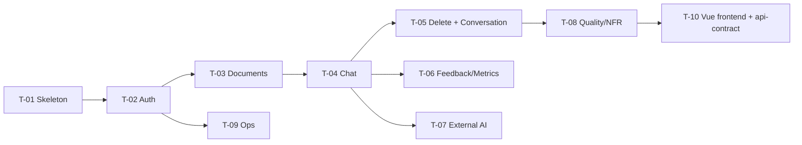

# PLAN — Chat với tài liệu (MVP)

> **Đầu vào:** [SAD v0.2](../04-design/SAD.md) · [USER_STORIES](../03-analysis/USER_STORIES.md) · [elements.yaml](../04-design/elements.yaml)
> **Trạng thái:** Draft — chờ PO (scope, thứ tự) và Tech Lead (khả thi) duyệt · **Tác giả:** Agent (Claude) · 2026-10-28

## 1. Nguyên tắc chia việc
- **Vertical slice:** mỗi task đi từ DB → API → UI → test và chạy được độc lập sau khi merge.
- Mỗi task ≤ ~400 dòng diff (giới hạn PR của Phase 8), có FR-ID và AC đích, test viết trước (TDD).
- Thứ tự: nền móng → bảo mật (High risk, làm sớm để review L3 sớm) → giá trị cốt lõi (hỏi đáp) → P1 → vận hành.
- Owner mặc định: Agent sinh code; **Dev owner (người)** chịu trách nhiệm review và merge từng PR.

## 2. Danh sách task

| Task | Tiêu đề | Story / FR | Phụ thuộc | Ước lượng | Risk | File chạm chính | Sprint |
|---|---|---|---|---|---|---|---|
| [T-01](tasks/T-01-skeleton.md) | Khung ứng dụng, cấu hình, CSDL, lỗi, health, CI | NFR-005, FR-003 (config) | — | 0.5 ngày | Low | `app/backend/cwd/main.py, config.py, db.py, errors.py`, `.github/workflows/ci.yml`, `AGENTS.md` | S1 |
| [T-02](tasks/T-02-auth.md) | Đăng nhập, phiên, CSRF, giới hạn sai, nhật ký kiểm toán, CLI tạo user, màn hình đăng nhập | US-101, US-103 · FR-001, FR-002, FR-019, NFR-010 | T-01 | 1 ngày | **High** | `app/backend/cwd/security.py, auth.py, audit.py, cli.py`, `app/frontend/*` | S1 |
| [T-03](tasks/T-03-documents.md) | Tải lên, kiểm tra, ingestion nền, danh sách, panel tài liệu | US-201..204 · FR-004..007 | T-02 | 1 ngày | Medium | `app/backend/cwd/documents.py, ingestion.py, textnorm.py`, `app/frontend/*` | S1 |
| [T-04](tasks/T-04-chat.md) | Truy xuất, bộ sinh cục bộ, hỏi đáp có trích dẫn, panel trích dẫn | US-301..305 · FR-009..013 | T-03 | 1.5 ngày | Medium | `app/backend/cwd/retrieval.py, generation.py, chat.py`, `app/frontend/*` | S2 |
| [T-05](tasks/T-05-delete-conversation.md) | Xóa tài liệu; hội thoại nhiều lượt, phạm vi, xem lại | US-205, US-401..403 · FR-008, FR-014..016 | T-04 | 1 ngày | Medium | `app/backend/cwd/documents.py, chat.py, retrieval.py`, `app/frontend/*` | S2 |
| [T-06](tasks/T-06-feedback-metrics.md) | Đánh giá câu trả lời, dashboard tuần | US-501, US-502 · FR-017, FR-018 | T-04 | 0.5 ngày | Low | `app/backend/cwd/metrics.py`, `app/frontend/*` | S3 |
| [T-07](tasks/T-07-external-ai.md) | AnthropicGenerator sau cờ chính sách dữ liệu | US-102 · FR-003, FR-011 | T-04 | 0.5 ngày | **High** | `app/backend/cwd/generation.py` | S3 |
| [T-08](tasks/T-08-quality-nfr.md) | Bộ đánh giá chất lượng/độ trễ; test injection, cô lập, log sạch | US-306 · NFR-001..004, NFR-008 | T-05 | 1 ngày | Medium | `app/backend/tests/eval/*`, `app/backend/tests/test_security_*.py` | S3 |
| [T-09](tasks/T-09-ops.md) | Sao lưu, khôi phục, dọn nhật ký | NFR-006, NFR-007 | T-02 | 0.5 ngày | Low | `app/backend/cwd/cli.py` | S3 |
| [T-10](tasks/T-10-restructure-vue-frontend.md) | Tái cấu trúc `app/{backend,frontend,api-contract}`; frontend Vue 3 + TypeScript; type sinh từ hợp đồng | Mọi story có UI · ADR-009 | T-01..T-09 | 1 ngày | Medium | `app/frontend/**`, `app/api-contract/**`, `tools/*` | S3 |

**Tổng:** ~8.5 ngày-người. Đường găng: T-01 → T-02 → T-03 → T-04 → T-05 → T-08.

## 3. Definition of Done (mọi task)
1. Test cho mọi AC đích viết trước và đều xanh; ID AC xuất hiện trong docstring test.
2. L0 xanh: `ruff check`, `ruff format --check`, `pytest` (coverage ≥ 70%), quét secret, `pip-audit`, `cross_view_audit.py`.
3. `traceability.md` cập nhật cột Code + Test cho story của task.
4. Commit theo Conventional Commits, có `Refs: US-xxx, FR-xxx`.
5. Không đổi hợp đồng `openapi.yaml` mà không cập nhật `elements.yaml` + ADR nếu là quyết định khó đảo ngược.

## 4. Quyết định khi lập kế hoạch
| ID | Quyết định | Lý do | Owner |
|---|---|---|---|
| PD-01 | Làm Auth (T-02) trước Documents | Mọi API khác cần `current_user`; High risk nên review L3 sớm | Tech Lead |
| PD-02 | Làm US-205 (P1) ngay sau chat | Rẻ (cascade + trigger sẵn có) và giảm rủi ro tài liệu sai không gỡ được | PO |
| PD-03 | T-07 (LLM ngoài) làm nhưng **tắt mặc định** | Sẵn sàng khi IT cho phép; không chặn launch | PO + IT |
| PD-04 | Bộ câu hỏi chuẩn tổng hợp (synthetic) trong `app/backend/tests/eval` cho tới khi có DEP-002 | Không chặn đo NFR-002; phải chạy lại với bộ thật trước go-live | QA |
| PD-05 | P2 (US-404, US-601) ngoài phạm vi | BRD §12.1 | PO |
| PD-06 | Thay UI JavaScript thuần bằng Vue 3 + TypeScript, tách thư mục backend/frontend/api-contract (T-10) | Yêu cầu chủ dự án 2026-10-28; ADR-009 | Chủ dự án |
| PD-07 | Phạm vi dự án dừng ở Phase 8 (không làm Release/Operate/Decommission) | Yêu cầu chủ dự án 2026-10-28 | Chủ dự án |

## 5. Rủi ro, ẩn số, khoảng trống
| ID | Mục | Loại | Tác động | Xử lý | Owner |
|---|---|---|---|---|---|
| PR-01 | Python 3.15 mới: thiếu wheel cho một số thư viện (đã gặp với PyYAML) | Rủi ro | Phải thay thư viện | Chỉ dùng thư viện thuần Python hoặc đã kiểm tra; ghi trong AGENTS.md | Tech Lead |
| PR-02 | Ngưỡng `CWD_MIN_RELEVANCE` chưa hiệu chỉnh với dữ liệu thật | Ẩn số | `not_found` sai hoặc trả lời lạc đề | Hiệu chỉnh bằng DEP-002 | QA |
| PR-03 | Chưa có CI server thật (GitHub Actions chưa được bật) | Khoảng trống | L0 chỉ chạy cục bộ | Cung cấp `.github/workflows/ci.yml` + `tools/ci_local.py` cho cùng bước | Tech Lead |
| PR-04 | Không có PDF thật của đội kinh doanh | Khoảng trống | Test dùng PDF sinh tự động | Bổ sung khi có DEP-002 | Đội kinh doanh |
| PR-05 | Không có người review L2/L3 trong phiên agent | Khoảng trống quy trình | Không thể merge theo đúng luật | Agent chuẩn bị review record; người phải review trước khi merge | PO |

## 6. Phê duyệt
| Vai trò | Quyết định | Ngày |
|---|---|---|
| PO (scope, thứ tự) | ☐ Approve ☐ Reject | |
| Tech Lead (khả thi) | ☐ Approve ☐ Reject | |
