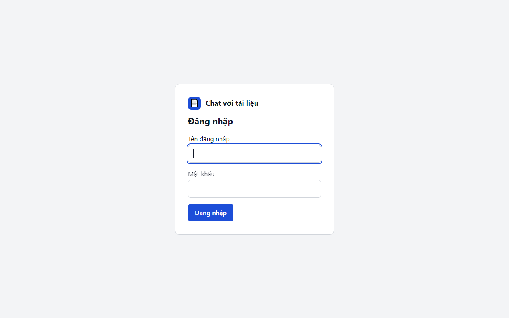

# 01 — Bắt đầu

## Đăng nhập

1. Mở địa chỉ ứng dụng mà quản trị viên cung cấp (ví dụ `http://127.0.0.1:8000`).
2. Nhập **Tên đăng nhập** và **Mật khẩu**, bấm **Đăng nhập**.

Lưu ý:
- Sai tên hoặc mật khẩu đều nhận cùng một thông báo *"Tên đăng nhập hoặc mật khẩu không đúng."* — hệ thống cố ý không cho biết phần nào sai.
- Nhập sai **5 lần trong 5 phút** sẽ bị tạm khóa; chờ **5 phút** rồi thử lại.
- Ứng dụng không có chức năng tự đăng ký hay quên mật khẩu. Liên hệ quản trị viên để được cấp hoặc đặt lại tài khoản.

## Giao diện chính (workspace)

| Vùng | Thành phần |
|---|---|
| **Thanh trên cùng** | Logo *Chat với tài liệu* (bấm để về màn hình chính) · huy hiệu **🔒 Xử lý cục bộ** hoặc **☁ Dùng dịch vụ AI bên ngoài** · **Số liệu sử dụng** (chỉ vai trò quản lý) · tên đăng nhập · **Đăng xuất** |
| **Cột trái — Tài liệu (n)** | Nút **+ Tải lên PDF**, ô kéo thả, tiến độ tải lên, danh sách tài liệu với ô chọn phạm vi và nút 🗑 xóa |
| **Cột phải — Hội thoại** | Nút **Cuộc hội thoại mới**, dòng **Phạm vi**, các lượt hỏi đáp, ô nhập câu hỏi và nút **Gửi** |

Khi chưa có tài liệu, cột trái hiện *"Chưa có tài liệu nào."* với nút **Tải tài liệu đầu tiên**, và ô hỏi bị khóa kèm gợi ý *"Hãy tải tài liệu để bắt đầu hỏi."*

## Đăng xuất
Bấm **Đăng xuất** ở góc phải. Phiên bị hủy ngay; muốn dùng tiếp phải đăng nhập lại.

## Khi phiên hết hạn
Sau **8 giờ không hoạt động**, phiên tự hết hạn. Lần thao tác tiếp theo sẽ đưa bạn về màn hình đăng nhập với thông báo:

> Phiên đăng nhập đã hết hạn. Vui lòng đăng nhập lại; câu hỏi đang soạn đã được giữ lại.

Câu hỏi bạn đang gõ dở **không bị mất** — đăng nhập lại là thấy.

## Dùng bằng bàn phím
- **Tab / Shift+Tab** di chuyển giữa các nút và ô nhập.
- **Enter** gửi câu hỏi, **Shift+Enter** xuống dòng.
- **Esc** đóng panel nguồn trích dẫn.
- Ứng dụng hỗ trợ trình đọc màn hình (thông báo "Đã có câu trả lời", "Đã xóa …").
