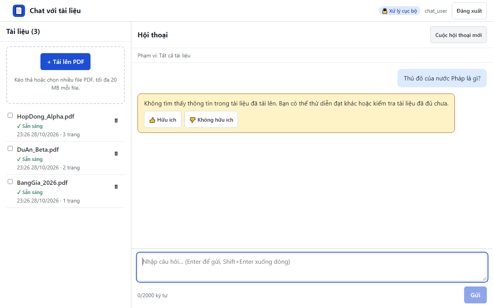

# 03 — Hỏi đáp với tài liệu

## Đặt câu hỏi

1. Gõ câu hỏi vào ô **"Nhập câu hỏi…"** ở cuối cột Hội thoại.
2. Nhấn **Enter** (hoặc bấm **Gửi**). **Shift+Enter** để xuống dòng.
3. Trong lúc chờ, hệ thống hiện *"Đang trả lời…"* và khóa nút Gửi.

- Bộ đếm bên dưới cho biết độ dài, ví dụ `120/2000 ký tự`.
- Câu hỏi rỗng hoặc chỉ có khoảng trắng sẽ không được gửi.
- Gõ **không dấu** vẫn tìm được nội dung có dấu (ví dụ `gia tri hop dong` tìm được "giá trị hợp đồng").
- Ô hỏi bị khóa khi chưa có tài liệu nào **✓ Sẵn sàng**; dòng gợi ý bên dưới cho biết lý do.

## Đọc câu trả lời và kiểm chứng nguồn

- Các số **[1]**, **[2]** trong câu trả lời là **trích dẫn**. Danh sách nguồn bên dưới ghi rõ **tên tài liệu — số trang**.
- Bấm vào một trích dẫn để mở **panel Nguồn** bên phải, hiển thị **đoạn văn gốc** và số trang. Hội thoại vẫn giữ nguyên.
- Đóng panel bằng nút **Đóng** hoặc phím **Esc**.
- Tên tài liệu và số trang luôn lấy từ dữ liệu hệ thống, không do AI tự viết — bạn có thể tin vào vị trí trích dẫn.
- Nếu thông tin nằm ở nhiều tài liệu (hoặc các tài liệu nêu giá trị khác nhau), câu trả lời trích **tất cả** các nguồn liên quan để bạn tự đối chiếu.

## Khi tài liệu không có câu trả lời

Hệ thống **không đoán** và không dùng kiến thức bên ngoài. Nếu tài liệu không chứa thông tin, bạn nhận khung màu vàng:

> Không tìm thấy thông tin trong tài liệu đã tải lên. Bạn có thể thử diễn đạt khác hoặc kiểm tra tài liệu đã đủ chưa.

Câu trả lời dạng này không có trích dẫn. Hãy thử: dùng từ khóa có trong tài liệu, bỏ chọn phạm vi, hoặc kiểm tra tài liệu cần thiết đã **✓ Sẵn sàng** chưa.

## Giới hạn phạm vi tài liệu

- Mặc định hệ thống tìm trong **tất cả** tài liệu sẵn sàng — dòng phía trên hội thoại ghi *"Phạm vi: Tất cả tài liệu"*.
- Tích **ô chọn** cạnh một hoặc vài tài liệu ở cột trái để chỉ hỏi trong các tài liệu đó; dòng phạm vi đổi thành *"Phạm vi: n tài liệu đã chọn"*.
- Bỏ tích hết để quay lại tìm trong tất cả.

Thu hẹp phạm vi giúp câu trả lời chính xác hơn khi nhiều tài liệu có nội dung giống nhau (ví dụ nhiều hợp đồng cùng mẫu).

## Hỏi tiếp và hội thoại mới

- Trong cùng hội thoại, bạn có thể hỏi tiếp mà không nhắc lại ngữ cảnh. Ví dụ: *"Giá trị hợp đồng Alpha là bao nhiêu?"* rồi *"Thời hạn của nó?"*
- Bấm **Cuộc hội thoại mới** để bắt đầu chủ đề khác với ngữ cảnh trống.
- Hội thoại hiện tại được giữ lại khi bạn tải lại trang trong cùng tab trình duyệt. Phiên bản MVP chưa có màn hình danh sách các hội thoại cũ.

## Đánh giá câu trả lời

Dưới mỗi câu trả lời có hai nút **👍 Hữu ích** và **👎 Không hữu ích**.
- Chọn **Không hữu ích** sẽ hỏi thêm lý do (không bắt buộc, tối đa 500 ký tự).
- Mỗi câu trả lời bạn chỉ có một đánh giá; bấm lại nút khác sẽ thay đánh giá cũ.
- Đánh giá giúp nhóm sản phẩm đo và cải thiện chất lượng.

## Mẹo viết câu hỏi tốt

| Nên | Tránh |
|---|---|
| Hỏi cụ thể, có tên riêng: *"Hạn thanh toán đợt 2 của hợp đồng Alpha?"* | Hỏi chung chung: *"Hạn là khi nào?"* (khi chưa có ngữ cảnh) |
| Dùng thuật ngữ có trong tài liệu | Từ đồng nghĩa hiếm gặp |
| Một ý mỗi câu hỏi | Gộp nhiều câu hỏi không liên quan |
| Chọn phạm vi khi biết tài liệu nào chứa đáp án | Hỏi kiến thức chung không có trong tài liệu |

**Luôn bấm trích dẫn để kiểm chứng** trước khi dùng câu trả lời cho quyết định quan trọng.
