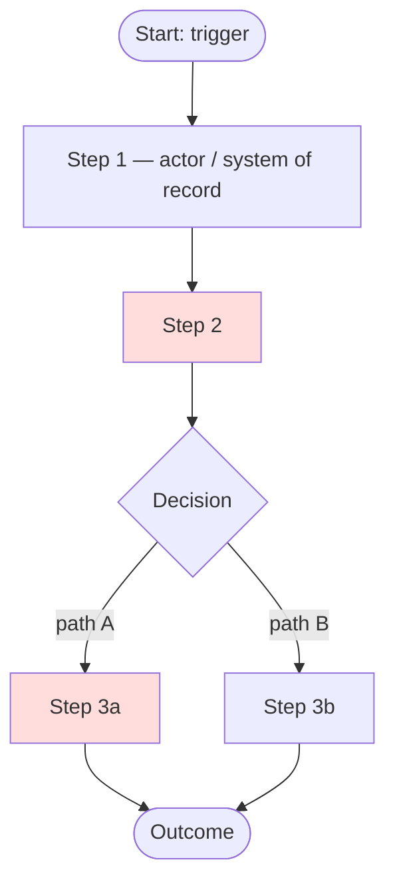
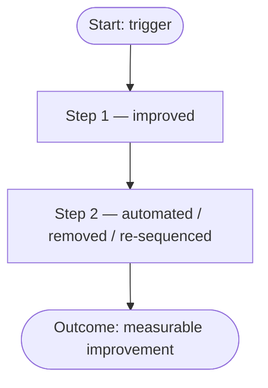

# Business Requirements Document — [Initiative Name]

> **Standard:** IEEE 29148-2018 (Systems and software engineering — Life cycle processes — Requirements engineering)
> **Document number:** [TBD: e.g., PRJ-XXXX-BRD-001]
> **Version:** 0.1
> **Status:** Draft (Template — not baselined)
> **Author:** [TBD]
> **Date:** [TBD]
> **Confidentiality:** [Internal / Confidential]

---

## 0. How to use this template

This BRD is structured to satisfy every item in `docs/requirements/BRD_IEEE_29148_Checklist.xlsx`
(20 checklist items across 6 categories). See the compliance map in [Appendix B](#appendix-b--checklist-compliance-map).

**Rules for authors:**

1. Replace every `[TBD: ...]` placeholder. If an item cannot be filled, record an `OQ-xxx` in Section 13 — do **not** invent metrics, baselines, stakeholders, or decisions.
2. Keep all IDs (`BO-xxx`, `BR-xxx`, `OQ-xxx`, …) permanent. Never renumber after review; mark withdrawn items `Withdrawn` and keep the row.
3. Business requirements must use **shall** syntax, one obligation per requirement, free of solution/technology design.
4. Run the self-check in [Appendix A](#appendix-a--pre-review-verification-checklist) before circulating for review.

**Identifier scheme**

| Prefix | Meaning | Example |
|---|---|---|
| `SRC-xxx` | Source / evidence | SRC-001 |
| `BO-xxx` | Business objective | BO-001 |
| `MET-xxx` | Success metric / KPI | MET-001 |
| `STK-xxx` | Stakeholder | STK-001 |
| `SN-xxx` | Stakeholder need | SN-001 |
| `BR-xxx` | Business requirement | BR-001 |
| `BRU-xxx` | Business rule | BRU-001 |
| `CON-xxx` | Constraint | CON-001 |
| `ASM-xxx` | Assumption | ASM-001 |
| `DEP-xxx` | Dependency | DEP-001 |
| `RSK-xxx` | Risk | RSK-001 |
| `OQ-xxx` | Open question | OQ-001 |
| `AC-xxx` | Acceptance criterion | AC-001 |

**Requirement syntax**

> **[BR-xxx]** [Condition or trigger, if any], the [business actor or organization] **shall** [required capability or outcome] [object and qualifying constraint].

- Use **shall** for mandatory, **should** for desirable, **may** for optional. Never "will", "must", "can", "needs to".
- One idea per requirement. Quantify volume, time, frequency, accuracy, cost wherever a quantity matters.
- Avoid unverifiable words: *fast, user-friendly, robust, seamless, efficient, world-class, as needed*.

**Source register**

| Source ID | Source | Type | Owner | Date / Version | What it evidences |
|---|---|---|---|---|---|
| SRC-001 | [TBD: interview / report / policy / data extract / workshop] | [TBD] | [TBD] | [TBD] | [TBD] |

> Claims without a source are marked `[Unverified]` and raise an `OQ-xxx`.

---

## 1. Document control

- **Title:** Business Requirements Document — [Initiative Name]
- **Document number:** [TBD]
- **Status:** Draft / In review / Approved / Baselined *(select one)*
- **Author:** [TBD]
- **Contributors:** [TBD]
- **Reviewers:** [TBD]
- **Approver:** [TBD]

**Version history**

| Version | Date | Author | Change summary |
|---|---|---|---|
| 0.1 | [TBD] | [TBD] | Initial template draft |

**Distribution list:** [TBD]
**Confidentiality classification:** [TBD]

---

## 2. Executive summary

### 2.1 Business problem and impact

[One paragraph: the core business problem/opportunity, quantified impact (revenue, cost, risk, compliance, customer impact), with source `SRC-xxx` or marked `[Unverified]`. — *Checklist: Business Purpose & Drivers*]

### 2.2 Vision statement

[One or two sentences: the desired future state and how this initiative aligns with organizational strategy. — *Checklist: Vision Statement*]

> Example form: "By [date], [organization] will be able to [business outcome] so that [strategic benefit], measured by [MET-xxx]."

### 2.3 Proposed business change

[One paragraph: what changes in the business — processes, capabilities, roles — without prescribing technology.]

### 2.4 Expected benefits and proving metrics

| Benefit | Metric ID | Baseline | Target | Timeframe |
|---|---|---|---|---|
| [TBD] | MET-001 | [TBD] | [TBD] | [TBD] |

### 2.5 Investment, timeline, and headline risks

- **Investment / funding envelope:** [TBD]
- **Target timeline / key dates:** [TBD]
- **Top risks (headline):** [TBD: RSK-xxx]

### 2.6 Decision requested

[What the approver is being asked to approve, and by when.]

---

## 3. Business context and problem statement

### 3.1 Current state ("As-Is") workflow

[Document the existing business process, who it affects, and where it breaks down. Root causes distinguished from symptoms. — *Checklist: Current State ('As-Is') Workflow*]

*Replace with the real flow; highlight pain points.*

**Affected parties and evidence:** [TBD]
**Cost of inaction (12 months):** [TBD: quantify revenue, cost, risk, compliance, customer impact]
**Why now (trigger and urgency):** [TBD: regulation / revenue loss / cost pressure / competitive threat / incident]

### 3.2 Target state ("To-Be") workflow

[The proposed business process, highlighting improvements, automation, or structural changes vs. 3.1. — *Checklist: Target State ('To-Be') Workflow*]

### 3.3 Operational scenarios and use cases

[High-level business scenarios and primary use cases from the end-user/business perspective (who does what, under which conditions, expected outcome). Detailed use cases belong downstream in PRD/SRS. — *Checklist: Operational Scenario & Use Cases*]

| Scenario ID | Actor | Trigger | Goal / expected outcome | Notes |
|---|---|---|---|---|
| UC-001 | [TBD] | [TBD] | [TBD] | [TBD] |

---

## 4. Business drivers and objectives

*Checklist: Business Purpose & Drivers · Business Objectives & Success Metrics*

### 4.1 Drivers and objectives

| ID | Business driver | Objective (outcome, not activity) | Metric ID | Baseline | Target | Timeframe | Source |
|---|---|---|---|---|---|---|---|
| BO-001 | [TBD: driver, priority order — name the one whose removal kills the initiative] | [TBD: outcome] | MET-001 | [TBD] | [TBD] | [TBD] | SRC-xxx |

### 4.2 Metric definitions

A target without a baseline and a measurement method is not a valid objective. For each `MET-xxx`:

| Metric ID | Definition | Formula | Data source | Owner | Frequency | Baseline date |
|---|---|---|---|---|---|---|
| MET-001 | [TBD] | [TBD] | [TBD] | [TBD] | [TBD] | [TBD] |

### 4.3 Explicit non-goals

[What is explicitly *not* a goal, even though stakeholders may assume it is. — *Checklist: completeness*]

---

## 5. Scope

*Checklist: Scope & Boundaries*

### 5.1 In scope

- **Business capabilities:** [TBD]
- **Processes:** [TBD]
- **Organizational units:** [TBD]
- **Channels / customer segments / geographies:** [TBD]
- **Data domains:** [TBD]

### 5.2 Out of scope (with reasons)

| Item | Reason for exclusion |
|---|---|
| [TBD: e.g., integration with X program — owned by initiative Y] | [TBD] |

### 5.3 Deferred to a later phase

| Item | Phase | Rationale |
|---|---|---|
| [TBD] | [TBD] | [TBD] |

### 5.4 Boundaries with adjacent initiatives

[Where this initiative stops and adjacent programs start; what a stakeholder might wrongly assume is included; minimum releasable scope if budget/time cut ~30%.]

---

## 6. Stakeholders and needs

### 6.1 Stakeholder identification

*Checklist: Stakeholder Identification*

Include internal and external stakeholders, sponsors, user classes, negative stakeholders, and those who can block adoption.

| ID | Stakeholder / group | Role in the business | Interest | Influence (High/Med/Low) | Needs | Source |
|---|---|---|---|---|---|---|
| STK-001 | [TBD: e.g., executive sponsor] | [TBD] | [TBD] | [TBD] | SN-001 | SRC-xxx |
| STK-002 | [TBD: e.g., end users / operations staff] | [TBD] | [TBD] | [TBD] | SN-002 | SRC-xxx |
| STK-003 | [TBD: e.g., compliance / legal] | [TBD] | [TBD] | [TBD] | SN-003 | SRC-xxx |

### 6.2 User personas and profile characteristics

*Checklist: User Personas & Profile Characteristics*

| Persona ID | Stakeholder group | Business role | Operational context | Domain experience level | Frequency of use | Notes |
|---|---|---|---|---|---|---|
| UP-001 | STK-002 | [TBD] | [TBD: where/when they work] | [TBD: novice / experienced / expert] | [TBD] | [TBD] |

### 6.3 Stakeholder needs

| ID | Stakeholder | Need statement (stakeholder's terms) | Current pain | Evidence | Priority (Must/Should/Could) |
|---|---|---|---|---|---|
| SN-001 | STK-001 | [TBD] | [TBD] | SRC-xxx | [TBD] |

### 6.4 Conflicts between stakeholders

| ID | Conflict | Parties | Arbitrator / decision owner | Status |
|---|---|---|---|---|
| C-001 | [TBD: e.g., speed vs. control] | [TBD] | [TBD] | Open → OQ-xxx |

---

## 7. Business requirements

*Checklist: Singularity & Clarity · Completeness & Implementation-Free · Traceability & Rationale · Feasibility & Realism*

### 7.1 Quality rules for this section (IEEE 29148)

Every `BR-xxx` **shall** satisfy all of the following before review:

| Characteristic | Test |
|---|---|
| Necessary | If removed, an objective or stakeholder need is no longer met |
| Implementation-free | States outcome/capability, not mechanism, product, or design |
| Unambiguous | Only one reading for an informed reader; terms in the glossary (Section 14) |
| Consistent | Contradicts no other requirement, rule, or constraint |
| Complete | Actor, trigger, outcome, and any limit are present |
| Singular | Exactly one obligation — no "and/or" chains |
| Feasible | Achievable within known constraints (Section 9) and risks (Section 10) |
| Traceable | Unique ID and a named source (`BO-xxx` or `SN-xxx`) |
| Verifiable | An acceptance criterion and verification method can be defined |

### 7.2 Requirements

Group requirements by business capability or process area — one table per group.

#### Group: [Capability / process area name]

| ID | Requirement (`shall` statement) | Rationale | Source | Priority | Acceptance criteria | Verification method | Status |
|---|---|---|---|---|---|---|---|
| BR-001 | [TBD: "When [trigger], the [actor] shall [capability] [constraint]."] | [TBD: why needed] | BO-001 / SN-001 | Must / Should / Could / Won't | AC-001 | Review / Test / Inspection / Demonstration / Analysis | Draft |
| BR-002 | [TBD] | [TBD] | BO-001 | [TBD] | AC-002 | [TBD] | Draft |

**Priority scheme:** **Must** (initiative fails without it) · **Should** (significant value, workaround exists) · **Could** (desirable) · **Won't** (excluded this release).

Every requirement needs at least one acceptance criterion that is objectively decidable and does not restate the requirement verbatim.

---

## 8. Business rules

| ID | Rule | Type (Policy / Legal / Calculation / Decision) | Scope | Enforcement owner | Source |
|---|---|---|---|---|---|
| BRU-001 | [TBD: e.g., "A refund above 500 EUR requires manager approval"] | [TBD] | [TBD: process or domain] | [TBD] | SRC-xxx |

*Classify which rules are legal/regulatory (non-negotiable) vs. internal policy (may change); note thresholds, exceptions, and approval limits; note rules that conflict across regions/products/business units.*

---

## 9. Constraints

*Checklist: Business Constraints · Dependencies & Constraints*

Constraints are non-negotiable boundaries. Preferences belong in assumptions or design inputs, not here.

| ID | Constraint | Type (Regulatory / Legal / Budget / Time / Contractual / Technical / Organizational) | Imposed by | Impact on the solution space | Source |
|---|---|---|---|---|---|
| CON-001 | [TBD] | [TBD] | [TBD: party] | [TBD] | SRC-xxx |

*Also state: fixed budget/headcount/timeline limits; legacy systems, data, or vendors that must be retained; organizational/change-capacity limits; data residency requirements.*

---

## 10. Assumptions, dependencies, and risks

*Checklist: Business Assumptions · Dependencies & Constraints · Business Risks & Mitigation*

| ID | Item | Type | Description | Impact if false / occurs | Owner | Validation / mitigation / contingency | Due |
|---|---|---|---|---|---|---|---|
| ASM-001 | [TBD] | Assumption | [TBD: what is assumed true but unverified] | [TBD] | [TBD] | [TBD: how and when validated] | [TBD] |
| DEP-001 | [TBD] | Dependency | [TBD: external deliverable/decision — other teams, vendors, programs, legacy systems] | [TBD] | [TBD] | [TBD: tracking action + fallback if it slips] | [TBD] |
| RSK-001 | [TBD] | Risk | [TBD: cause → event → effect] | [TBD: severity] | [TBD] | [TBD: mitigation / contingency; early-warning signal] | [TBD] |

*Every assumption needs a validation action; every dependency needs an owner; every risk needs a severity and a response. Name the risk that would stop the initiative and who owns the response.*

---

## 11. Business quality and non-functional attributes

*Checklist: Compliance & Regulatory Standards · Business Continuity & Availability · Security & Business Policy Constraints*

State these in **business terms** (obligations the business owes customers, regulators, or itself). Technical targets belong to the downstream PRD/SAD.

### 11.1 Compliance and regulatory obligations

| ID | Obligation | Origin (law / regulation / policy / contract) | Scope | Owner | Audit / evidence requirement | Source |
|---|---|---|---|---|---|---|
| NFR-001 | [TBD: e.g., data privacy, retention, residency, auditability — GDPR/HIPAA/local law as applicable] | [TBD] | [TBD] | [TBD] | [TBD] | SRC-xxx |

### 11.2 Business continuity and availability

| ID | Obligation | Business impact of downtime | RTO / RPO expectation | Availability target | Contractual or aspirational | Source |
|---|---|---|---|---|---|---|
| NFR-002 | [TBD] | [TBD] | [TBD] | [TBD] | Hard obligation / aspiration | SRC-xxx |

### 11.3 Security and business policy constraints

| ID | Obligation | Origin (policy / regulation / contract) | Enforcement owner | Source |
|---|---|---|---|---|
| NFR-003 | [TBD: access control, segregation of duties, business policy enforcement] | [TBD] | [TBD] | SRC-xxx |

### 11.4 Other business-level obligations

Accessibility, language, channel, and volume/growth obligations:
[TBD — e.g., "The business shall serve N concurrent users at peak" — hard obligation vs. aspiration.]

---

## 12. Traceability

*Checklist: Traceability & Rationale*

### 12.1 Traceability matrix

| Business objective | Stakeholder need | Business requirement | Acceptance criteria | Downstream PRD/SRS ID |
|---|---|---|---|---|
| BO-001 | SN-001 | BR-001 | AC-001 | [TBD] |

### 12.2 Coverage report

Report explicitly (do not leave implicit):

- **Objectives with no requirements:** [TBD / None]
- **Requirements with no objective or need (orphans):** [TBD / None]
- **Needs with no requirement:** [TBD / None]
- **Requirements with no acceptance criterion or verification method:** [TBD / None]

---

## 13. Open questions and decisions

| ID | Question / decision needed | Why it matters (what it blocks) | Owner | Needed by | Status | Resolution |
|---|---|---|---|---|---|---|
| OQ-001 | [TBD: e.g., "Baseline value for MET-001 unknown — blocks Section 4"] | Section 4 | [TBD] | [TBD] | Open | — |

*Decisions taken during elicitation are recorded here with date, decision maker, and rationale. Never resolve an open question silently by assumption.*

---

## 14. Glossary and references

### 14.1 Glossary

| Term | Definition |
|---|---|
| [TBD: business term / acronym, incl. any term whose meaning is disputed] | [TBD] |

### 14.2 References

| Reference | Version | Location | Access date |
|---|---|---|---|
| [TBD: business case, policies, regulations, prior analyses] | [TBD] | [TBD] | [TBD] |

---

## 15. Approval

| Role | Name | Decision | Signature / date |
|---|---|---|---|
| Executive sponsor | [TBD] | Approve / Approve with conditions / Reject | [TBD] |
| Business owner | [TBD] | Approve / Reject | [TBD] |
| Product manager / product owner | [TBD] | Approve / Reject | [TBD] |
| Compliance / legal (if applicable) | [TBD] | Approve / Reject | [TBD] |

*State the conditions of approval and the baseline version being approved. Target approval date: [TBD] — gates [TBD: downstream PRD/SAD work].*

**Change control after baselining:** [TBD: how scope/objective changes will be controlled]

---

## 16. Appendix

Supporting analysis, process maps, interview notes, data extracts, and any material referenced above.

---

## Appendix A — Pre-review verification checklist

Run before circulating. Report any failed check as an `OQ-xxx` or a defect against the affected ID.
Do not mark the document ready for approval while a **Must** requirement fails a check.

**Requirement quality**

- [ ] Every requirement uses **shall** syntax and contains one obligation.
- [ ] Every requirement is free of solution/design language.
- [ ] Every requirement is quantified where quantity affects acceptance.
- [ ] No vague qualifiers remain (*fast, easy, robust, efficient, user-friendly, …*).
- [ ] Every specialized term is in the glossary (Section 14).
- [ ] No requirement duplicates or contradicts another.
- [ ] Every requirement has a unique, permanent ID.

**Completeness and traceability**

- [ ] Every business objective has at least one requirement.
- [ ] Every requirement traces to an objective or stakeholder need.
- [ ] Every requirement has at least one acceptance criterion.
- [ ] Every requirement has a verification method.
- [ ] Every stakeholder group has at least one need recorded.
- [ ] Scope, exclusions, assumptions, dependencies, risks are all populated.
- [ ] Every open question has an owner and a needed-by date.

**Business validation**

- [ ] The problem statement is evidenced, not asserted.
- [ ] Baseline and target values are sourced and measurable.
- [ ] Benefits and costs are stated in business terms.
- [ ] The sponsor confirms the problem and desired outcome are represented accurately.
- [ ] The document is understandable by a business reader without technical translation.

**Readiness statement:** `Ready for review` / `Ready with conditions` / `Not ready` — blocking items: [TBD: list by ID]

---

## Appendix B — Checklist compliance map

Mapping of every item in `BRD_IEEE_29148_Checklist.xlsx` to the section of this BRD that satisfies it.
Use this table to update the checklist's **Status** and **Notes** columns as the document matures.

| # | Category | Checklist item | BRD section | How it is satisfied |
|---|---|---|---|---|
| 1 | 1. Document & Business Overview | Business Purpose & Drivers | §2.1, §4.1 | Problem quantified with sources; drivers listed in priority order |
| 2 | 1. Document & Business Overview | Business Objectives & Success Metrics | §4 | Every objective has metric ID, baseline, target, timeframe, source; metrics defined in §4.2 |
| 3 | 1. Document & Business Overview | Scope & Boundaries | §5 | In-scope, out-of-scope (with reasons), deferred, boundaries all explicit |
| 4 | 1. Document & Business Overview | Vision Statement | §2.2 | Concise future-state vision aligned with organizational strategy |
| 5 | 2. Stakeholder & User Analysis | Stakeholder Identification | §6.1 | Internal/external stakeholders, sponsors, user classes identified and categorized |
| 6 | 2. Stakeholder & User Analysis | User Personas & Profile Characteristics | §6.2 | User profiles, business roles, operational contexts, experience levels specified |
| 7 | 2. Stakeholder & User Analysis | Business Constraints | §9 | Organizational, financial, regulatory, time-to-market constraints documented with imposer and impact |
| 8 | 3. Business Process & Operational Concept | Current State ('As-Is') Workflow | §3.1 | Existing workflow documented (Mermaid), pain points highlighted, cost of inaction quantified |
| 9 | 3. Business Process & Operational Concept | Target State ('To-Be') Workflow | §3.2 | Proposed process illustrated, improvements/automation/structural changes highlighted |
| 10 | 3. Business Process & Operational Concept | Operational Scenario & Use Cases | §3.3 | High-level business scenarios and primary use cases from end-user perspective |
| 11 | 4. Business & High-Level Functional Requirements | Singularity & Clarity | §7.1, §7.2 | Each `BR-xxx` is one shall-statement, one obligation, unambiguous |
| 12 | 4. Business & High-Level Functional Requirements | Completeness & Implementation-Free | §7.1, §7.2 | Actor/trigger/outcome/limits present; no technical design embedded |
| 13 | 4. Business & High-Level Functional Requirements | Traceability & Rationale | §7.2, §12 | Every requirement has rationale, unique ID, source; matrix in §12 |
| 14 | 4. Business & High-Level Functional Requirements | Feasibility & Realism | §7.1, §9, §10 | Feasibility test against constraints and risks before review |
| 15 | 5. Business Quality & Non-Functional Attributes | Compliance & Regulatory Standards | §11.1 | Legal/regulatory/privacy/auditability obligations with origin and owner |
| 16 | 5. Business Quality & Non-Functional Attributes | Business Continuity & Availability | §11.2 | Downtime impact, RTO/RPO, availability targets defined |
| 17 | 5. Business Quality & Non-Functional Constraints | Security & Business Policy Constraints | §11.3 | High-level security, access control, policy enforcement established |
| 18 | 6. Assumptions, Dependencies & Risks | Business Assumptions | §10 | Every `ASM-xxx` has a validation action and due date |
| 19 | 6. Assumptions, Dependencies & Risks | Dependencies & Constraints | §9, §10 | Interdependencies with initiatives, third parties, legacy systems mapped with owners |
| 20 | 6. Assumptions, Dependencies & Risks | Business Risks & Mitigation | §10 | Risks with cause→event→effect, severity, owner, mitigation/contingency |
