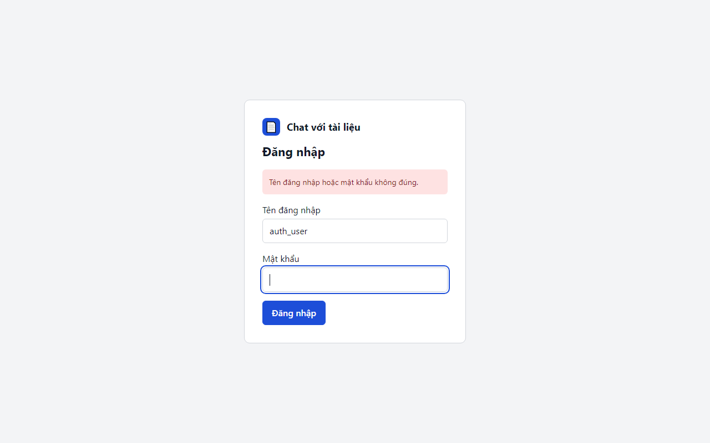

# 05. AC-101.3 sai mật khẩu hiển thị thông báo chung

| Mục | Giá trị |
|---|---|
| Chức năng | Đăng nhập và phiên |
| Nhóm | US-101 Đăng nhập |
| Tiêu chí chấp nhận | AC-101.3 |
| Kết quả | ✅ Đạt |
| Thời gian chạy | 1.0 s |
| Bắt đầu (UTC) | 2026-10-28 16:26:05 |
| Mã test | `app/e2e/tests/auth.spec.ts:12` |

Tệp: [screenshot.png](screenshot.png) · [video.mp4](video.mp4) · [result.json](result.json) · [← Mục lục](../report.md)

## Các bước kiểm thử (mã Playwright)

```ts
test("AC-101.3 sai mật khẩu hiển thị thông báo chung", async ({ page }) => {
  await page.goto("/");
  await page.getByLabel("Tên đăng nhập").fill("auth_user");
  await page.getByLabel("Mật khẩu").fill("sai-mat-khau");
  await page.getByRole("button", { name: "Đăng nhập" }).click();
  await expect(page.getByRole("alert")).toHaveText("Tên đăng nhập hoặc mật khẩu không đúng.");
});
```

## Video

<video src="video.mp4" controls width="960"></video>

[Mở video.mp4](video.mp4)

## Ảnh chụp màn hình cuối test


