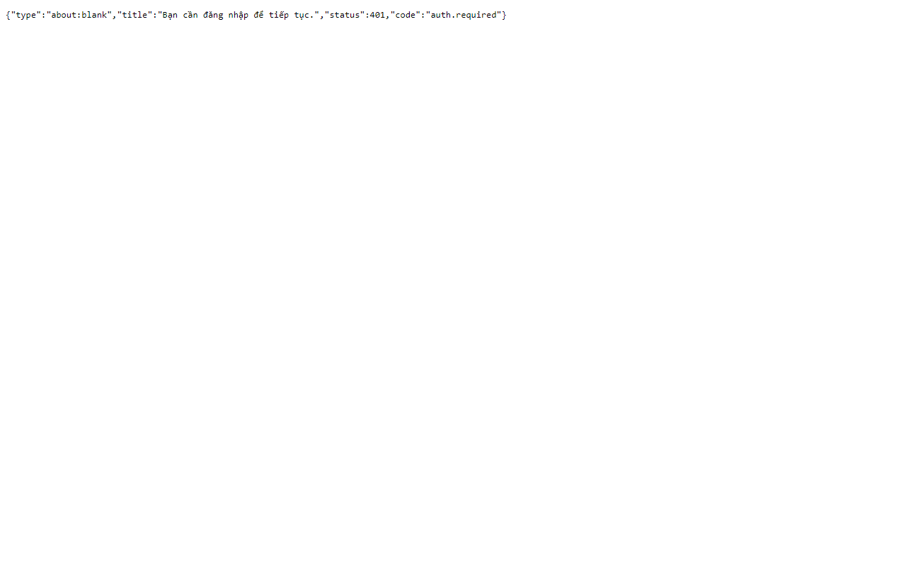

# 07. AC-101.4 gọi API trực tiếp khi chưa đăng nhập bị từ chối

| Mục | Giá trị |
|---|---|
| Chức năng | Đăng nhập và phiên |
| Nhóm | US-101 Đăng nhập |
| Tiêu chí chấp nhận | AC-101.4 |
| Kết quả | ✅ Đạt |
| Thời gian chạy | 0.6 s |
| Bắt đầu (UTC) | 2026-10-28 16:26:07 |
| Mã test | `app/e2e/tests/auth.spec.ts:29` |

Tệp: [screenshot.png](screenshot.png) · [video.mp4](video.mp4) · [result.json](result.json) · [← Mục lục](../report.md)

## Các bước kiểm thử (mã Playwright)

```ts
test("AC-101.4 gọi API trực tiếp khi chưa đăng nhập bị từ chối", async ({ page }) => {
  // Opened in the browser so the screenshot/video show the raw 401 problem+json response.
  const r = await page.goto("/api/documents");
  expect(r?.status()).toBe(401);
  expect((await r?.json()).code).toBe("auth.required");
  await expect(page.locator("body")).toContainText("auth.required");
});
```

## Video

<video src="video.mp4" controls width="960"></video>

[Mở video.mp4](video.mp4)

## Ảnh chụp màn hình cuối test


