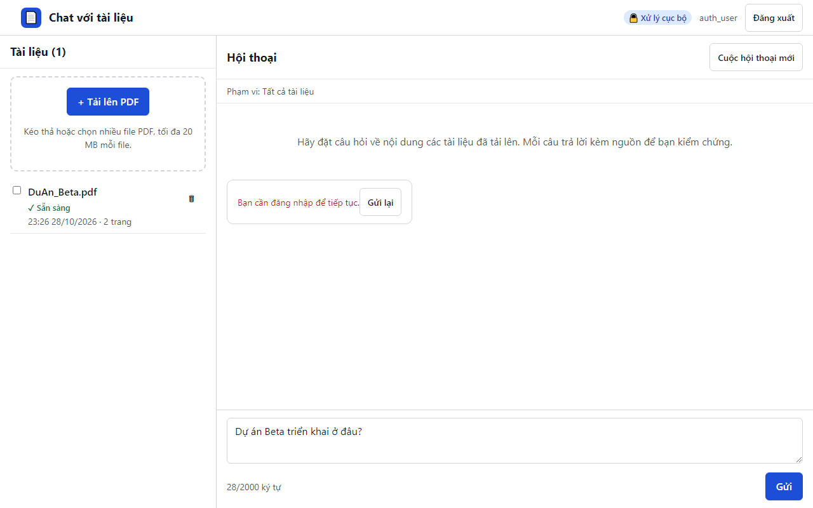

# 08. EC-15 phiên hết hạn giữ lại câu hỏi đang soạn

| Mục | Giá trị |
|---|---|
| Chức năng | Đăng nhập và phiên |
| Nhóm | US-101 Đăng nhập |
| Tiêu chí chấp nhận | EC-15 |
| Kết quả | ✅ Đạt |
| Thời gian chạy | 4.1 s |
| Bắt đầu (UTC) | 2026-10-28 16:26:08 |
| Mã test | `app/e2e/tests/auth.spec.ts:37` |

Tệp: [screenshot.png](screenshot.png) · [video.mp4](video.mp4) · [result.json](result.json) · [← Mục lục](../report.md)

## Các bước kiểm thử (mã Playwright)

```ts
test("EC-15 phiên hết hạn giữ lại câu hỏi đang soạn", async ({ page, context }) => {
  await login(page, "auth_user");
  await upload(page, "DuAn_Beta.pdf");
  await expectStatus(page, "DuAn_Beta.pdf", "Sẵn sàng");
  await context.clearCookies(); // phiên mất phía trình duyệt ⇒ request tiếp theo nhận 401
  await send(page, "Dự án Beta triển khai ở đâu?");
  await expect(page.getByText("Phiên đăng nhập đã hết hạn")).toBeVisible();
  await page.getByLabel("Tên đăng nhập").fill("auth_user");
  await page.getByLabel("Mật khẩu").fill(PASSWORD);
  await page.getByRole("button", { name: "Đăng nhập" }).click();
  await expect(page.getByLabel("Câu hỏi", { exact: true })).toHaveValue("Dự án Beta triển khai ở đâu?");
});
```

## Video

<video src="video.mp4" controls width="960"></video>

[Mở video.mp4](video.mp4)

## Ảnh chụp màn hình cuối test


