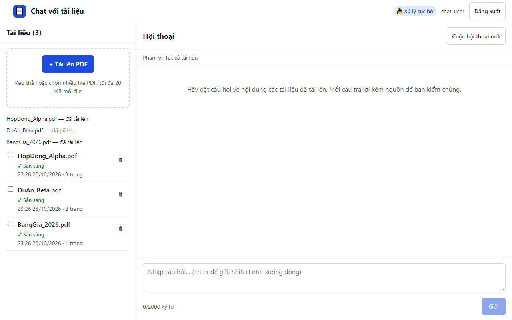

# 09. AC-301.1 / AC-305.1 câu trả lời kèm trích dẫn tên tài liệu và trang

| Mục | Giá trị |
|---|---|
| Chức năng | Hỏi đáp có trích dẫn |
| Nhóm | US-301..US-501 Hỏi đáp có trích dẫn |
| Tiêu chí chấp nhận | AC-301.1, AC-305.1 |
| Kết quả | ✅ Đạt |
| Thời gian chạy | 1.5 s |
| Bắt đầu (UTC) | 2026-10-28 16:26:12 |
| Mã test | `app/e2e/tests/chat.spec.ts:18` |

Tệp: [screenshot.png](screenshot.png) · [video.mp4](video.mp4) · [result.json](result.json) · [← Mục lục](../report.md)

## Các bước kiểm thử (mã Playwright)

```ts
test("AC-301.1 / AC-305.1 câu trả lời kèm trích dẫn tên tài liệu và trang", async ({ page }) => {
  await ask(page, "Giá trị hợp đồng Alpha là bao nhiêu?");
  const answer = page.locator(".msg-a").last();
  await expect(answer).toContainText("2,5 tỷ đồng");
  await expect(answer.getByRole("button", { name: "HopDong_Alpha.pdf — tr. 2" })).toBeVisible();
});
```

## Video

<video src="video.mp4" controls width="960"></video>

[Mở video.mp4](video.mp4)

## Ảnh chụp màn hình cuối test


