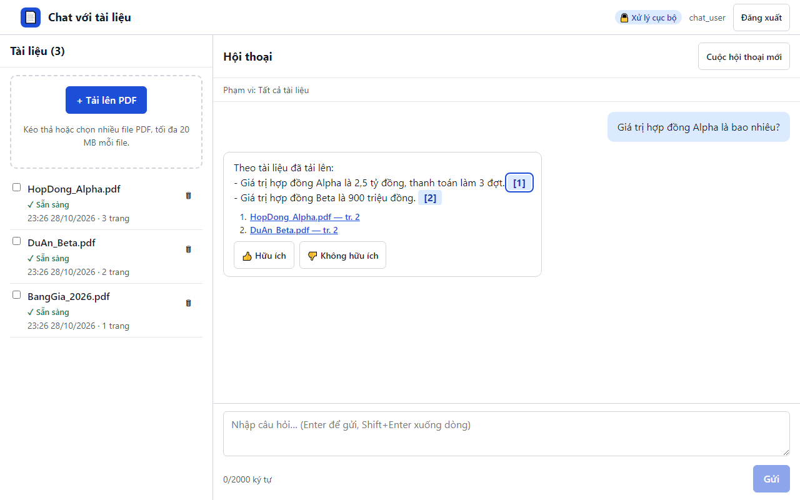

# 10. AC-305.2 bấm trích dẫn mở đoạn gốc; Esc đóng và trả focus

| Mục | Giá trị |
|---|---|
| Chức năng | Hỏi đáp có trích dẫn |
| Nhóm | US-301..US-501 Hỏi đáp có trích dẫn |
| Tiêu chí chấp nhận | AC-305.2 |
| Kết quả | ✅ Đạt |
| Thời gian chạy | 1.6 s |
| Bắt đầu (UTC) | 2026-10-28 16:26:17 |
| Mã test | `app/e2e/tests/chat.spec.ts:25` |

Tệp: [screenshot.png](screenshot.png) · [video.mp4](video.mp4) · [result.json](result.json) · [← Mục lục](../report.md)

## Các bước kiểm thử (mã Playwright)

```ts
test("AC-305.2 bấm trích dẫn mở đoạn gốc; Esc đóng và trả focus", async ({ page }) => {
  await ask(page, "Giá trị hợp đồng Alpha là bao nhiêu?");
  const cite = page.locator("button.cite").first();
  await cite.click();
  const drawer = page.getByRole("dialog", { name: "Nguồn trích dẫn" });
  await expect(drawer).toContainText("HopDong_Alpha.pdf — trang 2");
  await expect(drawer.locator(".drawer-text")).toContainText("Giá trị hợp đồng Alpha là 2,5 tỷ đồng");
  await page.keyboard.press("Escape");
  await expect(drawer).toHaveCount(0);
  await expect(cite).toBeFocused();
});
```

## Video

<video src="video.mp4" controls width="960"></video>

[Mở video.mp4](video.mp4)

## Ảnh chụp màn hình cuối test


