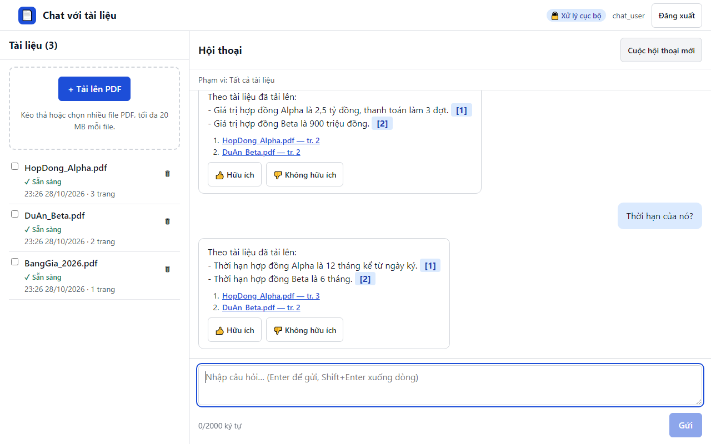

# 13. AC-401.1 hỏi tiếp hiểu ngữ cảnh lượt trước

| Mục | Giá trị |
|---|---|
| Chức năng | Hỏi đáp có trích dẫn |
| Nhóm | US-301..US-501 Hỏi đáp có trích dẫn |
| Tiêu chí chấp nhận | AC-401.1 |
| Kết quả | ✅ Đạt |
| Thời gian chạy | 1.8 s |
| Bắt đầu (UTC) | 2026-10-28 16:26:23 |
| Mã test | `app/e2e/tests/chat.spec.ts:50` |

Tệp: [screenshot.png](screenshot.png) · [video.mp4](video.mp4) · [result.json](result.json) · [← Mục lục](../report.md)

## Các bước kiểm thử (mã Playwright)

```ts
test("AC-401.1 hỏi tiếp hiểu ngữ cảnh lượt trước", async ({ page }) => {
  await ask(page, "Giá trị hợp đồng Alpha là bao nhiêu?");
  await ask(page, "Thời hạn của nó?");
  await expect(page.locator(".msg-a").nth(1).getByRole("button", { name: "HopDong_Alpha.pdf — tr. 3" })).toBeVisible();
});
```

## Video

<video src="video.mp4" controls width="960"></video>

[Mở video.mp4](video.mp4)

## Ảnh chụp màn hình cuối test


