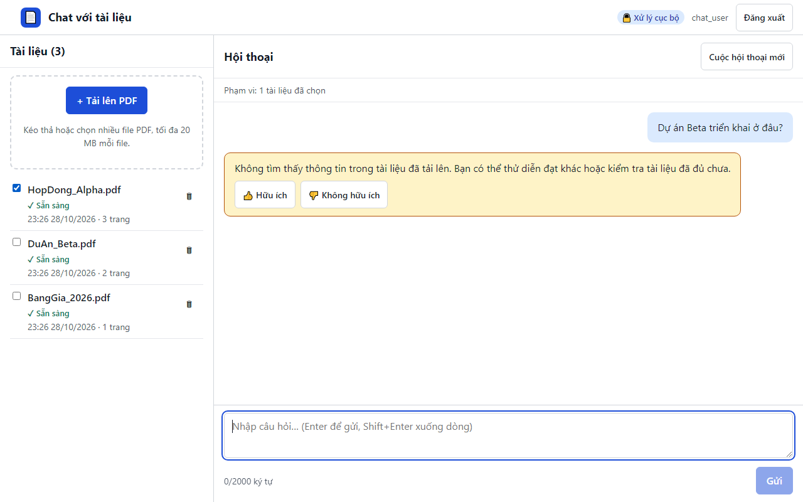

# 14. AC-402.1 / AC-402.2 giới hạn phạm vi vào một tài liệu

| Mục | Giá trị |
|---|---|
| Chức năng | Hỏi đáp có trích dẫn |
| Nhóm | US-301..US-501 Hỏi đáp có trích dẫn |
| Tiêu chí chấp nhận | AC-402.1, AC-402.2 |
| Kết quả | ✅ Đạt |
| Thời gian chạy | 1.7 s |
| Bắt đầu (UTC) | 2026-10-28 16:26:24 |
| Mã test | `app/e2e/tests/chat.spec.ts:56` |

Tệp: [screenshot.png](screenshot.png) · [video.mp4](video.mp4) · [result.json](result.json) · [← Mục lục](../report.md)

## Các bước kiểm thử (mã Playwright)

```ts
test("AC-402.1 / AC-402.2 giới hạn phạm vi vào một tài liệu", async ({ page }) => {
  await page.getByRole("checkbox", { name: "Chọn HopDong_Alpha.pdf làm phạm vi câu hỏi" }).check();
  await expect(page.getByText("Phạm vi: 1 tài liệu đã chọn")).toBeVisible();
  await ask(page, "Dự án Beta triển khai ở đâu?");
  const answer = page.locator(".msg-a").last();
  await expect(answer).toHaveClass(/not-found/);
  await expect(answer).not.toContainText("DuAn_Beta.pdf");
});
```

## Video

<video src="video.mp4" controls width="960"></video>

[Mở video.mp4](video.mp4)

## Ảnh chụp màn hình cuối test


