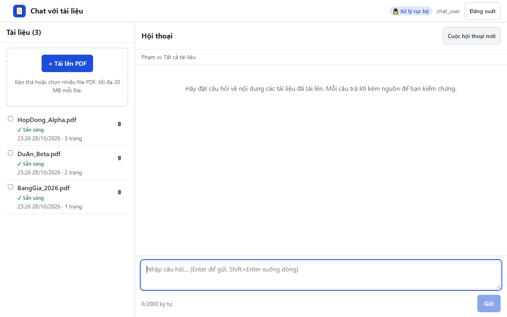

# 15. AC-403.1 / AC-403.2 hội thoại giữ thứ tự; cuộc hội thoại mới trống

| Mục | Giá trị |
|---|---|
| Chức năng | Hỏi đáp có trích dẫn |
| Nhóm | US-301..US-501 Hỏi đáp có trích dẫn |
| Tiêu chí chấp nhận | AC-403.1, AC-403.2 |
| Kết quả | ✅ Đạt |
| Thời gian chạy | 1.9 s |
| Bắt đầu (UTC) | 2026-10-28 16:26:26 |
| Mã test | `app/e2e/tests/chat.spec.ts:65` |

Tệp: [screenshot.png](screenshot.png) · [video.mp4](video.mp4) · [result.json](result.json) · [← Mục lục](../report.md)

## Các bước kiểm thử (mã Playwright)

```ts
test("AC-403.1 / AC-403.2 hội thoại giữ thứ tự; cuộc hội thoại mới trống", async ({ page }) => {
  await ask(page, "Giá trị hợp đồng Alpha là bao nhiêu?");
  await ask(page, "Phí bảo trì hằng năm là bao nhiêu?");
  await expect(page.locator(".msg-q")).toHaveText(["Giá trị hợp đồng Alpha là bao nhiêu?", "Phí bảo trì hằng năm là bao nhiêu?"]);
  await page.reload(); // US-403: hội thoại của phiên trình duyệt được khôi phục
  await expect(page.locator(".msg-q")).toHaveCount(2);
  await page.getByRole("button", { name: "Cuộc hội thoại mới" }).click();
  await expect(page.locator(".msg-q")).toHaveCount(0);
});
```

## Video

<video src="video.mp4" controls width="960"></video>

[Mở video.mp4](video.mp4)

## Ảnh chụp màn hình cuối test


