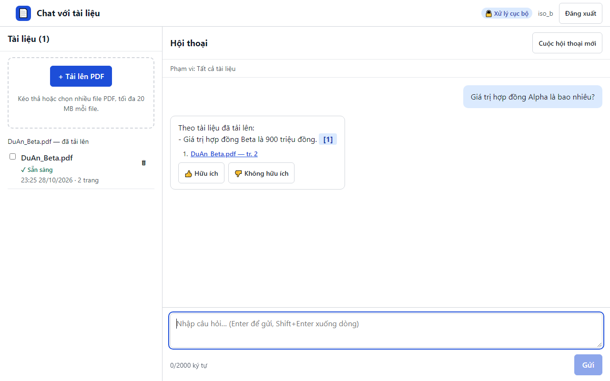

# 01. AC-NFR-004 người dùng khác không thấy và không hỏi được tài liệu của mình

| Mục | Giá trị |
|---|---|
| Chức năng | Cô lập dữ liệu và phân quyền |
| Nhóm | NFR-004 Cô lập workspace |
| Tiêu chí chấp nhận | AC-NFR-004 |
| Kết quả | ✅ Đạt |
| Thời gian chạy | 8.8 s |
| Bắt đầu (UTC) | 2026-10-28 16:25:49 |
| Mã test | `app/e2e/tests/access.spec.ts:6` |

Tệp: [screenshot.png](screenshot.png) · [video.mp4](video.mp4) · [result.json](result.json) · [← Mục lục](../report.md)

## Các bước kiểm thử (mã Playwright)

```ts
test("AC-NFR-004 người dùng khác không thấy và không hỏi được tài liệu của mình", async ({ browser, page: b }) => {
  // Setup as user A in a separate context; the recorded page is user B's point of view.
  const contextA = await browser.newContext();
  const a = await contextA.newPage();
  await login(a, "iso_a");
  await ensureUploaded(a, "HopDong_Alpha.pdf");
  await contextA.close();

  await login(b, "iso_b");
  await expect(b.locator(".doc-name", { hasText: "HopDong_Alpha.pdf" })).toHaveCount(0);
  await ensureUploaded(b, "DuAn_Beta.pdf");
  await ask(b, "Giá trị hợp đồng Alpha là bao nhiêu?");
  // B may get an answer from B's own similar page ("Giá trị hợp đồng Beta"), but never A's document.
  const answer = b.locator(".msg-a").last();
  await expect(answer).not.toContainText("HopDong_Alpha.pdf");
  await expect(answer).not.toContainText("2,5 tỷ");
});
```

## Video

<video src="video.mp4" controls width="960"></video>

[Mở video.mp4](video.mp4)

## Ảnh chụp màn hình cuối test


