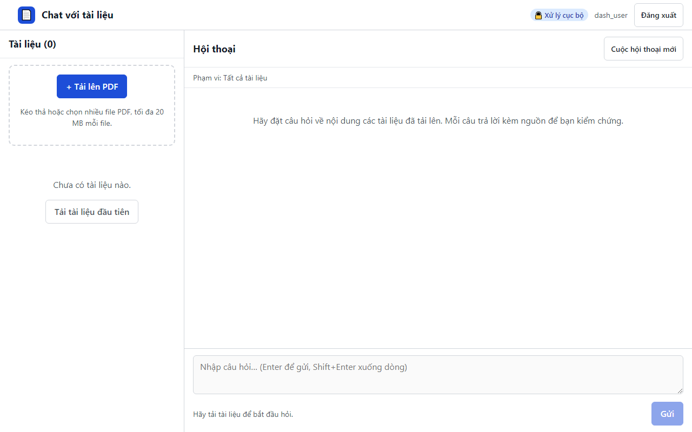

# 02. AC-502.2 người dùng thường không có mục Số liệu sử dụng

| Mục | Giá trị |
|---|---|
| Chức năng | Cô lập dữ liệu và phân quyền |
| Nhóm | US-502 Số liệu sử dụng |
| Tiêu chí chấp nhận | AC-502.2 |
| Kết quả | ✅ Đạt |
| Thời gian chạy | 1.2 s |
| Bắt đầu (UTC) | 2026-10-28 16:25:58 |
| Mã test | `app/e2e/tests/access.spec.ts:26` |

Tệp: [screenshot.png](screenshot.png) · [video.mp4](video.mp4) · [result.json](result.json) · [← Mục lục](../report.md)

## Các bước kiểm thử (mã Playwright)

```ts
test("AC-502.2 người dùng thường không có mục Số liệu sử dụng", async ({ page }) => {
  await login(page, "dash_user");
  await expect(page.getByRole("button", { name: "Số liệu sử dụng" })).toHaveCount(0);
  expect((await page.request.get("/api/metrics/weekly")).status()).toBe(403);
});
```

## Video

<video src="video.mp4" controls width="960"></video>

[Mở video.mp4](video.mp4)

## Ảnh chụp màn hình cuối test


