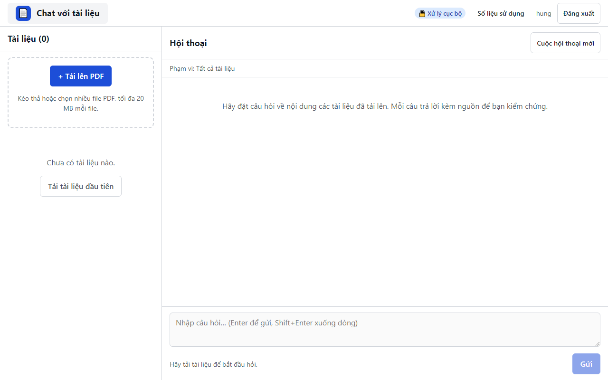

# 03. AC-502.1 quản lý xem số liệu theo tuần

| Mục | Giá trị |
|---|---|
| Chức năng | Cô lập dữ liệu và phân quyền |
| Nhóm | US-502 Số liệu sử dụng |
| Tiêu chí chấp nhận | AC-502.1 |
| Kết quả | ✅ Đạt |
| Thời gian chạy | 4.9 s |
| Bắt đầu (UTC) | 2026-10-28 16:25:59 |
| Mã test | `app/e2e/tests/access.spec.ts:32` |

Tệp: [screenshot.png](screenshot.png) · [video.mp4](video.mp4) · [result.json](result.json) · [← Mục lục](../report.md)

## Các bước kiểm thử (mã Playwright)

```ts
test("AC-502.1 quản lý xem số liệu theo tuần", async ({ page, browser }) => {
  // Own data: one question asked this week by dash_user (no dependency on other spec files).
  // Closed afterwards: open contexts would leak into later tests' screenshots/videos.
  const askerContext = await browser.newContext();
  const asker = await askerContext.newPage();
  await login(asker, "dash_user");
  await ensureUploaded(asker, "DuAn_Beta.pdf");
  await ask(asker, "Dự án Beta triển khai ở đâu?");
  await expect(asker.locator(".msg-a").last()).toContainText("Đà Nẵng");
  await askerContext.close();
  await login(page, "hung");
  await page.getByRole("button", { name: "Số liệu sử dụng" }).click();
  await expect(page.getByRole("heading", { name: "Số liệu sử dụng theo tuần" })).toBeVisible();
  const rows = page.locator("tbody tr");
  await expect(rows).toHaveCount(8);
  // các spec trước đã đặt câu hỏi trong tuần này ⇒ tuần hiện tại có người dùng hoạt động
  await expect(rows.last().locator("td").nth(1)).not.toHaveText("0");
  await page.getByRole("button", { name: "Về màn hình chính" }).click();
  await expect(page.getByRole("heading", { name: /Tài liệu/ })).toBeVisible();
});
```

## Video

<video src="video.mp4" controls width="960"></video>

[Mở video.mp4](video.mp4)

## Ảnh chụp màn hình cuối test


