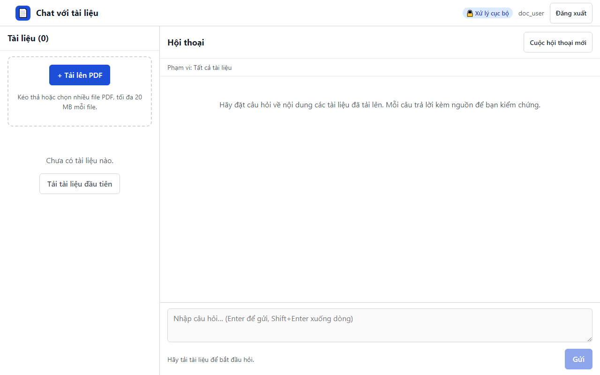

# 18. AC-204.2 workspace trống hướng dẫn tải tài liệu và khóa ô hỏi

| Mục | Giá trị |
|---|---|
| Chức năng | Quản lý tài liệu |
| Nhóm | US-201..US-205 Quản lý tài liệu |
| Tiêu chí chấp nhận | AC-204.2 |
| Kết quả | ✅ Đạt |
| Thời gian chạy | 1.2 s |
| Bắt đầu (UTC) | 2026-10-28 16:26:31 |
| Mã test | `app/e2e/tests/documents.spec.ts:10` |

Tệp: [screenshot.png](screenshot.png) · [video.mp4](video.mp4) · [result.json](result.json) · [← Mục lục](../report.md)

## Các bước kiểm thử (mã Playwright)

```ts
test("AC-204.2 workspace trống hướng dẫn tải tài liệu và khóa ô hỏi", async ({ page }) => {
  await expect(page.getByRole("button", { name: "Tải tài liệu đầu tiên" })).toBeVisible();
  await expect(page.getByLabel("Câu hỏi", { exact: true })).toBeDisabled();
  await expect(page.getByText("Hãy tải tài liệu để bắt đầu hỏi.")).toBeVisible();
});
```

## Video

<video src="video.mp4" controls width="960"></video>

[Mở video.mp4](video.mp4)

## Ảnh chụp màn hình cuối test


