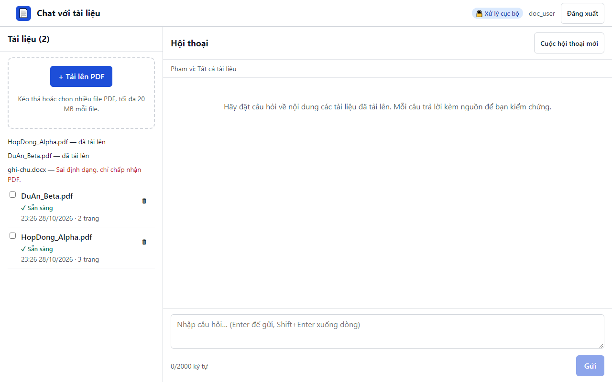

# 19. AC-201.1 / AC-201.2 / AC-202.1 tải song song nhiều file, file sai định dạng bị từ chối riêng

| Mục | Giá trị |
|---|---|
| Chức năng | Quản lý tài liệu |
| Nhóm | US-201..US-205 Quản lý tài liệu |
| Tiêu chí chấp nhận | AC-201.1, AC-201.2, AC-202.1 |
| Kết quả | ✅ Đạt |
| Thời gian chạy | 4.4 s |
| Bắt đầu (UTC) | 2026-10-28 16:26:32 |
| Mã test | `app/e2e/tests/documents.spec.ts:16` |

Tệp: [screenshot.png](screenshot.png) · [video.mp4](video.mp4) · [result.json](result.json) · [← Mục lục](../report.md)

## Các bước kiểm thử (mã Playwright)

```ts
test("AC-201.1 / AC-201.2 / AC-202.1 tải song song nhiều file, file sai định dạng bị từ chối riêng", async ({ page }) => {
  await upload(page, "HopDong_Alpha.pdf", "DuAn_Beta.pdf", "ghi-chu.docx");
  await expect(page.getByText("ghi-chu.docx —")).toContainText("Sai định dạng, chỉ chấp nhận PDF.");
  // AC-203.2: trạng thái chuyển "Sẵn sàng" không cần tải lại trang
  await expectStatus(page, "HopDong_Alpha.pdf", "Sẵn sàng");
  await expectStatus(page, "DuAn_Beta.pdf", "Sẵn sàng");
  await expect(page.locator(".doc-name", { hasText: "ghi-chu.docx" })).toHaveCount(0);
  // AC-204.1: tên, trạng thái, số trang
  await expect(page.locator(".doc", { hasText: "HopDong_Alpha.pdf" })).toContainText("3 trang");
  await expect(page.getByRole("heading", { name: "Tài liệu (2)" })).toBeVisible();
});
```

## Video

<video src="video.mp4" controls width="960"></video>

[Mở video.mp4](video.mp4)

## Ảnh chụp màn hình cuối test


