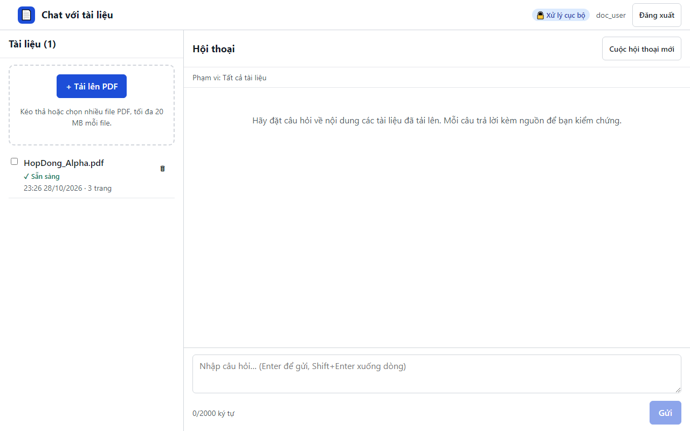

# 20. AC-205.1 / AC-205.3 xóa tài liệu phải xác nhận; Hủy giữ nguyên

| Mục | Giá trị |
|---|---|
| Chức năng | Quản lý tài liệu |
| Nhóm | US-201..US-205 Quản lý tài liệu |
| Tiêu chí chấp nhận | AC-205.1, AC-205.3 |
| Kết quả | ✅ Đạt |
| Thời gian chạy | 1.6 s |
| Bắt đầu (UTC) | 2026-10-28 16:26:37 |
| Mã test | `app/e2e/tests/documents.spec.ts:28` |

Tệp: [screenshot.png](screenshot.png) · [video.mp4](video.mp4) · [result.json](result.json) · [← Mục lục](../report.md)

## Các bước kiểm thử (mã Playwright)

```ts
test("AC-205.1 / AC-205.3 xóa tài liệu phải xác nhận; Hủy giữ nguyên", async ({ page }) => {
  await expectStatus(page, "DuAn_Beta.pdf", "Sẵn sàng");
  await page.getByRole("button", { name: "Xóa DuAn_Beta.pdf" }).click();
  const dialog = page.getByRole("dialog", { name: "Xóa tài liệu?" });
  await expect(dialog).toBeVisible();
  await dialog.getByRole("button", { name: "Hủy" }).click();
  await expect(page.locator(".doc-name", { hasText: "DuAn_Beta.pdf" })).toHaveCount(1);

  await page.getByRole("button", { name: "Xóa DuAn_Beta.pdf" }).click();
  await page.getByRole("dialog", { name: "Xóa tài liệu?" }).getByRole("button", { name: "Xóa" }).click();
  await expect(page.locator(".doc-name", { hasText: "DuAn_Beta.pdf" })).toHaveCount(0);
  await expect(page.getByRole("heading", { name: "Tài liệu (1)" })).toBeVisible();
});
```

## Video

<video src="video.mp4" controls width="960"></video>

[Mở video.mp4](video.mp4)

## Ảnh chụp màn hình cuối test


